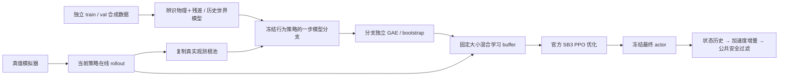
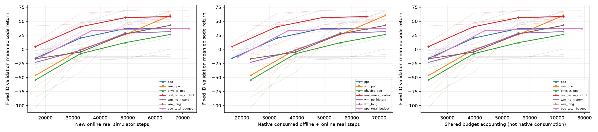

# FalconWorld

**面向自动驾驶纵向控制的紧凑世界模型与 PPO 强化学习研究。**

FalconWorld 将可辨识物理动力学、学习残差和前车运动历史组合成动作条件世界模型，用真值模拟器观测启动短模型分支，辅助 Stable-Baselines3 PPO 训练。训练后只需策略网络即可输出纵向控制动作。仓库包含训练代码、固定依赖、对照与消融、已训练策略、合成数据、完整正式测试轨迹和独立审计。

当前完成的是**本地仿真研究**：已有纵向跟驰 PPO，并新增二维阿克曼横纵向联合 PPO，直接输出加速度和前轮转角。CARLA 保留前期世界模型＋MPC 工作；R550 实车 PPO 部署、摄像头端到端驾驶及 Raspberry Pi 实时控制验收尚未完成。

> 原纵向实验中，同新增在线步数下，世界模型辅助 PPO 的平均碰撞数减少，但相对纯 PPO 的回报差异 95% 区间跨零，种子差异明显，并有平顺性和计算成本代价。当前证据支持条件性收益，尚未证明稳定总体优势。

[完整数学推导](docs/WORLD_MODEL_DERIVATION.md) · [正式实验报告](docs/SB3_RL_REPORT.md) · [实验协议](docs/SB3_RL_PROTOCOL.md) · [实验与策略文件](results/README.md) · [English overview](docs/PPO_PROJECT_EN.md)

## 新实验：残差补偿未建模转向死区

在合成的单调转向死区、增益及偏置失配下，给物理模型相同数据和重新辨识机会，并加入增益/偏置扩展物理与知道正确死区结构的强对照。残差相对同底座扩展物理模型，在新ID测试中将单步转角MAE从0.003923降至0.0000531rad，3秒位置误差从0.1721降至0.00389m；对应PPO的ID回报差+3.34，95%区间[0.58,6.18]，两者均完成60/60。

**这支持对未建模失配的条件性补偿价值，不等于优于准确物理。** 正确机制物理模型预测仍更准；OOD预测、速度误差及部分闭环指标没有统一收益。首个非单调近似已归档排除，v2使用全新数据；完整对照、负结果与成本均保留。

[失配设定、结果和边界](docs/ACKERMANN_RESIDUAL_MISMATCH.md) · [完整冻结报告](results/ackermann_mismatch_v2/REPORT.md)

## 改进：多步可微世界模型辅助 PPO

保留全部真实PPO经验，以16步冻结模型预测梯度辅助actor训练，执行时仍只运行PPO。验证选配置后，换新训练种子和未查看的新场景进行两组独立测试，各600回合。

**短预算样本效率：**同为16384新增在线步，模型辅助完成120/120，纯PPO为21/120；给纯PPO20480在线步的额外总交互控制完成39/120。模型方案另有3000离线交互，原生总交互19384，及256次actor预热，均完整计入。

**长预算控制质量：**65536在线步下，模型辅助的ID/OOD横向RMSE从纯PPO的0.100/0.132m降至0.075/0.087m，转角变化率RMS约降28%；完成119/120，纯PPO117/120。OOD回报差+0.892，95%区间[0.167,1.923]；ID回报区间跨零。

代价：模型预热＋训练时间约为纯PPO的2.6–3.0倍，模型池拟合与候选筛选另计。丰富物理模型辅助也有类似收益，尚未证明学习残差优于强物理；不能将有限仿真优势写成必然或实车保证。

[实现、公式和复现](docs/ACKERMANN_MODEL_GRADIENT.md) · [长预算全种子报告](results/ackermann_gradient_final/REPORT.md) · [短预算与总交互控制](results/ackermann_gradient_efficiency/REPORT.md)

## 首轮：横纵向联合 PPO（2026-11-06）

已实际完成三训练种子、三方法、每任务65536在线步的二维训练与288回合冻结测试。PPO输出两个连续动作：期望加速度＋前轮转角，不需要传统横向控制器替代转向输出。

|方法|ID完成/48|OOD完成/48|ID横向RMSE m|OOD横向RMSE m|
|---|---:|---:|---:|---:|
|纯PPO|48|48|0.100|0.139|
|学习世界模型辅助PPO|34|28|0.556|0.665|
|丰富物理模型辅助PPO|16|19|0.694|0.781|

**首轮一步替换方法弱于纯PPO。** 不能将纵向结果外推为横向收益。联合策略仍有转向振荡，零越界样本不代表实车安全。

[联合控制接口与复现](docs/ACKERMANN_RL.md) · [全部种子与成本报告](results/ackermann_rl/REPORT.md) · [原始轨迹独立审计](results/ackermann_rl/audit.json)

```powershell
.\.venv\Scripts\python.exe run_ackermann_rl.py --preset quick --workers 3 --output outputs/ackermann_rl/new_run
.\.venv\Scripts\python.exe scripts/audit_ackermann_rl.py --run outputs/ackermann_rl/new_run
.\.venv\Scripts\python.exe scripts/report_ackermann_rl.py --run outputs/ackermann_rl/new_run
```

以下系统流程、四维模型和七方法表格仍对应原纵向研究；二维联合控制使用14维观测、连续双动作，细节见新增文档。

## 系统流程



“真实 rollout”来自独立真值模拟器，不来自真实车辆。世界模型参与训练；在线 actor 推理不需要 MPC 搜索或世界模型递归。

## 世界模型的数学形式

状态为 $s_t=(g_t,v_t,v_t^L,a_t)$：净间距、自车速度、前车速度、执行器内部加速度。采样周期 $\Delta t=0.1$ 秒，期望加速度 $u_t\in[-6,2]$ m/s²。由 $\dot g=v^L-v,\dot v=a,\dot a=(u-a)/\tau$ 得到显式 Euler 转移。

物理执行器考虑加速/制动不对称与速度相关响应。用指标函数表示两个分支：条件成立时 $\mathbf{1}[P]=1$，否则为 0。

```math
\tau_t=(1+\kappa v_t)\left[\tau_-+(\tau_+-\tau_-)\mathbf{1}[u_t\ge a_t]\right].
```

因此，加速分支取 $\tau_+(1+\kappa v_t)$，制动分支取 $\tau_-(1+\kappa v_t)$。执行器的一步预测为：

```math
a^{\mathrm{phys}}_{t+1}=a_t+\frac{\Delta t(u_t-a_t)}{\max(\Delta t,\tau_t)}.
```

$(\tau_+,\tau_-,\kappa)$ 仅在 train 上用一步转移最小二乘辨识。ID 合成数据约得 $(0.45,0.75,0.045)$，不是小车实测参数。

模型包含两个小型 tanh MLP：自车残差头 4→32→1，前车历史头 6→32→1。

```math
\begin{aligned}
z_t&=[v_t,a_t,u_t,u_t-a_t], \\
q_t&=[v_t^L,v_{t-4}^L-v_{t-5}^L,\ldots,v_t^L-v_{t-1}^L].
\end{aligned}
```

```math
\begin{aligned}
\widehat a_{t+1}&=\mathrm{clip}(a^{\mathrm{phys}}_{t+1}+R_\omega(z_t),-6,2), \\
\widehat{\Delta v_t^L}&=\mathrm{clip}(L_\eta(q_t),-0.6,0.2).
\end{aligned}
```

完整世界模型为

```math
\widehat s_{t+1}=\begin{bmatrix}
g_t+\Delta t(v_t^L-v_t)\\
\max(0,v_t+\Delta t a_t)\\
\max(0,v_t^L+\widehat{\Delta v_t^L})\\
\widehat a_{t+1}
\end{bmatrix}.
```

**速度更新使用旧 $a_t$；前车头输出速度增量，不再乘一次 $\Delta t$。** 六帧历史因果递归更新，不读取真实未来、场景标签或隐藏条件。网络按标准化的一步监督 MSE 拟合；尺度只来自 train，val 早停，test 隔离。当前物理模型已准确解释 ID 自车动力学，残差约为数值零，这一负结果保留。

这是低维确定性状态转移世界模型，不生成 RGB 视频，也不等同于 Dreamer/RSSM 潜变量模型。参数辨识、标准化、损失函数、单位和递归推导见 [数学文档](docs/WORLD_MODEL_DERIVATION.md)。

## 世界模型如何辅助 PPO

观测为六帧四维状态加上一次实际加速度命令，共 25 维；采用固定尺度，不裁剪 OOD 输入。Actor、critic 分别使用 64×64 tanh 隐层。Actor 输出五分类加速度**增量**：

```math
\begin{aligned}
\Delta u_j&\in\{-0.8,-0.4,0,0.4,0.8\}, \\
u_t&=\mathcal S\!\left(s_t,\mathrm{clip}(u_{t-1}+\Delta u_j,-6,2)\right).
\end{aligned}
```

$\mathcal S$ 为公共安全过滤器，不是形式化安全保证。本节纵向策略不输出航向或转角；$a_t$ 是仿真特权输入，实车需要另外估计。

每轮先采集 2048 条在线模拟器转移，再用**同一个尚未更新的行为策略**从本轮观测池抽根，生成一步模型分支。主方法用 1024 条合成样本替换学习 buffer 的一半；真实轨迹与每条模型分支分别计算 GAE，再调用官方 PPO 优化器。没有额外策略更新，不把不同分支拼成连续轨迹，也不混入旧策略离线 replay。

```math
\begin{aligned}
\delta_i&=\bar r_i+\gamma(1-d_i)V_{\rm old}(o_{i+1})-V_{\rm old}(o_i), \\
\widehat A_i&=\delta_i+\gamma\lambda(1-b_i)\widehat A_{i+1}.
\end{aligned}
```

$d_i$ 表示真正终止，$b_i$ 切断跨 episode/分支的优势链；碰撞不 bootstrap，时间截断及非终止分支末端保留最终状态 bootstrap。训练统一 $\bar r=0.01r$，评估使用未缩放原始回报；$\gamma=0.99,\lambda=0.95$。

```math
\begin{aligned}
\rho_i(\phi)&=\frac{\pi_\phi(j_i\mid o_i)}{\pi_{\rm old}(j_i\mid o_i)}, \\
L^{\rm clip}&=\mathbb E_{D_{\rm mix}}\left[
\min\{\rho_i\widehat A_i,\mathrm{clip}(\rho_i,0.8,1.2)\widehat A_i\}\right].
\end{aligned}
```

实现沿用 SB3 的 minibatch 优势标准化、value MSE、Adam 和梯度裁剪。主方法 buffer、epochs、batch 和实际 Adam 次数与纯 PPO 相同。混合样本分布和短分支 GAE 改变了训练目标，因此它是模型辅助 PPO 变体，不能宣称原始 PPO 无偏性或 MBPO 性能定理直接适用。

**一步分支的具体作用：**显式 Euler 下，同根同动作的下一间距和自车速度一致，即时奖励也一致。世界模型预测的下一前车速度/执行器状态主要通过 critic bootstrap 改变优势目标。三步分支还会改变后续奖励。不能将一步结果解释为“学到了更好的即时奖励”。

## 方案优势与边界

| 设计 | 潜在价值 | 本项目证据与限制 |
|---|---|---|
| 物理先验＋小型学习头 | 减少未知量，可解释，CPU 可训练 | ID 自车残差近零；尚无额外自车动力学收益 |
| 真实观测根上的短分支 | 不新增真值环境交互，生成当前策略局部反事实目标 | 一步均值好于三步消融；离线采集与生成时间仍需计费 |
| 同步冻结行为策略 | 分支 old log probability 可核验 | 不能消除模型状态分布偏差和 GAE 时域差异 |
| 训练用模型、推理用 actor | 在线执行不必递归模型或搜索候选轨迹 | 官方 `PPO.load()` 已验证；Pi 时延、车辆控制未验收 |
| 对照、消融、完整轨迹 | 可核查收益来源、预算和失败种子 | 相对纯 PPO 主回报区间跨零，不支持稳定总体优越 |

在固定非终止区域、确定性转移且 value 为 $L_V$-Lipschitz 等假设下，由三角不等式有一步目标偏差界：

```math
|\widehat{\mathcal T}^{\pi}V-\mathcal T^{\pi}V|
\le\mathbb E_{j\sim\pi}\left[|\widehat r-r|+\gamma L_V\|\widehat F-F\|\right].
```

同动作序列下，若单步误差至多 $\varepsilon$、真实转移 Lipschitz 常数为 $L_F$，则 $e_k\le\varepsilon\sum_{j=0}^{k-1}L_F^j$。短分支限制开环误差传播，但更依赖 critic；碰撞边界不连续，不能直接套全局平滑界。这是有条件误差分析，**不是性能改善证明**；完整假设见 [推导第 4 节](docs/WORLD_MODEL_DERIVATION.md#4-为什么有潜在帮助又为什么不保证改善)。

## 正式实验

场景为匀速、温和变速、急刹、启停；每回合最多 120 步（12 秒）。ID 初始前车速度 6–13 m/s，OOD 为 14–19 m/s 并将执行器时间常数乘 1.45。这些速度、尺度是合成基准设定，不能直接用于低速 R550。

3 个训练种子 × 7 方法，共 21 个任务、1680 个测试回合。每方法每分布 120 回合，train/val/test 按独立完整 episode 种子隔离；各方法使用配对测试条件。固定最终 checkpoint 评价，不按 test 挑权重。

| 方法 | 含义 | ID 碰撞 / 120 | ID 原始回报 | OOD 碰撞 / 120 | OOD 原始回报 |
|---|---|---:|---:|---:|---:|
| `ppo` | 官方默认优化配置 | 21 | 42.77 | 28 | 26.08 |
| `wm_ppo` | 历史世界模型，一步替换 50% | **2** | 58.77 | **11** | **50.28** |
| `physics_ppo` | 丰富辨识物理模型，同分支规则 | 29 | 32.85 | 37 | 10.62 |
| `real_reuse_control` | 纯 PPO，20 epochs，双倍优化 | 6 | **59.08** | 28 | 20.81 |
| `wm_no_history` | 删除前车速度差历史 | 27 | 33.47 | 25 | 29.68 |
| `wm_long` | 历史模型，三步分支 | 15 | 45.65 | 27 | 26.60 |
| `ppo_total_budget` | 离线采集预算换为额外在线步 | 21 | 43.34 | 28 | 27.86 |

主比较每任务 65,536 新增在线步、10,240 次实际 Adam 更新。公共离线数据为 5,385 train＋1,390 val 转移，只拟合世界模型，不预训练 actor/critic。总交互控制为 72,311 在线步、11,300 次 Adam 更新；额外更新控制为 20,480 次。

训练 seed → 场景族内配对 episode 的分层 bootstrap（2000 次）结果：

- `wm_ppo − ppo` 原始回报：ID **+16.00，95% CI [−7.30, 59.59]**；OOD **+24.20，[−27.45, 90.02]**。均跨零，只有 3 个训练种子，尚未确立稳定总体优势。
- 相对 `physics_ppo`，OOD 回报差 **+39.66，[18.51, 66.99]**，仅为该合成基准的条件性证据。
- ID jerk RMS 差 **+0.672 m/s³，[0.138, 1.329]**，平顺性变差；共享主机平均训练时间约 **145.38 vs 98.63 秒（+47.4%）**，模型池预训练成本另计。这不是 Pi 计时。
- 收益很大部分来自改善纯 PPO seed 1 的失败；seed 0 的 OOD 回报反而从 42.66 降为 12.75。全部种子均保留。

另完成纯 PPO 的 204,800 步 × 3 seed 参考和 240 个测试回合：ID 碰撞 13/120、回报 52.63；OOD 碰撞 29/120、回报 21.80。它不是等预算优势对照，且仍有种子不稳定。多组比较未做多重检验校正；零碰撞样本不等于零风险。



全部逐种子/逐场景指标、配对区间、成本和失败分析见 [正式报告](docs/SB3_RL_REPORT.md)。独立审计通过表示登记实验完整、日志指标一致，不代表已满足部署门槛。

## 快速复现

已验证环境：Windows、Python 3.11.9、CPU PyTorch 2.15.0+cpu、Stable-Baselines3 2.9.2、Gymnasium 1.4.0。NumPy/SciPy 紧凑模型不要求 GPU。36 项运行依赖锁定于 [requirements-rl-lock.txt](requirements-rl-lock.txt)；已在原主机实际安装并核对，未声称独立干净机器安装验收。

在项目根目录 PowerShell：

```powershell
.\setup_rl.ps1
.\setup_rl.ps1 -VerifyOnly
.\.venv\Scripts\python.exe -m pip install pytest==9.1.1
.\.venv\Scripts\python.exe -m pytest -q

# 小预算流程验证，不支持统计优势结论
.\.venv\Scripts\python.exe reproduce_sb3_rl.py --preset smoke --workers 3

# 正式：测试 → 训练 → 冻结评价 → 独立审计 → 报告
.\.venv\Scripts\python.exe reproduce_sb3_rl.py --preset standard --workers 3
```

既有完整测试为 130 项与 31 个子检查通过，本次发布验证见 [发布记录](docs/PUBLICATION.md)。发布结果位于 `results/`；复现生成新的 `outputs/`，避免直接复用发布结果冒充重跑。只复用指纹一致的完成任务；中断任务归档后重训，不支持任意中间时刻精确恢复。

加载已发布最终策略做仿真评价，或独立核查发布轨迹：

```powershell
.\.venv\Scripts\python.exe scripts/evaluate_sb3_policy.py --checkpoint results/sb3_standard/seed0/wm_ppo/final_policy.zip --output outputs/published_policy_check --split val
.\.venv\Scripts\python.exe scripts/audit_sb3_rl.py --run results/sb3_standard --output outputs/published_standard_audit
.\.venv\Scripts\python.exe scripts/audit_sb3_reference.py --run results/ppo_reference_204800 --output outputs/published_reference_audit
```

评价目录必须是新目录，重复评价换名字。全部 seed 均发布，seed 0 仅是命令示例。策略 zip 可用官方 `PPO.load()` 加载；它不包含世界模型和模型 RNG，用于冻结推理评价。

## 代码与前期工作

```text
falconworld/                  动力学、世界模型、RL 环境、PPO 分支、MPC 与适配
run_sb3_rl.py                 七方法训练、固定最终策略评价
run_sb3_reference.py          较充分纯 PPO 预算参考
reproduce_sb3_rl.py           一键测试、训练、审计、报告
scripts/                     诊断、审计、评价、导出、设备准备
tests/                       模型、终止语义、概率、预算和审计测试
docs/                        数学推导、协议、报告与负结果
results/sb3_standard/         21 策略、合成数据、1680 测试回合与轨迹
results/ppo_reference_204800/  3 策略、240 测试回合与轨迹
```

前期世界模型＋CEM-MPC 复现见 [README_MPC.md](README_MPC.md)、[纵向模型](docs/MODELS.md)、[二维阿克曼](docs/ACKERMANN.md)、[CARLA](docs/CARLA.md)，其结果不与 PPO 合并。旧自研 PPO/DQN 代码及负结果文档保留，正式对照以本轮 SB3 为准；旧 `outputs/` 全量历史未上传。

R550 接入见 [部署准备](docs/R550.md)。仓库不发布个人原始车辆日志或 SSH 地址。仿真加速度不能直接当作底盘串口字段；还需低速标定、感知与状态估计、控制适配、停车/接管/超时保护以及 ARM64 时延测试。

## 参考研究

- Schulman et al., [Proximal Policy Optimization Algorithms](https://arxiv.org/abs/1707.06347), 2017：PPO clipped surrogate。
- Janner et al., [When to Trust Your Model: Model-Based Policy Optimization](https://jannerm.github.io/mbpo-www/), NeurIPS 2019：短模型分支与模型偏差相关研究；本仓库不复现其完整算法或定理。
- [Stable-Baselines3 PPO](https://stable-baselines3.readthedocs.io/en/master/modules/ppo.html)：库接口；实验版本以本仓库锁文件和登记记录为准。
