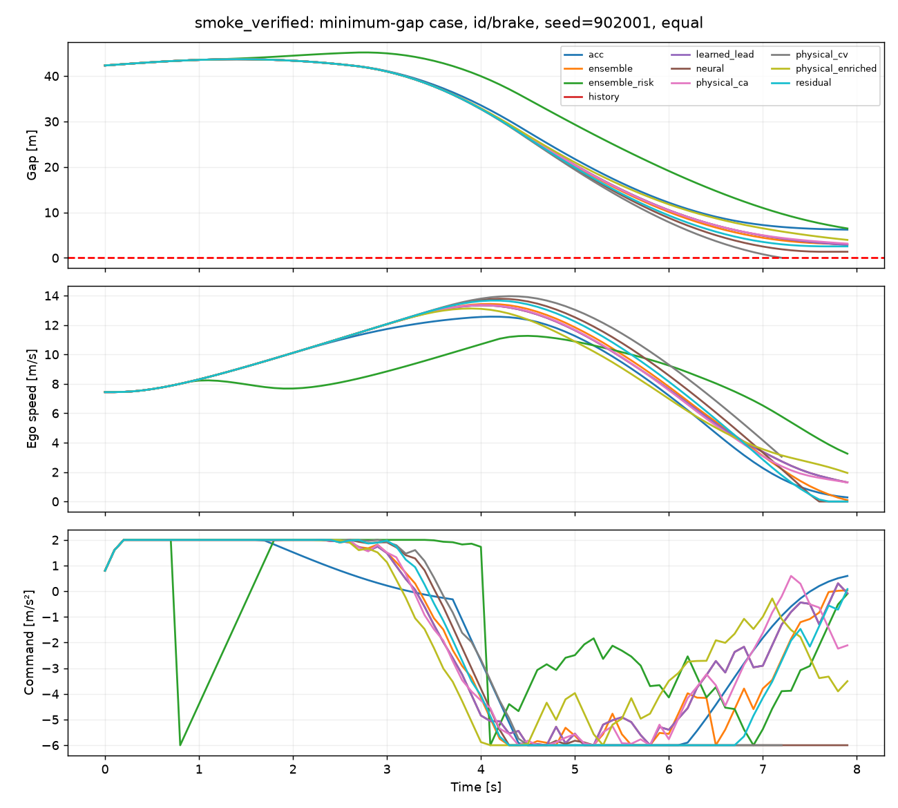
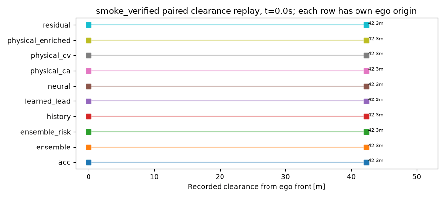
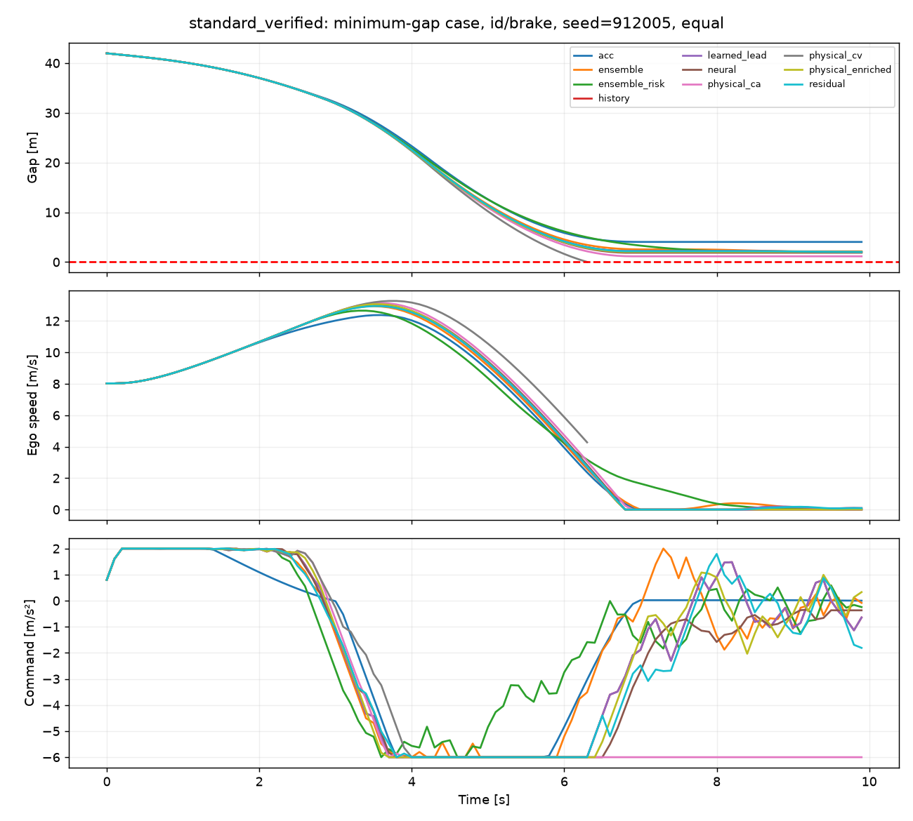
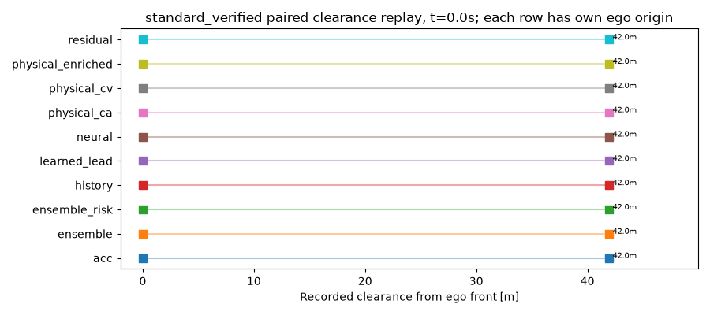

# FalconWorld 实验报告

生成时间：2026-11-04T18:13:39+08:00。本报告由 `python scripts/build_report.py` 从磁盘实验结果生成，可在标准实验结束后重跑。未运行的项目不据代码存在而算完成。

## 为什么加入世界模型：证据、收益、代价与适用边界

建模问题是执行器响应失配与未知前车运动。学习器使用当前状态、过去6帧和候选动作，模型自身递归未来；CEM比较候选序列并只执行第一步，再读新观测。系统属于基于模型的规划控制，没有训练策略或价值函数，不称强化学习。

证据链按数据和物理辨识 → 独立episode递归预测 → 同一MPC候选评估 → 闭环安全/进度/舒适性 → 完整计算周期报告。强物理基线通过train辨识非对称、速度相关时常；固定无噪声一阶结构可由辨识解决，不能把失配tau=0.5作为唯一比较。

学习残差、无历史/有历史、仅学习前车、集成和集成风险开关均保留。若 history 与 learned_lead 接近，则不能把前车预测收益归因于学习自车动力学。风险项只用成员间距分歧，离线经验区间是独立诊断；不具备概率安全保证。未知时刻的无先兆急刹不能由模型可靠预知。

主实验使用特权执行器状态。传感实验移除该列并因果估计，停车时内部制动不可辨识。ID/OOD分别报告，OOD同时改变速度与执行器响应；这些均是仿真假设，不是R550实测标定。零碰撞不代表通用安全保证；较低预测误差不自动构成闭环收益。

## 纵向 smoke_verified

原始目录 `outputs\smoke_verified`；状态 **verified_complete**，期望 304、已记录 304、缺失 0、重复 0。
未齐全时下表仅为中间记录，模型样本不平衡，不能据此下优势结论。smoke 即使齐全也仅验证工程路径。

训练成本：seed 0: 2.84s；包括该 seed 的全部纵向模型，CPU NumPy 训练，不代表 ARM64 训练或部署性能。

数据版本 `longitudinal-v1`，内容SHA256 `5ff872dffe8c62285f10fcf5273d5beb671b058a8958783a6ff3285314e0df56`；各集合完整episode数：train=48, val=16, test=16, ood=16。归一化与参数辨识仅train，模型选择与预算仅val。

### 递归开环

先对每个 episode 内所有非重叠窗口取均值，再对 episode 均值等权汇总。标准版在同一冻结数据上训练三个seed，因此下表数量为seed×episode评估次数，不能将跨seed重复的测试episode误当新增独立场景；独立场景数见数据manifest。不是把相邻帧当独立样本，完整 0.1/0.5/1/3s 数值见附属 CSV。

|模型|集合|时域 s|seed×episode次数|间距 MAE m|自车 MAE m/s|前车 MAE m/s|执行器 MAE m/s²|
|---|---|---|---|---|---|---|---|
|ensemble|ood|0.5|16|0.0436|0.02348|0.3026|0.09938|
|ensemble|ood|1|16|0.3045|0.07773|0.9129|0.1291|
|ensemble|ood|3|16|3.969|0.2739|2.801|0.1545|
|ensemble|test|0.5|16|0.02508|7.691e-13|0.1717|3.409e-12|
|ensemble|test|1|16|0.176|2.456e-12|0.5313|4.038e-12|
|ensemble|test|3|16|2.886|6.62e-12|2.42|4.455e-12|
|history|ood|0.5|16|0.05406|0.02348|0.3877|0.09938|
|history|ood|1|16|0.3779|0.07773|1.089|0.1291|
|history|ood|3|16|4.387|0.2739|2.999|0.1545|
|history|test|0.5|16|0.02766|7.69e-13|0.1956|3.409e-12|
|history|test|1|16|0.209|2.456e-12|0.6715|4.038e-12|
|history|test|3|16|4.055|6.62e-12|3.03|4.455e-12|
|learned_lead|ood|0.5|16|0.05406|0.02348|0.3877|0.09938|
|learned_lead|ood|1|16|0.3779|0.07773|1.089|0.1291|
|learned_lead|ood|3|16|4.387|0.2739|2.999|0.1545|
|learned_lead|test|0.5|16|0.02766|7.708e-13|0.1956|3.419e-12|
|learned_lead|test|1|16|0.209|2.465e-12|0.6715|4.058e-12|
|learned_lead|test|3|16|4.055|6.643e-12|3.03|4.49e-12|
|neural|ood|0.5|16|0.09809|0.03949|0.4931|0.1643|
|neural|ood|1|16|0.4219|0.1334|0.9065|0.2172|
|neural|ood|3|16|3.735|0.5762|2.615|0.2358|
|neural|test|0.5|16|0.09005|0.01069|0.4429|0.04444|
|neural|test|1|16|0.3922|0.0314|0.841|0.05241|
|neural|test|3|16|3.253|0.1307|2.124|0.07107|
|physical_ca|ood|0.5|16|0.01752|0.04063|0.08179|0.1701|
|physical_ca|ood|1|16|0.1193|0.1383|0.2744|0.2378|
|physical_ca|ood|3|16|2.486|0.6216|1.975|0.2923|
|physical_ca|test|0.5|16|0.01493|0.02174|0.08284|0.1015|
|physical_ca|test|1|16|0.09637|0.08207|0.2009|0.151|
|physical_ca|test|3|16|1.475|0.4569|1.115|0.215|
|physical_cv|ood|0.5|16|0.0908|0.04063|0.435|0.1701|
|physical_cv|ood|1|16|0.4211|0.1383|0.8138|0.2378|
|physical_cv|ood|3|16|3.963|0.6216|2.372|0.2923|
|physical_cv|test|0.5|16|0.08181|0.02174|0.3921|0.1015|
|physical_cv|test|1|16|0.3665|0.08207|0.7429|0.151|
|physical_cv|test|3|16|3.175|0.4569|1.926|0.215|
|physical_enriched|ood|0.5|16|0.01628|0.02348|0.08179|0.09938|
|physical_enriched|ood|1|16|0.1085|0.07773|0.2744|0.1291|
|physical_enriched|ood|3|16|2.204|0.2739|1.975|0.1545|
|physical_enriched|test|0.5|16|0.01291|7.708e-13|0.08284|3.419e-12|
|physical_enriched|test|1|16|0.0769|2.465e-12|0.2009|4.058e-12|
|physical_enriched|test|3|16|1.093|6.643e-12|1.115|4.49e-12|
|residual|ood|0.5|16|0.09961|0.02348|0.4931|0.09938|
|residual|ood|1|16|0.4344|0.07773|0.9065|0.1291|
|residual|ood|3|16|3.722|0.2739|2.615|0.1545|
|residual|test|0.5|16|0.09016|7.69e-13|0.4429|3.409e-12|
|residual|test|1|16|0.3925|2.456e-12|0.841|4.038e-12|
|residual|test|3|16|3.216|6.62e-12|2.124|4.455e-12|

test 3秒点估计相对强物理（间距MAE 1.093m、自车MAE 6.643e-12m/s）：ensemble 间距差+1.794m、自车差-2.285e-14m/s；history 间距差+2.963m、自车差-2.284e-14m/s；learned_lead 间距差+2.963m、自车差+0m/s；neural 间距差+2.16m、自车差+0.1307m/s；physical_ca 间距差+0.3823m、自车差+0.4569m/s；physical_cv 间距差+2.082m、自车差+0.4569m/s；residual 间距差+2.124m、自车差-2.284e-14m/s。这是全部方法的描述性均值差，不是独立的显著性结论；需要同时检查下方闭环结果。

归因检查：history 与仅学习前车 learned_lead 的3秒间距MAE差为+1.377e-13m；二者接近表示该条件下学习自车残差没有提供额外可见预测收益，不能将前车历史能力说成自车动力学突破。

ood 3秒点估计相对强物理（间距MAE 2.204m、自车MAE 0.2739m/s）：ensemble 间距差+1.766m、自车差-1.145e-13m/s；history 间距差+2.184m、自车差-1.146e-13m/s；learned_lead 间距差+2.184m、自车差+0m/s；neural 间距差+1.531m、自车差+0.3022m/s；physical_ca 间距差+0.2822m、自车差+0.3476m/s；physical_cv 间距差+1.759m、自车差+0.3476m/s；residual 间距差+1.518m、自车差-1.146e-13m/s。这是全部方法的描述性均值差，不是独立的显著性结论；需要同时检查下方闭环结果。

归因检查：history 与仅学习前车 learned_lead 的3秒间距MAE差为+3.357e-13m；二者接近表示该条件下学习自车残差没有提供额外可见预测收益，不能将前车历史能力说成自车动力学突破。

### 闭环全部方法与预算

|模型|分布|预算|n|碰撞|完成率|进度 m|gap RMSE m|jerk m/s³|回退/回合|推理中位数均值 ms|回合p95均值 ms|超时率|
|---|---|---|---|---|---|---|---|---|---|---|---|---|
|acc|id|equal|8|0|1|79.88|11.8|1.364|0|0|0.0623|0|
|acc|ood|equal|8|0|1|105.1|21.67|0.8126|0|0|0.03888|0|
|ensemble|id|equal|8|0|1|82.93|11.03|1.637|0.75|50.42|73.89|0.009375|
|ensemble|id|time|8|0|1|83.44|11.05|1.7|0.375|41.18|60.07|0.004688|
|ensemble|ood|equal|8|0|1|122.4|11.03|1.214|3|50.48|72.84|0.01094|
|ensemble|ood|time|8|0|1|122.8|10.58|0.9471|1.375|42.67|66.26|0.003125|
|ensemble_risk|id|equal|8|0|1|81.6|11.78|1.632|0.625|49.97|71.54|0.007812|
|ensemble_risk|id|time|8|0|1|82.18|11.4|1.692|0.875|44.5|71.85|0.01094|
|ensemble_risk|ood|equal|8|0|1|122.8|10.87|1.103|3.375|50.87|73.47|0.00625|
|ensemble_risk|ood|time|8|0|1|122.4|10.96|1.071|4.375|43.46|69.29|0.0125|
|history|id|equal|8|0|1|82.84|10.79|1.426|0.125|14.75|27.26|0.001563|
|history|id|time|8|0|1|82.68|10.78|1.443|0.125|34.85|60.12|0.001563|
|history|ood|equal|8|0|1|122.7|10.4|1.026|0.875|14.86|27.67|0|
|history|ood|time|8|0|1|122.5|10.46|1.147|0.625|34.91|62.92|0.007812|
|learned_lead|id|equal|8|0|1|82.9|10.79|1.426|0|10.5|21.94|0|
|learned_lead|id|time|8|0|1|82.8|10.76|1.4|0|37.9|64.41|0|
|learned_lead|ood|equal|8|0|1|122.7|10.4|1.026|0.875|10.4|22.85|0|
|learned_lead|ood|time|8|0|1|122.4|10.9|1.171|3.75|37.51|66.74|0.009375|
|neural|id|equal|8|0|1|83.81|10.76|1.992|4|11.55|25.41|0|
|neural|id|time|8|0|1|81.26|11.88|2.214|3.875|45.86|81.75|0.01875|
|neural|ood|equal|8|1|0.875|124.6|9.924|0.9892|4.125|11.46|23.43|0.001563|
|neural|ood|time|8|0|1|123.5|10.78|1.12|5.125|44.38|75.16|0.01562|
|physical_ca|id|equal|8|0|1|83.87|10.71|1.454|0|4.911|14.68|0|
|physical_ca|id|time|8|0|1|82.96|10.66|1.617|0.625|18.22|75.44|0.007812|
|physical_ca|ood|equal|8|0|1|123.7|9.869|0.9041|3.375|4.975|15.21|0|
|physical_ca|ood|time|8|0|1|118.6|12.96|1.518|3|18.99|79.44|0.0375|
|physical_cv|id|equal|8|1|0.875|84.79|10.98|1.929|8|3.706|13.29|0|
|physical_cv|id|time|8|1|0.875|83.43|11.97|1.815|4.875|14.58|78.08|0.02196|
|physical_cv|ood|equal|8|1|0.875|125.1|9.706|0.893|3.5|3.815|13.57|0|
|physical_cv|ood|time|8|0|1|122.9|11.24|1.204|4.5|13.61|78.33|0.02031|
|physical_enriched|id|equal|8|0|1|83.33|10.77|1.375|0|5.602|16.86|0|
|physical_enriched|id|time|8|0|1|82.41|10.73|1.566|0.25|18.93|66.64|0.003125|
|physical_enriched|ood|equal|8|0|1|122.9|10.19|0.9552|0|5.483|15.91|0|
|physical_enriched|ood|time|8|0|1|122.8|10.21|1.101|0.25|18.55|67.6|0.003125|
|residual|id|equal|8|0|1|83.62|10.8|1.581|2.75|12.79|26.18|0|
|residual|id|time|8|0|1|82.93|10.8|1.627|0.625|41.92|70.65|0.007812|
|residual|ood|equal|8|0|1|124|10.16|0.9313|3.375|12.63|27.34|0.001563|
|residual|ood|time|8|0|1|123.3|10.46|1.235|2.375|44.73|75.22|0.0125|

效应为学习/经典方法减去丰富物理 `physical_enriched`；低误差/碰撞的负差值较好，进度正差值较好。区间依照原始配对文件的统计单位，3训练种子的训练不确定性估计仍不稳定。

|方法|分布|预算|指标|配对数|差值|95%区间|
|---|---|---|---|---|---|---|
|history|id|equal|progress_m|8|-0.4844|[-1.181, 0.1931]|
|history|id|equal|gap_rmse_m|8|0.01801|[-0.09605, 0.1321]|
|history|id|equal|jerk_rms_mps3|8|0.05059|[-0.08551, 0.1793]|
|history|id|equal|collision|8|0|[0, 0]|
|neural|id|equal|progress_m|8|0.4858|[-0.3398, 1.311]|
|neural|id|equal|gap_rmse_m|8|-0.004967|[-0.08755, 0.07761]|
|neural|id|equal|jerk_rms_mps3|8|0.6164|[0.1312, 1.081]|
|neural|id|equal|collision|8|0|[0, 0]|
|residual|ood|equal|progress_m|8|1.03|[0.8927, 1.165]|
|residual|ood|equal|gap_rmse_m|8|-0.02699|[-0.239, 0.185]|
|residual|ood|equal|jerk_rms_mps3|8|-0.02393|[-0.1254, 0.07809]|
|residual|ood|equal|collision|8|0|[0, 0]|
|neural|ood|equal|progress_m|8|1.624|[1.024, 2.225]|
|neural|ood|equal|gap_rmse_m|8|-0.2631|[-0.4058, -0.1157]|
|neural|ood|equal|jerk_rms_mps3|8|0.03393|[-0.08236, 0.1502]|
|neural|ood|equal|collision|8|0.125|[0, 0.25]|
|learned_lead|id|equal|progress_m|8|-0.4258|[-1.155, 0.3031]|
|learned_lead|id|equal|gap_rmse_m|8|0.02027|[-0.09605, 0.1365]|
|learned_lead|id|equal|jerk_rms_mps3|8|0.05032|[-0.08551, 0.1786]|
|learned_lead|id|equal|collision|8|0|[0, 0]|
|residual|id|equal|progress_m|8|0.2905|[-0.3434, 0.9194]|
|residual|id|equal|gap_rmse_m|8|0.03351|[-0.07642, 0.153]|
|residual|id|equal|jerk_rms_mps3|8|0.2054|[0.03483, 0.3759]|
|residual|id|equal|collision|8|0|[0, 0]|
|ensemble_risk|id|equal|progress_m|8|-1.728|[-2.63, -0.8252]|
|ensemble_risk|id|equal|gap_rmse_m|8|1.007|[-0.01102, 2.04]|
|ensemble_risk|id|equal|jerk_rms_mps3|8|0.2566|[0.09665, 0.4166]|
|ensemble_risk|id|equal|collision|8|0|[0, 0]|
|physical_cv|id|equal|progress_m|8|1.461|[0.8093, 2.143]|
|physical_cv|id|equal|gap_rmse_m|8|0.2086|[0.06096, 0.3557]|
|physical_cv|id|equal|jerk_rms_mps3|8|0.5534|[6.747e-05, 1.107]|
|physical_cv|id|equal|collision|8|0.125|[0, 0.25]|
|ensemble|id|equal|progress_m|8|-0.3948|[-0.7131, -0.07549]|
|ensemble|id|equal|gap_rmse_m|8|0.2669|[-0.105, 0.6389]|
|ensemble|id|equal|jerk_rms_mps3|8|0.262|[0.1994, 0.3246]|
|ensemble|id|equal|collision|8|0|[0, 0]|
|physical_cv|ood|equal|progress_m|8|2.13|[1.748, 2.512]|
|physical_cv|ood|equal|gap_rmse_m|8|-0.481|[-0.7651, -0.213]|
|physical_cv|ood|equal|jerk_rms_mps3|8|-0.06224|[-0.1367, 0.01515]|
|physical_cv|ood|equal|collision|8|0.125|[0, 0.25]|
|acc|id|equal|progress_m|8|-3.446|[-4.139, -2.783]|
|acc|id|equal|gap_rmse_m|8|1.037|[0.4922, 1.581]|
|acc|id|equal|jerk_rms_mps3|8|-0.01141|[-0.1399, 0.114]|
|acc|id|equal|collision|8|0|[0, 0]|
|learned_lead|ood|equal|progress_m|8|-0.2277|[-0.5592, 0.1038]|
|learned_lead|ood|equal|gap_rmse_m|8|0.2171|[0.03079, 0.4033]|
|learned_lead|ood|equal|jerk_rms_mps3|8|0.07096|[0.005261, 0.1356]|
|learned_lead|ood|equal|collision|8|0|[0, 0]|
|history|ood|equal|progress_m|8|-0.2277|[-0.5771, 0.1038]|
|history|ood|equal|gap_rmse_m|8|0.2171|[0.04067, 0.4033]|
|history|ood|equal|jerk_rms_mps3|8|0.07096|[0.006369, 0.1356]|
|history|ood|equal|collision|8|0|[0, 0]|
|physical_ca|id|equal|progress_m|8|0.5373|[0.4645, 0.6101]|
|physical_ca|id|equal|gap_rmse_m|8|-0.05867|[-0.0858, -0.03267]|
|physical_ca|id|equal|jerk_rms_mps3|8|0.07879|[0.01947, 0.1375]|
|physical_ca|id|equal|collision|8|0|[0, 0]|
|acc|ood|equal|progress_m|8|-17.85|[-20.75, -14.94]|
|acc|ood|equal|gap_rmse_m|8|11.49|[9.291, 13.36]|
|acc|ood|equal|jerk_rms_mps3|8|-0.1427|[-0.271, -0.00673]|
|acc|ood|equal|collision|8|0|[0, 0]|
|ensemble|ood|equal|progress_m|8|-0.5462|[-1.158, 0.07211]|
|ensemble|ood|equal|gap_rmse_m|8|0.845|[0.2941, 1.387]|
|ensemble|ood|equal|jerk_rms_mps3|8|0.2585|[0.07097, 0.445]|
|ensemble|ood|equal|collision|8|0|[0, 0]|
|ensemble_risk|ood|equal|progress_m|8|-0.08092|[-0.7635, 0.6034]|
|ensemble_risk|ood|equal|gap_rmse_m|8|0.68|[0.01655, 1.348]|
|ensemble_risk|ood|equal|jerk_rms_mps3|8|0.1474|[0.05652, 0.2383]|
|ensemble_risk|ood|equal|collision|8|0|[0, 0]|
|physical_ca|ood|equal|progress_m|8|0.8236|[0.4137, 1.234]|
|physical_ca|ood|equal|gap_rmse_m|8|-0.3185|[-0.3905, -0.2433]|
|physical_ca|ood|equal|jerk_rms_mps3|8|-0.05114|[-0.09436, -0.007927]|
|physical_ca|ood|equal|collision|8|0|[0, 0]|
|physical_ca|id|time|progress_m|8|0.5544|[0.1219, 0.9869]|
|physical_ca|id|time|gap_rmse_m|8|-0.07272|[-0.115, -0.03063]|
|physical_ca|id|time|jerk_rms_mps3|8|0.05091|[-0.1098, 0.2116]|
|physical_ca|id|time|collision|8|0|[0, 0]|
|ensemble|ood|time|progress_m|8|-0.004535|[-0.4383, 0.4319]|
|ensemble|ood|time|gap_rmse_m|8|0.3721|[-0.1109, 0.8162]|
|ensemble|ood|time|jerk_rms_mps3|8|-0.1543|[-0.2754, -0.03206]|
|ensemble|ood|time|collision|8|0|[0, 0]|
|residual|id|time|progress_m|8|0.5246|[0.1506, 0.8987]|
|residual|id|time|gap_rmse_m|8|0.07134|[-0.03851, 0.1812]|
|residual|id|time|jerk_rms_mps3|8|0.06108|[-0.07096, 0.1913]|
|residual|id|time|collision|8|0|[0, 0]|
|history|ood|time|progress_m|8|-0.2907|[-0.7343, 0.1529]|
|history|ood|time|gap_rmse_m|8|0.2553|[-0.2399, 0.7504]|
|history|ood|time|jerk_rms_mps3|8|0.04506|[-0.1112, 0.2013]|
|history|ood|time|collision|8|0|[0, 0]|
|ensemble_risk|id|time|progress_m|8|-0.2229|[-0.6393, 0.1936]|
|ensemble_risk|id|time|gap_rmse_m|8|0.6688|[0.02492, 1.318]|
|ensemble_risk|id|time|jerk_rms_mps3|8|0.1253|[-0.04565, 0.3036]|
|ensemble_risk|id|time|collision|8|0|[0, 0]|
|learned_lead|id|time|progress_m|8|0.3982|[-0.357, 1.153]|
|learned_lead|id|time|gap_rmse_m|8|0.02915|[-0.03645, 0.09474]|
|learned_lead|id|time|jerk_rms_mps3|8|-0.1663|[-0.3075, -0.02758]|
|learned_lead|id|time|collision|8|0|[0, 0]|
|physical_cv|ood|time|progress_m|8|0.1094|[-1.863, 2.082]|
|physical_cv|ood|time|gap_rmse_m|8|1.029|[-0.9299, 2.998]|
|physical_cv|ood|time|jerk_rms_mps3|8|0.1023|[-0.01071, 0.2153]|
|physical_cv|ood|time|collision|8|0|[0, 0]|
|history|id|time|progress_m|8|0.2778|[-0.5122, 1.089]|
|history|id|time|gap_rmse_m|8|0.04913|[-0.01239, 0.1129]|
|history|id|time|jerk_rms_mps3|8|-0.1235|[-0.2851, 0.03709]|
|history|id|time|collision|8|0|[0, 0]|
|residual|ood|time|progress_m|8|0.5304|[0.3401, 0.7208]|
|residual|ood|time|gap_rmse_m|8|0.2534|[-0.07877, 0.5893]|
|residual|ood|time|jerk_rms_mps3|8|0.1336|[0.0695, 0.1976]|
|residual|ood|time|collision|8|0|[0, 0]|
|physical_cv|id|time|progress_m|8|1.025|[0.02239, 1.984]|
|physical_cv|id|time|gap_rmse_m|8|1.245|[0.6452, 1.837]|
|physical_cv|id|time|jerk_rms_mps3|8|0.2489|[0.00711, 0.4887]|
|physical_cv|id|time|collision|8|0.125|[0, 0.25]|
|ensemble_risk|ood|time|progress_m|8|-0.4139|[-1.351, 0.5956]|
|ensemble_risk|ood|time|gap_rmse_m|8|0.7508|[0.08297, 1.475]|
|ensemble_risk|ood|time|jerk_rms_mps3|8|-0.03017|[-0.192, 0.1243]|
|ensemble_risk|ood|time|collision|8|0|[0, 0]|
|neural|id|time|progress_m|8|-1.146|[-3.532, 1.097]|
|neural|id|time|gap_rmse_m|8|1.155|[-0.08653, 2.396]|
|neural|id|time|jerk_rms_mps3|8|0.6474|[0.1701, 1.125]|
|neural|id|time|collision|8|0|[0, 0]|
|ensemble|id|time|progress_m|8|1.032|[0.4719, 1.593]|
|ensemble|id|time|gap_rmse_m|8|0.3236|[0.0449, 0.6022]|
|ensemble|id|time|jerk_rms_mps3|8|0.1341|[-0.1428, 0.4109]|
|ensemble|id|time|collision|8|0|[0, 0]|
|physical_ca|ood|time|progress_m|8|-4.138|[-8.267, -0.008625]|
|physical_ca|ood|time|gap_rmse_m|8|2.75|[0.1822, 5.362]|
|physical_ca|ood|time|jerk_rms_mps3|8|0.4166|[0.1098, 0.735]|
|physical_ca|ood|time|collision|8|0|[0, 0]|
|learned_lead|ood|time|progress_m|8|-0.3358|[-1.242, 0.5158]|
|learned_lead|ood|time|gap_rmse_m|8|0.6966|[-0.1664, 1.607]|
|learned_lead|ood|time|jerk_rms_mps3|8|0.06959|[-0.1048, 0.244]|
|learned_lead|ood|time|collision|8|0|[0, 0]|
|neural|ood|time|progress_m|8|0.7119|[-0.4569, 1.866]|
|neural|ood|time|gap_rmse_m|8|0.5681|[-0.07379, 1.21]|
|neural|ood|time|jerk_rms_mps3|8|0.01844|[-0.2193, 0.2387]|
|neural|ood|time|collision|8|0|[0, 0]|

完整周期合并分位数（区别于上面的回合p95均值）：

|model|condition|budget|cycles|p50_ms|p95_ms|timeout_rate|
|---|---|---|---|---|---|---|
|acc|id|equal|640|0.013799999578623101|0.07301000205188747|0.0|
|acc|ood|equal|640|0.012900000001536682|0.05151499935891478|0.0|
|ensemble|id|equal|640|55.199299999003415|73.93202499715697|0.009375|
|ensemble|id|time|640|46.45660000096541|62.31994999943708|0.0046875|
|ensemble|ood|equal|640|55.72269999902346|74.36880499863028|0.0109375|
|ensemble|ood|time|640|48.0504999995901|70.25426500149477|0.003125|
|ensemble_risk|id|equal|640|54.98290000105044|70.97360500083593|0.0078125|
|ensemble_risk|id|time|640|49.038050001399824|72.31493500203213|0.0109375|
|ensemble_risk|ood|equal|640|55.89930000132881|74.49837000240221|0.00625|
|ensemble_risk|ood|time|640|48.2013500022731|71.05809999957272|0.0125|
|history|id|equal|640|19.52049999999872|27.558079999289475|0.0015625|
|history|id|time|640|42.031249999126885|58.885639999243686|0.0015625|
|history|ood|equal|640|19.708449999598088|27.847110000038803|0.0|
|history|ood|time|640|42.33189999831666|63.81376000281307|0.0078125|
|learned_lead|id|equal|640|15.260600001056446|22.952124999756048|0.0|
|learned_lead|id|time|640|48.15785000027972|65.24450499910014|0.0|
|learned_lead|ood|equal|640|15.453349999006605|24.090464998334937|0.0|
|learned_lead|ood|time|640|47.78720000103931|69.27047499812033|0.009375|
|neural|id|equal|640|16.52135000040289|25.063754999428042|0.0|
|neural|id|time|640|55.203800000526826|83.75861499735036|0.01875|
|neural|ood|equal|640|16.457949999676202|24.534250002034238|0.0015625|
|neural|ood|time|640|53.514999999606516|77.23244499939021|0.015625|
|physical_ca|id|equal|640|9.490900001765112|14.819664998503866|0.0|
|physical_ca|id|time|640|54.73524999979418|80.09983000065404|0.0078125|
|physical_ca|ood|equal|640|9.451600000829785|15.822950001347634|0.0|
|physical_ca|ood|time|640|55.39200000021083|95.60663999782263|0.0375|
|physical_cv|id|equal|633|8.312499998282874|13.527320001594488|0.0|
|physical_cv|id|time|636|57.5527000000875|82.21947500078386|0.0220125786163522|
|physical_cv|ood|equal|635|8.622599998489022|14.200799998798166|0.0|
|physical_cv|ood|time|640|54.89070000112406|82.74441000194201|0.0203125|
|physical_enriched|id|equal|640|10.315949999494478|17.21753499932674|0.0|
|physical_enriched|id|time|640|51.37240000112797|67.02498999875388|0.003125|
|physical_enriched|ood|equal|640|10.135849997823243|15.86098499919899|0.0|
|physical_enriched|ood|time|640|50.78189999949245|71.83970999867597|0.003125|
|residual|id|equal|640|17.767799998182454|26.647509998292655|0.0|
|residual|id|time|640|51.53219999920111|71.2560350000785|0.0078125|
|residual|ood|equal|640|17.4623499988229|27.074625000022916|0.0015625|
|residual|ood|time|640|53.86304999956337|74.56536999925446|0.0125|

周期为主机状态估计、优化和安全检查，不含真实车辆 I/O。共享主机争用、workers 与 deadline 可能影响回退和结果；近似时间预算仅由 val profile 选候选数，需同时检查实际时间，不能宣称严格等时或硬实时。

可复现的范围是冻结的软件、数据、种子及实验配置；控制器使用实际墙钟超100ms触发制动回退，所以主机负载和系统调度可能改变触发时刻，进一步改变之后的状态与控制。闭环数值不能保证跨次逐位一致，重复执行也不能据不同负载挑选更好的结果。该基准不证明硬实时或Pi端截止期满足。

验证集完整周期预算选择（每模型均计算候选数×时域×迭代×成员数）：

|训练seed|模型|等候选ms|近似等时候选数|目标ms|实测ms|相对预算误差|15%内|
|---|---|---|---|---|---|---|---|
|seed0|physical_cv|7.49|5380|40.9|41.69|0.0193|True|
|seed0|physical_ca|7.214|4868|40.9|41.3|0.00996|True|
|seed0|physical_enriched|8.572|4093|40.9|40.38|-0.01272|True|
|seed0|neural|12.08|566|40.9|41.18|0.006954|True|
|seed0|residual|13.5|514|40.9|40.58|-0.00783|True|
|seed0|history|17.16|326|40.9|42.14|0.03046|True|
|seed0|learned_lead|11.84|790|40.9|40.08|-0.0201|True|
|seed0|ensemble|45.16|18|40.9|40.73|-0.004162|True|

### 本轮不确定性诊断

诊断模型 `<PROJECT_ROOT>\outputs\smoke_verified\seed0\models`，数据SHA256 `5ff872dffe8c62285f10fcf5273d5beb671b058a8958783a6ff3285314e0df56`。校准只用val，经验覆盖/宽度按episode汇总；各成员递归自身历史。分歧不是已校准置信度，较高覆盖也可能来自过宽区间。

|集合|时域s|状态|单位|episodes|覆盖率|覆盖95%区间|区间宽度|宽度95%区间|
|---|---|---|---|---|---|---|---|---|
|test|0.5|gap|m|16|0.9219|[0.859375, 0.984375]|0.1586|[0.1555686488365848, 0.16158510406411553]|
|test|0.5|ego_speed|mps|16|1|[1.0, 1.0]|5.145e-12|[5.144557696512564e-12, 5.145105591575216e-12]|
|test|0.5|leader_speed|mps|16|0.9688|[0.921875, 1.0]|1.481|[1.4566364714125646, 1.5046709472653563]|
|test|0.5|actuator|mps2|16|0.9844|[0.953125, 1.0]|2.206e-11|[2.2064139716670983e-11, 2.2064241032075255e-11]|
|test|1.0|gap|m|16|0.9688|[0.921875, 1.0]|1.391|[1.3656134897956205, 1.4162091242675363]|
|test|1.0|ego_speed|mps|16|0.9844|[0.953125, 1.0]|1.502e-11|[1.502089768973952e-11, 1.50213542689584e-11]|
|test|1.0|leader_speed|mps|16|0.9688|[0.921875, 1.0]|3.846|[3.7466041105313717, 3.9481470824834233]|
|test|1.0|actuator|mps2|16|0.9688|[0.921875, 1.0]|2.536e-11|[2.536305926566229e-11, 2.5363127276941768e-11]|
|test|3.0|gap|m|16|0.9844|[0.953125, 1.0]|15.62|[14.377522241711386, 16.9660625438245]|
|test|3.0|ego_speed|mps|16|0.9375|[0.859375, 1.0]|4.972e-11|[4.971788186355908e-11, 4.971847655799166e-11]|
|test|3.0|leader_speed|mps|16|0.9844|[0.953125, 1.0]|13.08|[11.921448805070431, 14.377953541222723]|
|test|3.0|actuator|mps2|16|0.9531|[0.890234375, 1.0]|2.614e-11|[2.6137518165450516e-11, 2.61377065043783e-11]|
|ood|0.5|gap|m|16|0.9062|[0.8125, 0.984375]|0.1909|[0.18472362796095426, 0.1977610506531609]|
|ood|0.5|ego_speed|mps|16|0|[0.0, 0.0]|5.145e-12|[5.144512038590677e-12, 5.145881776247307e-12]|
|ood|0.5|leader_speed|mps|16|0.9688|[0.90625, 1.0]|1.723|[1.6836983180252838, 1.7662033411660172]|
|ood|0.5|actuator|mps2|16|0|[0.0, 0.0]|2.206e-11|[2.2064139716670983e-11, 2.2064205349933695e-11]|
|ood|1.0|gap|m|16|0.9844|[0.953125, 1.0]|1.599|[1.56417835897333, 1.634595659950033]|
|ood|1.0|ego_speed|mps|16|0|[0.0, 0.0]|1.502e-11|[1.502123869734362e-11, 1.5022425803312698e-11]|
|ood|1.0|leader_speed|mps|16|0.9062|[0.828125, 0.96875]|4.24|[4.1492090197407405, 4.342448605923331]|
|ood|1.0|actuator|mps2|16|0|[0.0, 0.0]|2.536e-11|[2.5363059961232196e-11, 2.5363194812617897e-11]|
|ood|3.0|gap|m|16|0.75|[0.640625, 0.859375]|14.48|[14.169963334700233, 14.79708033009362]|
|ood|3.0|ego_speed|mps|16|0|[0.0, 0.0]|4.972e-11|[4.971774603124146e-11, 4.971838524214789e-11]|
|ood|3.0|leader_speed|mps|16|0.8438|[0.749609375, 0.9375]|11.47|[11.185795086230232, 11.749798941758892]|
|ood|3.0|actuator|mps2|16|0|[0.0, 0.0]|2.614e-11|[2.6137502470539865e-11, 2.6137589505953462e-11]|

OOD三秒自车速度经验覆盖率为0，平均宽度4.972e-11m/s。共同结构误差可使集成成员一致出错；该结果不能外推为OOD置信或安全保证。

在线 ensemble_risk 仅使用间距成员分歧的启发式惩罚，未使用此处的val经验校准半径。离线覆盖结果不能写成规划器已使用校准风险界。

同模型开环传感减特权误差（三秒；其余时域见附属CSV）：

|模型|集合|状态|单位|episodes|特权MAE|传感MAE|误差差|配对episode区间|
|---|---|---|---|---|---|---|---|---|
|ensemble|test|gap|m|16|2.886|2.88|-0.00597|[-0.03868556355025369, 0.026045844057488922]|
|ensemble|test|ego_speed|mps|16|6.62e-12|0.04941|0.04941|[0.03732869777983464, 0.06101297365978389]|
|ensemble|test|leader_speed|mps|16|2.42|2.42|0|[0.0, 0.0]|
|ensemble|test|actuator|mps2|16|4.455e-12|0.001162|0.001162|[0.0008736858280365105, 0.0014743542292676934]|
|history|test|gap|m|16|4.055|4.056|0.0009571|[-0.04035686420423253, 0.04043267985011952]|
|history|test|ego_speed|mps|16|6.62e-12|0.04941|0.04941|[0.03732869777983457, 0.06101297365978382]|
|history|test|leader_speed|mps|16|3.03|3.03|0|[0.0, 0.0]|
|history|test|actuator|mps2|16|4.455e-12|0.001162|0.001162|[0.0008736858280364833, 0.0014743542292676725]|
|learned_lead|test|gap|m|16|4.055|4.056|0.0009571|[-0.04035686420423058, 0.040432679850117455]|
|learned_lead|test|ego_speed|mps|16|6.643e-12|0.04941|0.04941|[0.037328697779758856, 0.06101297365976327]|
|learned_lead|test|leader_speed|mps|16|3.03|3.03|0|[0.0, 0.0]|
|learned_lead|test|actuator|mps2|16|4.49e-12|0.001162|0.001162|[0.0008736858279674614, 0.0014743542292308819]|
|neural|test|gap|m|16|3.253|3.255|0.00158|[-0.02938833124179876, 0.0349652284431555]|
|neural|test|ego_speed|mps|16|0.1307|0.132|0.001245|[-0.015838676964790372, 0.018174177043687734]|
|neural|test|leader_speed|mps|16|2.124|2.124|0|[0.0, 0.0]|
|neural|test|actuator|mps2|16|0.07107|0.07144|0.0003724|[-0.00046852721241977973, 0.0012103583445180783]|
|physical_ca|test|gap|m|16|1.475|1.484|0.009328|[-0.01918308451312207, 0.03903658643078061]|
|physical_ca|test|ego_speed|mps|16|0.4569|0.4439|-0.01301|[-0.025098194501255233, 0.000613042102391423]|
|physical_ca|test|leader_speed|mps|16|1.115|1.115|0|[0.0, 0.0]|
|physical_ca|test|actuator|mps2|16|0.215|0.2146|-0.0004266|[-0.0011145360619840478, 0.0001585731840963016]|
|physical_cv|test|gap|m|16|3.175|3.171|-0.004305|[-0.032177897913718695, 0.022653859738233074]|
|physical_cv|test|ego_speed|mps|16|0.4569|0.4439|-0.01301|[-0.025098194501255233, 0.000613042102391423]|
|physical_cv|test|leader_speed|mps|16|1.926|1.926|0|[0.0, 0.0]|
|physical_cv|test|actuator|mps2|16|0.215|0.2146|-0.0004266|[-0.0011145360619840478, 0.0001585731840963016]|
|physical_enriched|test|gap|m|16|1.093|1.171|0.07853|[0.04291199798198356, 0.11637896135677446]|
|physical_enriched|test|ego_speed|mps|16|6.643e-12|0.04941|0.04941|[0.037328697779758856, 0.06101297365976327]|
|physical_enriched|test|leader_speed|mps|16|1.115|1.115|0|[0.0, 0.0]|
|physical_enriched|test|actuator|mps2|16|4.49e-12|0.001162|0.001162|[0.0008736858279674614, 0.0014743542292308819]|
|residual|test|gap|m|16|3.216|3.232|0.01537|[-0.01800602356024273, 0.04859366051891133]|
|residual|test|ego_speed|mps|16|6.62e-12|0.04941|0.04941|[0.03732869777983457, 0.06101297365978382]|
|residual|test|leader_speed|mps|16|2.124|2.124|0|[0.0, 0.0]|
|residual|test|actuator|mps2|16|4.455e-12|0.001162|0.001162|[0.0008736858280364833, 0.0014743542292676725]|
|ensemble|ood|gap|m|16|3.969|3.958|-0.0114|[-0.04736274138126885, 0.02235630406671576]|
|ensemble|ood|ego_speed|mps|16|0.2739|0.2587|-0.01523|[-0.028586960863314064, -0.0024221968601756657]|
|ensemble|ood|leader_speed|mps|16|2.801|2.801|0|[0.0, 0.0]|
|ensemble|ood|actuator|mps2|16|0.1545|0.1546|8.56e-05|[-0.0004705988065131881, 0.000664619152639649]|
|history|ood|gap|m|16|4.387|4.375|-0.01208|[-0.04091046826343888, 0.013579732300832637]|
|history|ood|ego_speed|mps|16|0.2739|0.2587|-0.01523|[-0.02858696086331391, -0.0024221968601757606]|
|history|ood|leader_speed|mps|16|2.999|2.999|0|[0.0, 0.0]|
|history|ood|actuator|mps2|16|0.1545|0.1546|8.56e-05|[-0.00047059880651315836, 0.000664619152639648]|
|learned_lead|ood|gap|m|16|4.387|4.375|-0.01208|[-0.04091046826342182, 0.013579732300905655]|
|learned_lead|ood|ego_speed|mps|16|0.2739|0.2587|-0.01523|[-0.028586960863284255, -0.002422196860238925]|
|learned_lead|ood|leader_speed|mps|16|2.999|2.999|0|[0.0, 0.0]|
|learned_lead|ood|actuator|mps2|16|0.1545|0.1546|8.56e-05|[-0.0004705988065131097, 0.0006646191526396549]|
|neural|ood|gap|m|16|3.735|3.707|-0.02772|[-0.05537210856204781, -0.0016821948677140078]|
|neural|ood|ego_speed|mps|16|0.5762|0.5631|-0.01309|[-0.02416531158106001, -0.001198822361041084]|
|neural|ood|leader_speed|mps|16|2.615|2.615|0|[0.0, 0.0]|
|neural|ood|actuator|mps2|16|0.2358|0.2356|-0.000207|[-0.0007645940632643203, 0.0004323996940081303]|
|physical_ca|ood|gap|m|16|2.486|2.496|0.01035|[-0.021010532571497948, 0.0416940164675117]|
|physical_ca|ood|ego_speed|mps|16|0.6216|0.6269|0.005262|[-0.006578138047231547, 0.016707640507350192]|
|physical_ca|ood|leader_speed|mps|16|1.975|1.975|0|[0.0, 0.0]|
|physical_ca|ood|actuator|mps2|16|0.2923|0.2923|-1.376e-05|[-0.0003689888844206578, 0.0003195665835084639]|
|physical_cv|ood|gap|m|16|3.963|3.919|-0.04377|[-0.06982475054549539, -0.013259803549718372]|
|physical_cv|ood|ego_speed|mps|16|0.6216|0.6269|0.005262|[-0.006578138047231547, 0.016707640507350192]|
|physical_cv|ood|leader_speed|mps|16|2.372|2.372|0|[0.0, 0.0]|
|physical_cv|ood|actuator|mps2|16|0.2923|0.2923|-1.376e-05|[-0.0003689888844206578, 0.0003195665835084639]|
|physical_enriched|ood|gap|m|16|2.204|2.209|0.005584|[-0.0244903911591412, 0.03515193186682345]|
|physical_enriched|ood|ego_speed|mps|16|0.2739|0.2587|-0.01523|[-0.028586960863284255, -0.002422196860238925]|
|physical_enriched|ood|leader_speed|mps|16|1.975|1.975|0|[0.0, 0.0]|
|physical_enriched|ood|actuator|mps2|16|0.1545|0.1546|8.56e-05|[-0.0004705988065131097, 0.0006646191526396549]|
|residual|ood|gap|m|16|3.722|3.703|-0.01949|[-0.05069313570690015, 0.009121283463373629]|
|residual|ood|ego_speed|mps|16|0.2739|0.2587|-0.01523|[-0.02858696086331391, -0.0024221968601757606]|
|residual|ood|leader_speed|mps|16|2.615|2.615|0|[0.0, 0.0]|
|residual|ood|actuator|mps2|16|0.1545|0.1546|8.56e-05|[-0.00047059880651315836, 0.000664619152639648]|

## smoke_verified 闭环按场景族分层

所有方法按family×condition×budget的碰撞、完成、进度、gap、jerk、回退和真实逐周期pooled时延均保留。回合p95均值和pooled p95分别命名。效应为方法减physical_enriched；先重采样训练seed，再在seed内重采样配对episode，不把帧当独立样本。仅3个训练seed的训练不确定性区间仍有限。

[全部方法分族表](report_assets/smoke_verified_closed_by_family.csv)；[分族配对效应和区间](report_assets/smoke_verified_family_paired_effects.csv)；[逐训练seed效应](report_assets/smoke_verified_family_per_seed_effects.csv)。

[回退原因计数/逐周期触发率/受影响回合比例](report_assets/smoke_verified_fallback_reasons.csv)；[按场景族展开的回退归因](report_assets/smoke_verified_fallback_by_family.csv)。

`emergency_gap`表示独立间距安全监督触发；`deadline_exceeded`表示主机墙钟周期超期而强制制动；`solver_failure`和`model_or_solver_exception`分别表示无有效解与已捕获的模型/求解数值异常；`invalid_observation`表示观测校验失败。零计数也保留。总回退不能掩盖计算超期或模型失效；逐周期触发率与受影响回合比例采用各自分母，不可混用。

当前仅存分族表；本轮未完成标准规模，不输出分族优势结论。

选例规则：先碰撞、再全方法最小间距，固定排序；选择 `{'model': 'physical_cv', 'family': 'brake', 'condition': 'id', 'scenario_seed': 902001, 'training_seed': 0, 'budget': 'equal', 'collision': 1, 'min_gap_m': -0.27655347273924785}`。这是失败/边界展示，不代表总体效果。碰撞终止后的帧不补造，轨迹日志记录步进前状态。

## 纵向 standard_verified

原始目录 `outputs\standard_verified`；状态 **verified_complete**，期望 4560、已记录 4560、缺失 0、重复 0。
未齐全时下表仅为中间记录，模型样本不平衡，不能据此下优势结论。smoke 即使齐全也仅验证工程路径。

训练成本：seed 0: 16.38s; seed 1: 12.23s; seed 2: 16.67s；包括该 seed 的全部纵向模型，CPU NumPy 训练，不代表 ARM64 训练或部署性能。

数据版本 `longitudinal-v1`，内容SHA256 `63e06077a6e77d9be5615b89d26c5d6816811019f0a713311844deb35144b289`；各集合完整episode数：train=192, val=48, test=48, ood=48。归一化与参数辨识仅train，模型选择与预算仅val。

### 递归开环

先对每个 episode 内所有非重叠窗口取均值，再对 episode 均值等权汇总。标准版在同一冻结数据上训练三个seed，因此下表数量为seed×episode评估次数，不能将跨seed重复的测试episode误当新增独立场景；独立场景数见数据manifest。不是把相邻帧当独立样本，完整 0.1/0.5/1/3s 数值见附属 CSV。

|模型|集合|时域 s|seed×episode次数|间距 MAE m|自车 MAE m/s|前车 MAE m/s|执行器 MAE m/s²|
|---|---|---|---|---|---|---|---|
|ensemble|ood|0.5|144|0.04116|0.02411|0.2943|0.1057|
|ensemble|ood|1|144|0.2955|0.08183|0.867|0.1367|
|ensemble|ood|3|144|4.103|0.2593|3.066|0.1516|
|ensemble|test|0.5|144|0.02103|7.658e-08|0.1428|3.28e-07|
|ensemble|test|1|144|0.1496|2.418e-07|0.4678|4.493e-07|
|ensemble|test|3|144|2.591|1.023e-06|2.13|5.505e-07|
|history|ood|0.5|144|0.03864|0.02411|0.2852|0.1057|
|history|ood|1|144|0.2912|0.08183|0.8866|0.1367|
|history|ood|3|144|4.469|0.2593|3.483|0.1516|
|history|test|0.5|144|0.02041|9.931e-08|0.136|4.414e-07|
|history|test|1|144|0.1432|3.14e-07|0.4438|5.854e-07|
|history|test|3|144|2.228|1.328e-06|1.847|8.042e-07|
|learned_lead|ood|0.5|144|0.03864|0.02411|0.2852|0.1057|
|learned_lead|ood|1|144|0.2912|0.08183|0.8866|0.1367|
|learned_lead|ood|3|144|4.469|0.2593|3.483|0.1516|
|learned_lead|test|0.5|144|0.02041|8.205e-13|0.136|3.825e-12|
|learned_lead|test|1|144|0.1432|2.706e-12|0.4438|4.624e-12|
|learned_lead|test|3|144|2.228|7.333e-12|1.847|5.077e-12|
|neural|ood|0.5|144|0.09836|0.02591|0.4961|0.1125|
|neural|ood|1|144|0.4466|0.08731|0.9659|0.1434|
|neural|ood|3|144|4.047|0.2711|2.798|0.1604|
|neural|test|0.5|144|0.08262|0.00151|0.4084|0.00646|
|neural|test|1|144|0.3645|0.004722|0.7946|0.008692|
|neural|test|3|144|3.069|0.01625|2.018|0.01044|
|physical_ca|ood|0.5|144|0.01681|0.0434|0.08874|0.186|
|physical_ca|ood|1|144|0.1217|0.1489|0.2527|0.2591|
|physical_ca|ood|3|144|2.267|0.6315|1.941|0.2896|
|physical_ca|test|0.5|144|0.01312|0.02081|0.06707|0.09765|
|physical_ca|test|1|144|0.08351|0.07852|0.1748|0.1533|
|physical_ca|test|3|144|1.371|0.4358|1.054|0.2088|
|physical_cv|ood|0.5|144|0.09337|0.0434|0.4564|0.186|
|physical_cv|ood|1|144|0.4432|0.1489|0.8928|0.2591|
|physical_cv|ood|3|144|4.333|0.6315|2.609|0.2896|
|physical_cv|test|0.5|144|0.07742|0.02081|0.3743|0.09765|
|physical_cv|test|1|144|0.3505|0.07852|0.7232|0.1533|
|physical_cv|test|3|144|3.156|0.4358|1.944|0.2088|
|physical_enriched|ood|0.5|144|0.01522|0.02411|0.08874|0.1057|
|physical_enriched|ood|1|144|0.1066|0.08183|0.2527|0.1367|
|physical_enriched|ood|3|144|1.991|0.2593|1.941|0.1516|
|physical_enriched|test|0.5|144|0.01127|8.205e-13|0.06707|3.825e-12|
|physical_enriched|test|1|144|0.06524|2.706e-12|0.1748|4.624e-12|
|physical_enriched|test|3|144|1.018|7.333e-12|1.054|5.077e-12|
|residual|ood|0.5|144|0.09834|0.02411|0.4961|0.1057|
|residual|ood|1|144|0.4459|0.08183|0.9659|0.1367|
|residual|ood|3|144|4.036|0.2593|2.798|0.1516|
|residual|test|0.5|144|0.08262|9.931e-08|0.4084|4.414e-07|
|residual|test|1|144|0.3645|3.14e-07|0.7946|5.854e-07|
|residual|test|3|144|3.07|1.328e-06|2.018|8.042e-07|

test 3秒点估计相对强物理（间距MAE 1.018m、自车MAE 7.333e-12m/s）：ensemble 间距差+1.572m、自车差+1.023e-06m/s；history 间距差+1.209m、自车差+1.328e-06m/s；learned_lead 间距差+1.209m、自车差+0m/s；neural 间距差+2.05m、自车差+0.01625m/s；physical_ca 间距差+0.3531m、自车差+0.4358m/s；physical_cv 间距差+2.138m、自车差+0.4358m/s；residual 间距差+2.051m、自车差+1.328e-06m/s。这是全部方法的描述性均值差，不是独立的显著性结论；需要同时检查下方闭环结果。

归因检查：history 与仅学习前车 learned_lead 的3秒间距MAE差为-7.373e-08m；二者接近表示该条件下学习自车残差没有提供额外可见预测收益，不能将前车历史能力说成自车动力学突破。

ood 3秒点估计相对强物理（间距MAE 1.991m、自车MAE 0.2593m/s）：ensemble 间距差+2.111m、自车差+1.129e-06m/s；history 间距差+2.477m、自车差-1.423e-06m/s；learned_lead 间距差+2.477m、自车差+0m/s；neural 间距差+2.056m、自车差+0.01178m/s；physical_ca 间距差+0.2759m、自车差+0.3721m/s；physical_cv 间距差+2.341m、自车差+0.3721m/s；residual 间距差+2.045m、自车差-1.423e-06m/s。这是全部方法的描述性均值差，不是独立的显著性结论；需要同时检查下方闭环结果。

归因检查：history 与仅学习前车 learned_lead 的3秒间距MAE差为+5.311e-06m；二者接近表示该条件下学习自车残差没有提供额外可见预测收益，不能将前车历史能力说成自车动力学突破。

### 闭环全部方法与预算

|模型|分布|预算|n|碰撞|完成率|进度 m|gap RMSE m|jerk m/s³|回退/回合|推理中位数均值 ms|回合p95均值 ms|超时率|
|---|---|---|---|---|---|---|---|---|---|---|---|---|
|acc|id|equal|120|0|1|92.19|11.73|1.34|0.1083|0|0.03847|0|
|acc|ood|equal|120|0|1|124.4|24.93|0.8463|0|0|0.03741|0|
|ensemble|id|equal|120|0|1|96.77|10.02|1.731|1.492|40.37|57.01|0.006|
|ensemble|id|time|120|0|1|97.44|9.672|1.588|0.7083|33.61|44.6|8.333e-05|
|ensemble|ood|equal|120|0|1|145.5|11.06|1.064|1.075|40.48|57.66|0.007|
|ensemble|ood|time|120|0|1|144.7|11.4|0.9547|0.5917|34.41|47.37|0.003667|
|ensemble_risk|id|equal|120|0|1|95.73|10.38|1.658|1|40.62|59.19|0.007833|
|ensemble_risk|id|time|120|0|1|97.23|9.647|1.439|0.1333|34.38|45.63|8.333e-05|
|ensemble_risk|ood|equal|120|0|1|145.3|10.9|1.034|0.5667|40.49|56.42|0.004417|
|ensemble_risk|ood|time|120|0|1|145|11.07|0.9442|0.3833|33.49|45.9|0.003333|
|history|id|equal|120|0|1|97.57|9.692|1.61|1.108|12.01|21.74|0.0003333|
|history|id|time|120|0|0.9917|96.71|10.21|1.524|0.6667|31.81|45.63|0.0025|
|history|ood|equal|120|0|1|146.4|10.52|0.9611|0.2167|12|21.65|0|
|history|ood|time|120|0|1|146.1|10.56|1.005|0.2667|31.88|44.58|0.00125|
|learned_lead|id|equal|120|0|1|97.6|9.678|1.587|1.075|8.427|17.01|0|
|learned_lead|id|time|120|0|1|96.77|10.1|1.523|0.85|33.36|49.66|0.003167|
|learned_lead|ood|equal|120|0|1|146.4|10.52|0.961|0.2167|8.41|16.89|0|
|learned_lead|ood|time|120|0|0.9917|145.2|10.98|1.012|0.575|33.57|49.9|0.004583|
|neural|id|equal|120|0|1|97.31|9.664|1.99|6.825|9.211|17.63|8.333e-05|
|neural|id|time|120|0|0.9917|95.69|10.52|1.747|4.192|33.27|51.33|0.01108|
|neural|ood|equal|120|0|1|146.8|10.08|1.226|2.833|9.242|17.73|0.0001667|
|neural|ood|time|120|0|1|147.1|9.852|1.048|1.075|33.07|46.3|0.001083|
|physical_ca|id|equal|120|0|1|98.02|9.578|1.522|1.567|4.059|11.13|0|
|physical_ca|id|time|120|1|0.9833|97.14|9.967|1.396|0.5167|12.41|43.91|0.001|
|physical_ca|ood|equal|120|0|1|147.5|9.714|0.9898|0.2667|4.036|11.03|0|
|physical_ca|ood|time|120|0|1|147.2|9.591|1.097|0.7|12.47|45.13|0.002167|
|physical_cv|id|equal|120|18|0.85|98.07|10.02|1.916|9.358|2.922|9.462|0|
|physical_cv|id|time|120|7|0.925|95.63|11.06|1.821|5.442|9.659|51.09|0.009333|
|physical_cv|ood|equal|120|1|0.9917|148|9.666|1.225|4.25|2.986|9.723|0|
|physical_cv|ood|time|120|1|0.975|146.5|10.46|1.086|2.4|9.491|49.37|0.00685|
|physical_enriched|id|equal|120|0|1|97.8|9.622|1.413|0.3417|4.494|11.77|0.0001667|
|physical_enriched|id|time|120|0|1|97.4|9.722|1.419|0.6083|13.83|46.7|0.003583|
|physical_enriched|ood|equal|120|0|1|146.9|10.14|0.9492|0.008333|4.561|12.15|8.333e-05|
|physical_enriched|ood|time|120|0|1|145.4|10.65|1.056|0.6083|13.71|46.99|0.006083|
|residual|id|equal|120|2|0.9833|97.39|9.7|1.926|6.133|10.24|19.35|0.0001667|
|residual|id|time|120|0|0.9917|96.69|9.901|1.628|3.758|31.23|45.66|0.003167|
|residual|ood|equal|120|0|1|146.8|10.12|1.159|2.375|10.16|19.74|0.0001667|
|residual|ood|time|120|0|0.9917|146.3|10.35|1.085|1.4|31.41|46.65|0.0055|

效应为学习/经典方法减去丰富物理 `physical_enriched`；低误差/碰撞的负差值较好，进度正差值较好。区间依照原始配对文件的统计单位，3训练种子的训练不确定性估计仍不稳定。

|方法|分布|预算|指标|配对数|差值|95%区间|
|---|---|---|---|---|---|---|
|acc|id|equal|progress_m|120|-5.608|[-6.356, -4.921]|
|acc|id|equal|gap_rmse_m|120|2.109|[1.518, 2.714]|
|acc|id|equal|jerk_rms_mps3|120|-0.07289|[-0.1778, 0.01263]|
|acc|id|equal|collision|120|0|[0, 0]|
|ensemble_risk|id|equal|progress_m|120|-2.066|[-5.004, -0.4603]|
|ensemble_risk|id|equal|gap_rmse_m|120|0.7557|[-0.01583, 2.257]|
|ensemble_risk|id|equal|jerk_rms_mps3|120|0.2456|[-0.03421, 0.5815]|
|ensemble_risk|id|equal|collision|120|0|[0, 0]|
|residual|id|equal|progress_m|120|-0.4121|[-0.5607, -0.2577]|
|residual|id|equal|gap_rmse_m|120|0.07835|[0.006135, 0.1567]|
|residual|id|equal|jerk_rms_mps3|120|0.5135|[0.3482, 0.6686]|
|residual|id|equal|collision|120|0.01667|[0, 0.05833]|
|ensemble|id|equal|progress_m|120|-1.034|[-2.577, -0.285]|
|ensemble|id|equal|gap_rmse_m|120|0.3999|[-0.003881, 1.234]|
|ensemble|id|equal|jerk_rms_mps3|120|0.3177|[-0.01857, 0.6917]|
|ensemble|id|equal|collision|120|0|[0, 0]|
|physical_ca|ood|equal|progress_m|120|0.572|[0.4271, 0.7]|
|physical_ca|ood|equal|gap_rmse_m|120|-0.4276|[-0.4749, -0.3743]|
|physical_ca|ood|equal|jerk_rms_mps3|120|0.04056|[0.001256, 0.1047]|
|physical_ca|ood|equal|collision|120|0|[0, 0]|
|history|ood|equal|progress_m|120|-0.5707|[-1.209, 0.1158]|
|history|ood|equal|gap_rmse_m|120|0.38|[-0.09223, 0.7622]|
|history|ood|equal|jerk_rms_mps3|120|0.01188|[-0.0275, 0.06826]|
|history|ood|equal|collision|120|0|[0, 0]|
|physical_cv|ood|equal|progress_m|120|1.037|[0.7156, 1.346]|
|physical_cv|ood|equal|gap_rmse_m|120|-0.4753|[-0.5968, -0.348]|
|physical_cv|ood|equal|jerk_rms_mps3|120|0.2756|[0.1099, 0.4813]|
|physical_cv|ood|equal|collision|120|0.008333|[0, 0.03333]|
|residual|ood|equal|progress_m|120|-0.1231|[-0.4334, 0.1215]|
|residual|ood|equal|gap_rmse_m|120|-0.0165|[-0.06418, 0.0301]|
|residual|ood|equal|jerk_rms_mps3|120|0.2101|[0.07398, 0.3616]|
|residual|ood|equal|collision|120|0|[0, 0]|
|neural|ood|equal|progress_m|120|-0.09754|[-0.3411, 0.1122]|
|neural|ood|equal|gap_rmse_m|120|-0.06183|[-0.1194, -0.002748]|
|neural|ood|equal|jerk_rms_mps3|120|0.2766|[0.09782, 0.4852]|
|neural|ood|equal|collision|120|0|[0, 0]|
|ensemble_risk|ood|equal|progress_m|120|-1.615|[-2.642, -0.9643]|
|ensemble_risk|ood|equal|gap_rmse_m|120|0.7579|[0.258, 1.519]|
|ensemble_risk|ood|equal|jerk_rms_mps3|120|0.08512|[-0.01431, 0.2273]|
|ensemble_risk|ood|equal|collision|120|0|[0, 0]|
|neural|id|equal|progress_m|120|-0.4938|[-0.639, -0.3559]|
|neural|id|equal|gap_rmse_m|120|0.04236|[-0.01907, 0.1074]|
|neural|id|equal|jerk_rms_mps3|120|0.5773|[0.3501, 0.7967]|
|neural|id|equal|collision|120|0|[0, 0]|
|physical_ca|id|equal|progress_m|120|0.2229|[0.1606, 0.2865]|
|physical_ca|id|equal|gap_rmse_m|120|-0.04328|[-0.06864, -0.016]|
|physical_ca|id|equal|jerk_rms_mps3|120|0.1093|[0.03688, 0.1967]|
|physical_ca|id|equal|collision|120|0|[0, 0]|
|history|id|equal|progress_m|120|-0.2259|[-0.4054, -0.05427]|
|history|id|equal|gap_rmse_m|120|0.0701|[0.007686, 0.1355]|
|history|id|equal|jerk_rms_mps3|120|0.197|[0.04966, 0.3993]|
|history|id|equal|collision|120|0|[0, 0]|
|physical_cv|id|equal|progress_m|120|0.2677|[0.04845, 0.4448]|
|physical_cv|id|equal|gap_rmse_m|120|0.3999|[0.201, 0.6253]|
|physical_cv|id|equal|jerk_rms_mps3|120|0.5033|[0.2157, 0.7915]|
|physical_cv|id|equal|collision|120|0.15|[0.075, 0.225]|
|acc|ood|equal|progress_m|120|-22.51|[-24.01, -20.87]|
|acc|ood|equal|gap_rmse_m|120|14.79|[13.6, 15.88]|
|acc|ood|equal|jerk_rms_mps3|120|-0.1029|[-0.1731, -0.04265]|
|acc|ood|equal|collision|120|0|[0, 0]|
|learned_lead|id|equal|progress_m|120|-0.1974|[-0.3475, -0.05115]|
|learned_lead|id|equal|gap_rmse_m|120|0.05674|[-0.01705, 0.1303]|
|learned_lead|id|equal|jerk_rms_mps3|120|0.1743|[0.02974, 0.3619]|
|learned_lead|id|equal|collision|120|0|[0, 0]|
|learned_lead|ood|equal|progress_m|120|-0.5707|[-1.201, 0.1018]|
|learned_lead|ood|equal|gap_rmse_m|120|0.3804|[-0.09171, 0.7598]|
|learned_lead|ood|equal|jerk_rms_mps3|120|0.01177|[-0.02828, 0.07015]|
|learned_lead|ood|equal|collision|120|0|[0, 0]|
|ensemble|ood|equal|progress_m|120|-1.419|[-2.708, -0.6355]|
|ensemble|ood|equal|gap_rmse_m|120|0.9149|[0.2337, 1.93]|
|ensemble|ood|equal|jerk_rms_mps3|120|0.1146|[-0.02041, 0.3222]|
|ensemble|ood|equal|collision|120|0|[0, 0]|
|history|id|time|progress_m|120|-0.6844|[-2.739, 0.3017]|
|history|id|time|gap_rmse_m|120|0.4895|[-0.1219, 1.823]|
|history|id|time|jerk_rms_mps3|120|0.1049|[-0.05601, 0.2671]|
|history|id|time|collision|120|0|[0, 0]|
|ensemble|ood|time|progress_m|120|-0.7035|[-3.185, 2.098]|
|ensemble|ood|time|gap_rmse_m|120|0.7445|[-0.6116, 2.309]|
|ensemble|ood|time|jerk_rms_mps3|120|-0.1017|[-0.2284, -0.02352]|
|ensemble|ood|time|collision|120|0|[0, 0]|
|ensemble|id|time|progress_m|120|0.04238|[-0.4005, 0.874]|
|ensemble|id|time|gap_rmse_m|120|-0.05083|[-0.4363, 0.125]|
|ensemble|id|time|jerk_rms_mps3|120|0.1695|[-0.0008194, 0.3365]|
|ensemble|id|time|collision|120|0|[0, 0]|
|learned_lead|id|time|progress_m|120|-0.6231|[-2.465, 0.3327]|
|learned_lead|id|time|gap_rmse_m|120|0.3769|[-0.1416, 1.449]|
|learned_lead|id|time|jerk_rms_mps3|120|0.1041|[-0.001009, 0.1989]|
|learned_lead|id|time|collision|120|0|[0, 0]|
|neural|ood|time|progress_m|120|1.644|[0.1771, 4.841]|
|neural|ood|time|gap_rmse_m|120|-0.8022|[-2.558, -0.008421]|
|neural|ood|time|jerk_rms_mps3|120|-0.008051|[-0.1296, 0.0941]|
|neural|ood|time|collision|120|0|[0, 0]|
|history|ood|time|progress_m|120|0.6659|[-0.7453, 3.2]|
|history|ood|time|gap_rmse_m|120|-0.0981|[-1.421, 0.7209]|
|history|ood|time|jerk_rms_mps3|120|-0.05115|[-0.1786, 0.02951]|
|history|ood|time|collision|120|0|[0, 0]|
|residual|ood|time|progress_m|120|0.8156|[-1.156, 3.498]|
|residual|ood|time|gap_rmse_m|120|-0.3|[-1.734, 0.8124]|
|residual|ood|time|jerk_rms_mps3|120|0.02878|[-0.1067, 0.1651]|
|residual|ood|time|collision|120|0|[0, 0]|
|physical_cv|ood|time|progress_m|120|1.006|[-2.315, 3.522]|
|physical_cv|ood|time|gap_rmse_m|120|-0.1967|[-1.516, 1.808]|
|physical_cv|ood|time|jerk_rms_mps3|120|0.02959|[-0.07861, 0.2142]|
|physical_cv|ood|time|collision|120|0.008333|[0, 0.03333]|
|physical_ca|id|time|progress_m|120|-0.2558|[-2.599, 0.8764]|
|physical_ca|id|time|gap_rmse_m|120|0.2451|[-0.3323, 1.515]|
|physical_ca|id|time|jerk_rms_mps3|120|-0.02348|[-0.1292, 0.06895]|
|physical_ca|id|time|collision|120|0.008333|[0, 0.03333]|
|residual|id|time|progress_m|120|-0.7045|[-2.429, 0.275]|
|residual|id|time|gap_rmse_m|120|0.1788|[-0.3409, 1.07]|
|residual|id|time|jerk_rms_mps3|120|0.2092|[0.02979, 0.3796]|
|residual|id|time|collision|120|0|[0, 0]|
|physical_ca|ood|time|progress_m|120|1.786|[0.4142, 4.896]|
|physical_ca|ood|time|gap_rmse_m|120|-1.063|[-2.641, -0.3871]|
|physical_ca|ood|time|jerk_rms_mps3|120|0.04048|[-0.06506, 0.167]|
|physical_ca|ood|time|collision|120|0|[0, 0]|
|physical_cv|id|time|progress_m|120|-1.763|[-6.553, 0.2878]|
|physical_cv|id|time|gap_rmse_m|120|1.343|[0.01921, 4.269]|
|physical_cv|id|time|jerk_rms_mps3|120|0.4025|[0.1412, 0.6504]|
|physical_cv|id|time|collision|120|0.05833|[0.01667, 0.1167]|
|neural|id|time|progress_m|120|-1.712|[-5.624, -0.1963]|
|neural|id|time|gap_rmse_m|120|0.7943|[-0.03745, 2.938]|
|neural|id|time|jerk_rms_mps3|120|0.3277|[0.1101, 0.567]|
|neural|id|time|collision|120|0|[0, 0]|
|ensemble_risk|id|time|progress_m|120|-0.1708|[-0.8862, 0.8839]|
|ensemble_risk|id|time|gap_rmse_m|120|-0.07546|[-0.4522, 0.08397]|
|ensemble_risk|id|time|jerk_rms_mps3|120|0.01994|[-0.09729, 0.1034]|
|ensemble_risk|id|time|collision|120|0|[0, 0]|
|ensemble_risk|ood|time|progress_m|120|-0.474|[-2.08, 2.384]|
|ensemble_risk|ood|time|gap_rmse_m|120|0.4133|[-0.9654, 1.446]|
|ensemble_risk|ood|time|jerk_rms_mps3|120|-0.1123|[-0.2518, -0.03859]|
|ensemble_risk|ood|time|collision|120|0|[0, 0]|
|learned_lead|ood|time|progress_m|120|-0.2501|[-2.901, 2.237]|
|learned_lead|ood|time|gap_rmse_m|120|0.3285|[-0.9924, 1.797]|
|learned_lead|ood|time|jerk_rms_mps3|120|-0.04434|[-0.1627, 0.05231]|
|learned_lead|ood|time|collision|120|0|[0, 0]|

完整周期合并分位数（区别于上面的回合p95均值）：

|model|condition|budget|cycles|p50_ms|p95_ms|timeout_rate|
|---|---|---|---|---|---|---|
|acc|id|equal|12000|0.012700002116616815|0.04059999992023222|0.0|
|acc|ood|equal|12000|0.012600001355167478|0.037599998904624954|0.0|
|ensemble|id|equal|12000|40.02475000015693|69.03581000133272|0.006|
|ensemble|id|time|12000|37.44435000044177|47.748844998204724|8.333333333333333e-05|
|ensemble|ood|equal|12000|39.88884999853326|70.68501499888953|0.007|
|ensemble|ood|time|12000|38.32239999974263|50.446694999845896|0.0036666666666666666|
|ensemble_risk|id|equal|12000|40.520699998523924|70.90707500046847|0.007833333333333333|
|ensemble_risk|id|time|12000|38.431999999374966|47.99558500071725|8.333333333333333e-05|
|ensemble_risk|ood|equal|12000|40.36830000040936|68.48567000197363|0.004416666666666667|
|ensemble_risk|ood|time|12000|37.36180000123568|47.41495999933249|0.0033333333333333335|
|history|id|equal|12000|14.47070000176609|26.214549999895095|0.0003333333333333333|
|history|id|time|12000|37.770749997434905|50.753565000195515|0.0025|
|history|ood|equal|12000|14.432750000196393|25.805745002617186|0.0|
|history|ood|time|12000|38.06110000004992|49.43423500044446|0.00125|
|learned_lead|id|equal|12000|10.97854999898118|20.75613500019244|0.0|
|learned_lead|id|time|12000|37.38780000094266|64.84449500112532|0.0031666666666666666|
|learned_lead|ood|equal|12000|11.077999999542953|20.398400001067774|0.0|
|learned_lead|ood|time|12000|37.68725000008999|63.273464998383126|0.004583333333333333|
|neural|id|equal|12000|11.83859999946435|21.280274998935056|8.333333333333333e-05|
|neural|id|time|12000|38.05034999822965|60.37377999964519|0.011083333333333334|
|neural|ood|equal|12000|11.957650000113063|21.276335000948162|0.00016666666666666666|
|neural|ood|time|12000|38.12079999806883|57.17351999810488|0.0010833333333333333|
|physical_ca|id|equal|12000|6.939149998288485|13.714494998566803|0.0|
|physical_ca|id|time|11968|37.49030000108178|46.83206500030792|0.001002673796791444|
|physical_ca|ood|equal|12000|6.98634999935166|13.29407000030187|0.0|
|physical_ca|ood|time|12000|37.340799999583396|50.49918499862542|0.0021666666666666666|
|physical_cv|id|equal|11364|5.9269999983371235|11.726905000432454|0.0|
|physical_cv|id|time|11786|37.338899999667774|67.35535000098025|0.009502799932122857|
|physical_cv|ood|equal|11974|6.065550000130315|11.638685001344129|0.0|
|physical_cv|ood|time|11983|37.5266000010015|67.88149999920279|0.006843027622465159|
|physical_enriched|id|equal|12000|7.416200001898687|14.21673000040755|0.00016666666666666666|
|physical_enriched|id|time|12000|37.69854999882227|59.87047499984323|0.0035833333333333333|
|physical_enriched|ood|equal|12000|7.598500000312924|14.374805001716568|8.333333333333333e-05|
|physical_enriched|ood|time|12000|37.23550000177056|63.129790001585185|0.006083333333333333|
|residual|id|equal|11914|13.065400000414229|22.833299999911105|0.00016786973308712439|
|residual|id|time|12000|36.3164999998844|53.863339998861186|0.0031666666666666666|
|residual|ood|equal|12000|12.770549999913783|23.35894500083668|0.00016666666666666666|
|residual|ood|time|12000|36.28679999928863|54.26626999924337|0.0055|

周期为主机状态估计、优化和安全检查，不含真实车辆 I/O。共享主机争用、workers 与 deadline 可能影响回退和结果；近似时间预算仅由 val profile 选候选数，需同时检查实际时间，不能宣称严格等时或硬实时。

可复现的范围是冻结的软件、数据、种子及实验配置；控制器使用实际墙钟超100ms触发制动回退，所以主机负载和系统调度可能改变触发时刻，进一步改变之后的状态与控制。闭环数值不能保证跨次逐位一致，重复执行也不能据不同负载挑选更好的结果。该基准不证明硬实时或Pi端截止期满足。

验证集完整周期预算选择（每模型均计算候选数×时域×迭代×成员数）：

|训练seed|模型|等候选ms|近似等时候选数|目标ms|实测ms|相对预算误差|15%内|
|---|---|---|---|---|---|---|---|
|seed0|ensemble|48.17|38|50.42|51.03|0.01198|True|
|seed0|history|24.55|534|50.42|49.97|-0.009089|True|
|seed0|learned_lead|14.64|1366|50.42|50.46|0.000683|True|
|seed0|neural|14.93|774|50.42|49.99|-0.008608|True|
|seed0|physical_ca|8.645|4668|50.42|50.54|0.002289|True|
|seed0|physical_cv|7.246|5419|50.42|52.16|0.03439|True|
|seed0|physical_enriched|9.596|5412|50.42|49.47|-0.01899|True|
|seed0|residual|14.74|694|50.42|49.75|-0.01344|True|
|seed1|ensemble|32.1|52|30.16|30.55|0.01303|True|
|seed1|history|12.52|486|30.16|30.64|0.01595|True|
|seed1|learned_lead|9.159|838|30.16|30.35|0.006243|True|
|seed1|neural|9.664|554|30.16|30.22|0.002024|True|
|seed1|physical_ca|5.626|4612|30.16|30.09|-0.002421|True|
|seed1|physical_cv|4.761|5285|30.16|30.22|0.002155|True|
|seed1|physical_enriched|6.281|4484|30.16|30.17|0.0005435|True|
|seed1|residual|10.12|502|30.16|29.56|-0.01984|True|
|seed2|ensemble|30.38|38|28.26|28.53|0.00951|True|
|seed2|history|10.46|390|28.26|28.92|0.02315|True|
|seed2|learned_lead|8.22|774|28.26|28.6|0.01196|True|
|seed2|neural|9.228|390|28.26|29.24|0.03453|True|
|seed2|physical_ca|5.122|3973|28.26|28.28|0.0007699|True|
|seed2|physical_cv|4.589|3333|28.26|27.58|-0.02418|True|
|seed2|physical_enriched|6.055|3141|28.26|28.16|-0.003524|True|
|seed2|residual|9.81|334|28.26|28.35|0.003042|True|

### 本轮不确定性诊断

诊断模型 `<PROJECT_ROOT>\outputs\standard_verified\seed0\models`，数据SHA256 `63e06077a6e77d9be5615b89d26c5d6816811019f0a713311844deb35144b289`。校准只用val，经验覆盖/宽度按episode汇总；各成员递归自身历史。分歧不是已校准置信度，较高覆盖也可能来自过宽区间。

|集合|时域s|状态|单位|episodes|覆盖率|覆盖95%区间|区间宽度|宽度95%区间|
|---|---|---|---|---|---|---|---|---|
|test|0.5|gap|m|48|0.9583|[0.9322916666666666, 0.984375]|0.1905|[0.18699435963368055, 0.1942009209921677]|
|test|0.5|ego_speed|mps|48|0.9635|[0.9375, 0.9895833333333334]|4.431e-07|[4.184224105294476e-07, 4.6686803338020234e-07]|
|test|0.5|leader_speed|mps|48|0.9792|[0.9583333333333334, 0.9947916666666666]|1.484|[1.4439425930490413, 1.5315256942315372]|
|test|0.5|actuator|mps2|48|0.9688|[0.9427083333333334, 0.9895833333333334]|1.961e-06|[1.8809349845253134e-06, 2.0446856429690572e-06]|
|test|1.0|gap|m|48|0.9792|[0.9583333333333334, 0.9947916666666666]|1.327|[1.277167477577068, 1.383835539784842]|
|test|1.0|ego_speed|mps|48|0.9688|[0.9427083333333334, 0.9895833333333334]|1.455e-06|[1.3816444796534382e-06, 1.5306767319949948e-06]|
|test|1.0|leader_speed|mps|48|0.974|[0.9479166666666666, 0.9947916666666666]|3.741|[3.57648161510778, 3.937681628004029]|
|test|1.0|actuator|mps2|48|0.9844|[0.96875, 1.0]|3.041e-06|[2.9104151279838966e-06, 3.185632140176552e-06]|
|test|3.0|gap|m|48|0.9583|[0.9270833333333334, 0.984375]|18.2|[17.516576750847566, 18.93129210173537]|
|test|3.0|ego_speed|mps|48|0.9635|[0.9321614583333333, 0.9895833333333334]|6.62e-06|[6.118321966596961e-06, 7.145218034254335e-06]|
|test|3.0|leader_speed|mps|48|0.9531|[0.9217447916666667, 0.984375]|14.8|[14.297371065551554, 15.30431133053545]|
|test|3.0|actuator|mps2|48|0.9323|[0.890625, 0.9635416666666666]|3.21e-06|[2.9829538761751982e-06, 3.464999523290436e-06]|
|ood|0.5|gap|m|48|0.941|[0.904470486111111, 0.9739583333333334]|0.2005|[0.1949460208733337, 0.20667146730001557]|
|ood|0.5|ego_speed|mps|48|0|[0.0, 0.0]|1.352e-06|[1.114070646733031e-06, 1.5932390568434674e-06]|
|ood|0.5|leader_speed|mps|48|0.9549|[0.9166666666666666, 0.9895833333333334]|1.558|[1.5092565913194125, 1.611018508235518]|
|ood|0.5|actuator|mps2|48|0|[0.0, 0.0]|6.214e-06|[5.09912703012161e-06, 7.36358944575929e-06]|
|ood|1.0|gap|m|48|0.9566|[0.9253472222222223, 0.984375]|1.413|[1.3582012985245635, 1.4711084516891766]|
|ood|1.0|ego_speed|mps|48|0|[0.0, 0.0]|4.953e-06|[4.05625986601534e-06, 5.855994968303331e-06]|
|ood|1.0|leader_speed|mps|48|0.9566|[0.9253472222222223, 0.984375]|4.043|[3.861747242962807, 4.237534014313956]|
|ood|1.0|actuator|mps2|48|0|[0.0, 0.0]|9.285e-06|[7.706633067831109e-06, 1.0869824424797417e-05]|
|ood|3.0|gap|m|48|0.9531|[0.9166666666666666, 0.984375]|20.01|[19.389053276094494, 20.67434813974631]|
|ood|3.0|ego_speed|mps|48|0|[0.0, 0.0]|2.227e-05|[1.8372674199342882e-05, 2.642467207239926e-05]|
|ood|3.0|leader_speed|mps|48|0.9948|[0.984375, 1.0]|16.27|[15.870290458941563, 16.669958660530856]|
|ood|3.0|actuator|mps2|48|0|[0.0, 0.0]|8.414e-06|[6.984549963910971e-06, 1.002192552461452e-05]|

OOD三秒自车速度经验覆盖率为0，平均宽度2.227e-05m/s。共同结构误差可使集成成员一致出错；该结果不能外推为OOD置信或安全保证。

在线 ensemble_risk 仅使用间距成员分歧的启发式惩罚，未使用此处的val经验校准半径。离线覆盖结果不能写成规划器已使用校准风险界。

同模型开环传感减特权误差（三秒；其余时域见附属CSV）：

|模型|集合|状态|单位|episodes|特权MAE|传感MAE|误差差|配对episode区间|
|---|---|---|---|---|---|---|---|---|
|ensemble|test|gap|m|48|2.654|2.637|-0.01682|[-0.041546655953696485, 0.007900943350975045]|
|ensemble|test|ego_speed|mps|48|1.186e-06|0.04845|0.04845|[0.041004891990637456, 0.05602882421332285]|
|ensemble|test|leader_speed|mps|48|2.036|2.036|0|[0.0, 0.0]|
|ensemble|test|actuator|mps2|48|5.612e-07|0.001447|0.001446|[0.001194609193808529, 0.0017446069743503067]|
|history|test|gap|m|48|2.256|2.256|-0.0004972|[-0.021897776822663716, 0.02048197659421147]|
|history|test|ego_speed|mps|48|7.877e-07|0.04845|0.04845|[0.04100517634823655, 0.0560290096853235]|
|history|test|leader_speed|mps|48|1.769|1.769|0|[0.0, 0.0]|
|history|test|actuator|mps2|48|4.626e-07|0.001447|0.001446|[0.0011945840118798435, 0.0017446017038265464]|
|learned_lead|test|gap|m|48|2.256|2.256|-0.0004971|[-0.02189762129358523, 0.02048217616878743]|
|learned_lead|test|ego_speed|mps|48|7.333e-12|0.04845|0.04845|[0.041005840395997105, 0.056029699399619465]|
|learned_lead|test|leader_speed|mps|48|1.769|1.769|0|[0.0, 0.0]|
|learned_lead|test|actuator|mps2|48|5.077e-12|0.001447|0.001447|[0.0011949555704055105, 0.0017449701162323755]|
|neural|test|gap|m|48|3.09|3.083|-0.007412|[-0.030581200538107558, 0.015858047374727974]|
|neural|test|ego_speed|mps|48|0.01558|0.05353|0.03795|[0.03048744257963555, 0.04568413120912664]|
|neural|test|leader_speed|mps|48|2.025|2.025|0|[0.0, 0.0]|
|neural|test|actuator|mps2|48|0.01033|0.01044|0.0001076|[-0.00022741247775658643, 0.00045047674026786903]|
|physical_ca|test|gap|m|48|1.371|1.372|0.0003311|[-0.02327417612842579, 0.024391998811448923]|
|physical_ca|test|ego_speed|mps|48|0.4358|0.4279|-0.007824|[-0.019518770536775303, 0.004003341349105753]|
|physical_ca|test|leader_speed|mps|48|1.054|1.054|0|[0.0, 0.0]|
|physical_ca|test|actuator|mps2|48|0.2088|0.2081|-0.0006326|[-0.0013298969160387799, -4.633645725692914e-05]|
|physical_cv|test|gap|m|48|3.156|3.158|0.002055|[-0.022602138446464692, 0.028086369426802323]|
|physical_cv|test|ego_speed|mps|48|0.4358|0.4279|-0.007824|[-0.019518770536775303, 0.004003341349105753]|
|physical_cv|test|leader_speed|mps|48|1.944|1.944|0|[0.0, 0.0]|
|physical_cv|test|actuator|mps2|48|0.2088|0.2081|-0.0006326|[-0.0013298969160387799, -4.633645725692914e-05]|
|physical_enriched|test|gap|m|48|1.018|1.09|0.07195|[0.05172454913133, 0.09282126873716082]|
|physical_enriched|test|ego_speed|mps|48|7.333e-12|0.04845|0.04845|[0.041005840395997105, 0.056029699399619465]|
|physical_enriched|test|leader_speed|mps|48|1.054|1.054|0|[0.0, 0.0]|
|physical_enriched|test|actuator|mps2|48|5.077e-12|0.001447|0.001447|[0.0011949555704055105, 0.0017449701162323755]|
|residual|test|gap|m|48|3.086|3.081|-0.004655|[-0.027920938461147824, 0.01843668752403903]|
|residual|test|ego_speed|mps|48|7.877e-07|0.04845|0.04845|[0.04100517634823655, 0.0560290096853235]|
|residual|test|leader_speed|mps|48|2.025|2.025|0|[0.0, 0.0]|
|residual|test|actuator|mps2|48|4.626e-07|0.001447|0.001446|[0.0011945840118798435, 0.0017446017038265464]|
|ensemble|ood|gap|m|48|5.292|5.283|-0.00953|[-0.025281312873866, 0.005483837100053497]|
|ensemble|ood|ego_speed|mps|48|0.2593|0.2479|-0.01149|[-0.019904688404069285, -0.0035098110336397557]|
|ensemble|ood|leader_speed|mps|48|4.041|4.041|0|[0.0, 0.0]|
|ensemble|ood|actuator|mps2|48|0.1516|0.1516|-4.939e-05|[-0.000383142239522008, 0.00029085712820248595]|
|history|ood|gap|m|48|6.654|6.645|-0.009588|[-0.02672144118823355, 0.0074272711556537694]|
|history|ood|ego_speed|mps|48|0.2593|0.2479|-0.01149|[-0.01990458418248832, -0.0035105861571039228]|
|history|ood|leader_speed|mps|48|5.266|5.266|0|[0.0, 0.0]|
|history|ood|actuator|mps2|48|0.1516|0.1516|-4.939e-05|[-0.0003831356182240995, 0.000290851176531029]|
|learned_lead|ood|gap|m|48|6.654|6.645|-0.009588|[-0.026721462583377244, 0.00742726065347974]|
|learned_lead|ood|ego_speed|mps|48|0.2593|0.2479|-0.01149|[-0.019904516276397857, -0.0035107604369641558]|
|learned_lead|ood|leader_speed|mps|48|5.266|5.266|0|[0.0, 0.0]|
|learned_lead|ood|actuator|mps2|48|0.1516|0.1516|-4.939e-05|[-0.0003831362485723724, 0.00029085005275120975]|
|neural|ood|gap|m|48|4.039|4.026|-0.01322|[-0.03203312472129999, 0.005542596688105363]|
|neural|ood|ego_speed|mps|48|0.2891|0.2791|-0.01005|[-0.017570632061233788, -0.0025055150023906548]|
|neural|ood|leader_speed|mps|48|2.8|2.8|0|[0.0, 0.0]|
|neural|ood|actuator|mps2|48|0.166|0.1658|-0.0002494|[-0.0005264012539101742, 4.033534778583313e-05]|
|physical_ca|ood|gap|m|48|2.267|2.28|0.0131|[-0.0035086807056500173, 0.030229431915408778]|
|physical_ca|ood|ego_speed|mps|48|0.6315|0.6332|0.001785|[-0.005493018453020628, 0.009502333195570485]|
|physical_ca|ood|leader_speed|mps|48|1.941|1.941|0|[0.0, 0.0]|
|physical_ca|ood|actuator|mps2|48|0.2896|0.2896|-5.007e-05|[-0.0003010977929137387, 0.00020478861346339227]|
|physical_cv|ood|gap|m|48|4.333|4.319|-0.014|[-0.032285369009734395, 0.005646758873326726]|
|physical_cv|ood|ego_speed|mps|48|0.6315|0.6332|0.001785|[-0.005493018453020628, 0.009502333195570485]|
|physical_cv|ood|leader_speed|mps|48|2.609|2.609|0|[0.0, 0.0]|
|physical_cv|ood|actuator|mps2|48|0.2896|0.2896|-5.007e-05|[-0.0003010977929137387, 0.00020478861346339227]|
|physical_enriched|ood|gap|m|48|1.991|1.985|-0.006341|[-0.024026423310744973, 0.010379325298688877]|
|physical_enriched|ood|ego_speed|mps|48|0.2593|0.2479|-0.01149|[-0.019904516276397857, -0.0035107604369641558]|
|physical_enriched|ood|leader_speed|mps|48|1.941|1.941|0|[0.0, 0.0]|
|physical_enriched|ood|actuator|mps2|48|0.1516|0.1516|-4.939e-05|[-0.0003831362485723724, 0.00029085005275120975]|
|residual|ood|gap|m|48|4.026|4.011|-0.01535|[-0.035491375408746285, 0.004566758781726737]|
|residual|ood|ego_speed|mps|48|0.2593|0.2479|-0.01149|[-0.01990458418248832, -0.0035105861571039228]|
|residual|ood|leader_speed|mps|48|2.8|2.8|0|[0.0, 0.0]|
|residual|ood|actuator|mps2|48|0.1516|0.1516|-4.939e-05|[-0.0003831356182240995, 0.000290851176531029]|

## standard_verified 闭环按场景族分层

所有方法按family×condition×budget的碰撞、完成、进度、gap、jerk、回退和真实逐周期pooled时延均保留。回合p95均值和pooled p95分别命名。效应为方法减physical_enriched；先重采样训练seed，再在seed内重采样配对episode，不把帧当独立样本。仅3个训练seed的训练不确定性区间仍有限。

[全部方法分族表](report_assets/standard_verified_closed_by_family.csv)；[分族配对效应和区间](report_assets/standard_verified_family_paired_effects.csv)；[逐训练seed效应](report_assets/standard_verified_family_per_seed_effects.csv)。

[回退原因计数/逐周期触发率/受影响回合比例](report_assets/standard_verified_fallback_reasons.csv)；[按场景族展开的回退归因](report_assets/standard_verified_fallback_by_family.csv)。

`emergency_gap`表示独立间距安全监督触发；`deadline_exceeded`表示主机墙钟周期超期而强制制动；`solver_failure`和`model_or_solver_exception`分别表示无有效解与已捕获的模型/求解数值异常；`invalid_observation`表示观测校验失败。零计数也保留。总回退不能掩盖计算超期或模型失效；逐周期触发率与受影响回合比例采用各自分母，不可混用。

constant/id/equal：登记的history相对丰富物理，gap RMSE差+0.06617 [-0.07646,+0.2017]m，进度差-0.9492 [-1.362,-0.5703]m，jerk差+0.04979 [-0.01967,+0.1622]m/s³；碰撞0/30 对 0/30，完成率1.000 对 1.000，真实pooled周期p95 25.9 对 14ms。

constant/id/time：登记的history相对丰富物理，gap RMSE差+1.037 [-0.03647,+3.889]m，进度差-2.153 [-6.218,-0.6016]m，jerk差+0.08784 [-0.02378,+0.3303]m/s³；碰撞0/30 对 0/30，完成率1.000 对 1.000，真实pooled周期p95 54.5 对 62.6ms。

constant/ood/equal：登记的history相对丰富物理，gap RMSE差+0.7045 [+0.07382,+1.342]m，进度差-1.051 [-1.967,-0.1308]m，jerk差+0.01314 [-0.007646,+0.04355]m/s³；碰撞0/30 对 0/30，完成率1.000 对 1.000，真实pooled周期p95 25.9 对 14ms。

constant/ood/time：登记的history相对丰富物理，gap RMSE差+1.508 [+0.2014,+4.277]m，进度差-2.428 [-7.088,-0.2893]m，jerk差+0.09399 [-0.004395,+0.3096]m/s³；碰撞0/30 对 0/30，完成率1.000 对 1.000，真实pooled周期p95 52.7 对 57ms。

mild/id/equal：登记的history相对丰富物理，gap RMSE差-0.02099 [-0.08863,+0.05865]m，进度差-0.233 [-0.5363,-0.006394]m，jerk差-0.001022 [-0.07345,+0.05696]m/s³；碰撞0/30 对 0/30，完成率1.000 对 1.000，真实pooled周期p95 26.6 对 14.8ms。

mild/id/time：登记的history相对丰富物理，gap RMSE差-0.1091 [-0.4197,+0.06681]m，进度差-0.01945 [-0.2655,+0.3147]m，jerk差-0.02164 [-0.1597,+0.05885]m/s³；碰撞0/30 对 0/30，完成率1.000 对 1.000，真实pooled周期p95 49.5 对 67.8ms。

mild/ood/equal：登记的history相对丰富物理，gap RMSE差+0.5822 [-0.1123,+1.157]m，进度差-0.8385 [-1.754,+0.1622]m，jerk差+0.001331 [-0.03101,+0.03055]m/s³；碰撞0/30 对 0/30，完成率1.000 对 1.000，真实pooled周期p95 25.9 对 14.1ms。

mild/ood/time：登记的history相对丰富物理，gap RMSE差-1.403 [-6.009,+0.7209]m，进度差+2.623 [-0.9399,+11.09]m，jerk差-0.1296 [-0.5447,+0.09168]m/s³；碰撞0/30 对 0/30，完成率1.000 对 1.000，真实pooled周期p95 50.4 对 73.9ms。

brake/id/equal：登记的history相对丰富物理，gap RMSE差+0.1314 [+0.0334,+0.2988]m，进度差+0.1357 [+0.007126,+0.3529]m，jerk差+0.4462 [-0.004549,+1.151]m/s³；碰撞0/30 对 0/30，完成率1.000 对 1.000，真实pooled周期p95 27.3 对 13.5ms。

brake/id/time：登记的history相对丰富物理，gap RMSE差+0.09913 [+0.005932,+0.2219]m，进度差+0.1286 [-0.07774,+0.2995]m，jerk差+0.1868 [-0.3204,+0.6973]m/s³；碰撞0/30 对 0/30，完成率1.000 对 1.000，真实pooled周期p95 48.5 对 53.7ms。

brake/ood/equal：登记的history相对丰富物理，gap RMSE差-0.08511 [-0.2104,+0.04023]m，进度差-1.004 [-1.849,-0.0694]m，jerk差+0.07863 [-0.05842,+0.3655]m/s³；碰撞0/30 对 0/30，完成率1.000 对 1.000，真实pooled周期p95 25.5 对 15.1ms。

brake/ood/time：登记的history相对丰富物理，gap RMSE差-0.105 [-0.3449,+0.07477]m，进度差-0.2143 [-1.266,+0.9264]m，jerk差-0.08677 [-0.2305,+0.1187]m/s³；碰撞0/30 对 0/30，完成率1.000 对 1.000，真实pooled周期p95 47.3 对 59.7ms。

stopgo/id/equal：登记的history相对丰富物理，gap RMSE差+0.1038 [+0.05127,+0.1922]m，进度差+0.1431 [-0.1255,+0.4191]m，jerk差+0.2931 [+0.09263,+0.5209]m/s³；碰撞0/30 对 0/30，完成率1.000 对 1.000，真实pooled周期p95 25.3 对 14.4ms。

stopgo/id/time：登记的history相对丰富物理，gap RMSE差+0.931 [-1.232,+4.859]m，进度差-0.6933 [-6.801,+3.129]m，jerk差+0.1666 [-0.2154,+0.5156]m/s³；碰撞0/30 对 0/30，完成率0.967 对 1.000，真实pooled周期p95 51.3 对 60.4ms。

stopgo/ood/equal：登记的history相对丰富物理，gap RMSE差+0.3182 [-0.19,+0.6461]m，进度差+0.6113 [-0.01232,+1.355]m，jerk差-0.04559 [-0.1586,+0.04909]m/s³；碰撞0/30 对 0/30，完成率1.000 对 1.000，真实pooled周期p95 25.7 对 14.6ms。

stopgo/ood/time：登记的history相对丰富物理，gap RMSE差-0.393 [-2.854,+0.8334]m，进度差+2.683 [+0.3349,+7.687]m，jerk差-0.08217 [-0.291,+0.07024]m/s³；碰撞0/30 对 0/30，完成率1.000 对 1.000，真实pooled周期p95 47.4 对 53.8ms。

上述逐族描述同时给出好坏方向；不能把单个更低的gap误差自动称为总体驾驶改善。残差、仅学习前车、集成风险和经典控制等全部方法均在附表，不能只凭主方法摘录遗漏其他负结果。

选例规则：先碰撞、再全方法最小间距，固定排序；选择 `{'model': 'physical_cv', 'family': 'brake', 'condition': 'id', 'scenario_seed': 912005, 'training_seed': 1, 'budget': 'equal', 'collision': 1, 'min_gap_m': -0.41051779815567213}`。这是失败/边界展示，不代表总体效果。碰撞终止后的帧不补造，轨迹日志记录步进前状态。

## 六个研究问题的当前答案

1. **学到了什么、没有学到什么？** 固定前车头学习了速度与历史增量的单步相关性，自车残差在结构匹配ID中接近零。val组件交换把匀速族三秒约1.956m间距误差归因于前车头，单步前车误差0.003423m/s递归到1.646m/s；history与仅学习前车的组合几乎相同。这个证据支持“前车递归失稳”解释，不能包装成新的自车动力学能力，也不能仅凭相关性证明全部闭环差异的因果机制。

2. **相对最强合理基线改善了哪些指标？** 下表固定主方法history与预登记physical_enriched，未用测试选其他赢家。差值为history减强物理，方括号为训练seed→配对episode分层95%区间；低误差/jerk负值较好，进度正值较好。主表区间未作多指标校正，不能据大量分层检验挑选正例。

|分布|预算|回合/方法|碰撞h vs p|完成率h vs p|gap RMSE差m [CI]|进度差m [CI]|jerk差m/s³ [CI]|回退/回合h vs p|实际周期p50/p95 ms h vs p|超时率h vs p|实际候选范围h vs p|
|---|---|---|---|---|---|---|---|---|---|---|---|
|id|equal|120|0/120 vs 0/120|1.000 vs 1.000|+0.0701 [+0.007686,+0.1355]|-0.2259 [-0.4054,-0.05427]|+0.197 [+0.04966,+0.3993]|1.11 vs 0.342|14.5/26.2 vs 7.42/14.2|0.000333 vs 0.000167|64–64 vs 64–64|
|id|time|120|0/120 vs 0/120|0.992 vs 1.000|+0.4895 [-0.1219,+1.823]|-0.6844 [-2.739,+0.3017]|+0.1049 [-0.05601,+0.2671]|0.667 vs 0.608|37.8/50.8 vs 37.7/59.9|0.0025 vs 0.00358|390–534 vs 3141–5412|
|ood|equal|120|0/120 vs 0/120|1.000 vs 1.000|+0.38 [-0.09223,+0.7622]|-0.5707 [-1.209,+0.1158]|+0.01188 [-0.0275,+0.06826]|0.217 vs 0.00833|14.4/25.8 vs 7.6/14.4|0 vs 8.33e-05|64–64 vs 64–64|
|ood|time|120|0/120 vs 0/120|1.000 vs 1.000|-0.0981 [-1.421,+0.7209]|+0.6659 [-0.7453,+3.2]|-0.05115 [-0.1786,+0.02951]|0.267 vs 0.608|38.1/49.4 vs 37.2/63.1|0.00125 vs 0.00608|390–534 vs 3141–5412|

四个分布×预算比较中，主要gap指标没有一个95%区间完整低于零；其中1个区间完整高于零。当前登记结果不支持主history改善平均间距跟踪，更不能宣称世界模型总体驾驶收益成立。

3. **改善或退化来自哪个组件？** 强物理已辨识ID自车机制，历史模型没有额外可见自车收益。val的ego-only/leader-only交换及learned_lead消融把主要预测变化定位到前车头。一次6个稳定AR2候选+3个衰减CA参数的登记修复，将val平均gap误差0.80785m降到0.489326m，但仍劣于强物理0.399817m，因此保留负结果并停止，不替换正式测试方法。

4. **是否只是更保守或计算更多？** 等候选比较固定64候选×30步×3迭代，主方法实际完整周期增加量见表；近时预算用val选候选数，其真实候选范围与实测p50/p95也同时列出，不能因候选数相同就假设耗时相同。进度配对区间完整小于零的比较有1个，任何较大间距、较低碰撞若伴随进度/完成下降，都不能按同等效率收益解释。回退按原因附表区分超时制动与间距安全监督，不能把主机更频繁制动冒充模型能力。

5. **哪些场景没有优势或更差？** 主history分族gap误差区间完整偏好的格子：无；完整偏差的格子：brake/id/equal、brake/id/time、constant/ood/equal、constant/ood/time、stopgo/id/equal。其余分层区间跨零。这些是完整披露的分层诊断，未作多重比较校正；全部方法、安全/进度/jerk与原始样本数均在分族附表，不能单凭该列表选赢家。ID与OOD分别报告，OOD改变执行器时常和初始速度；有限仿真不能外推任意实车道路。

6. **数据、训练和运行代价是否值得？** 三个训练seed的全部纵向模型训练日志合计45.278s；这包括多个模型而非单独history成本。额外数据采集、验证和模型维护也不是零成本，在线成本用上表完整周期而非单次前向衡量。就当前登记主方法而言，没有证据证明额外训练与在线计算成本值得，保留丰富物理+MPC作为本任务更有根据的默认选择。 这只针对当前仿真、观测条件和模型结构，不否定其他机制或有真实标定数据时世界模型可能有价值。

## 传感观测闭环敏感性（smoke）

原始 `outputs\sensor_closed_verified/metrics.csv`；状态 `{'expected': 96, 'actual': 96, 'status': 'verified_complete'}`；读取 96 回合、形成 48 同模型同初始场景配对。一个训练seed，每族每分布两个场景；只作理想观测敏感性检查，不作为标准规模优势证据。

表中全部差值为 **sensor减privileged**，先在同模型、同family/condition/scenario/training_seed内配对，再对episode等权平均。两侧分别真实闭环重规划，不能拿其他方法或不同初值作参照。传感侧删除真实执行器列，只由过去速度差估计；没有仿真测量噪声、网络延迟或真实底盘反馈。

|方法|分布|配对数|碰撞率差|完成率差|进度差m|gap RMSE差m|jerk差m/s³|回退次数差|回合p95差ms|超时率差|
|---|---|---|---|---|---|---|---|---|---|---|
|history|id|8|0|0|0.0123|0.03207|0.0979|0|0.3199|0|
|history|ood|8|0|0|-0.01339|0.0201|0.003163|-0.875|-2.268|0|
|neural|id|8|0|0|-0.1928|-0.04844|0.05493|-1|0.7377|0|
|neural|ood|8|-0.125|0.125|-0.09298|-0.3738|-0.001926|0.625|0.6059|-0.001582|
|physical_enriched|id|8|0|0|-0.01786|0.01316|0.007886|0|-0.408|0|
|physical_enriched|ood|8|0|0|-0.09029|0.06062|0.002439|0|2.548|0|

观测估计误差与墙钟deadline引发的回退都可能改变闭环轨迹；差值不能全部解释为状态估计器自身的纯因果效应。尤其停车时速度恒零不能重建隐藏的负制动执行器状态。

## 二维 smoke_verified

目录 `outputs\ackermann\smoke_verified`；完整性 `{'expected': 16, 'actual': 16, 'unique': 16, 'missing': [], 'unexpected': [], 'verified_complete': True}`。

|budget|family|condition|controller|episodes|collisions|road_exits|completed|progress_m|tracking_rmse_m|speed_rmse_mps|jerk_rms_mps3|fallback_count|cycle_p50_ms|cycle_p95_ms|timeout_rate|
|---|---|---|---|---|---|---|---|---|---|---|---|---|---|---|---|
|candidates|curve|1.0|calibrated_physics_mpc|1|0.0|0.0|1.0|30.012593151082356|0.09771292900805822|0.15077749216864766|0.5840071250476123|0.0|7.2701999997661915|8.66909999967902|0.0|
|candidates|curve|1.0|learned_residual_mpc|1|0.0|0.0|1.0|30.172859388355892|0.10386791414471977|0.17555042379549662|0.8237458298802162|0.0|9.84729999981937|12.456474999089549|0.0|
|candidates|curve|1.0|pure_pursuit_pid|1|0.0|0.0|1.0|30.126339947102018|0.10648902027262884|0.07033826310151825|0.1664167964879619|0.0|0.05725000119127799|0.09223000051861162|0.0|
|candidates|curve|1.0|rich_physics_mpc|1|0.0|0.0|1.0|30.172859388355892|0.10386791414471977|0.17555042379549662|0.8237458298802162|0.0|8.063350000156788|9.562565000123868|0.0|
|candidates|obstacle|1.0|calibrated_physics_mpc|1|0.0|0.0|1.0|30.227354802079663|0.15994983331676782|0.22798969727052226|1.0968979808770818|0.0|8.455350000076578|10.908775001553295|0.0|
|candidates|obstacle|1.0|learned_residual_mpc|1|0.0|0.0|1.0|30.17146910867235|0.08822385967385502|0.23991340669304426|0.7991014884743677|0.0|10.274650001520058|12.764654997954493|0.0|
|candidates|obstacle|1.0|pure_pursuit_pid|1|0.0|0.0|1.0|30.188151615500196|0.19480882242175648|0.17254777661547435|0.3576704448986847|0.0|0.06159999975352548|0.10971999872708688|0.0|
|candidates|obstacle|1.0|rich_physics_mpc|1|0.0|0.0|1.0|30.12761977675724|0.08435221837688288|0.2283215119141764|0.6919288035622159|0.0|8.423850000326638|10.117760002685825|0.0|
|candidates|straight|1.0|calibrated_physics_mpc|1|0.0|0.0|1.0|30.088057342782843|0.06098049458866281|0.15977139223294887|0.6892876262536857|0.0|6.591699999262346|7.4085199976252625|0.0|
|candidates|straight|1.0|learned_residual_mpc|1|0.0|0.0|1.0|30.04527573221407|0.04900062847369837|0.1835210720644844|0.7479922796790724|0.0|8.96140000259038|13.237239998488802|0.0|
|candidates|straight|1.0|pure_pursuit_pid|1|0.0|0.0|1.0|30.09364572298666|0.010403492448605091|0.13152555180395326|0.28387542384694675|0.0|0.0562999994144775|0.11793000066973032|0.0|
|candidates|straight|1.0|rich_physics_mpc|1|0.0|0.0|1.0|30.131052570786796|0.061304225724028|0.20642049149450847|0.7897425451536136|0.0|7.1736999998393|10.88439000122889|0.0|
|candidates|variable_speed|1.0|calibrated_physics_mpc|1|0.0|0.0|1.0|30.148039685828774|0.0857346783121212|0.08984205234021052|0.6643342422557488|0.0|6.840800000645686|9.434319999127183|0.0|
|candidates|variable_speed|1.0|learned_residual_mpc|1|0.0|0.0|1.0|30.02402506714522|0.050167000774767254|0.21392334716294462|0.7065867149386142|0.0|9.061299999302719|10.561490001782659|0.0|
|candidates|variable_speed|1.0|pure_pursuit_pid|1|0.0|0.0|1.0|30.080758832471485|0.02816720980123321|0.26316557896957654|0.23822040613567447|0.0|0.055550000979565084|0.08275499967567157|0.0|
|candidates|variable_speed|1.0|rich_physics_mpc|1|0.0|0.0|1.0|30.02402506714522|0.050167000774767254|0.21392334716294462|0.7065867149386142|0.0|7.26339999891934|8.600490001845174|0.0|

递归开环按 episode 等权（yaw rad、转角 rad；位置 m、速度 m/s）：

|model|split|horizon_s|episodes|training_seeds|position_error_m|yaw_error_rad|speed_error_mps|steer_error_rad|
|---|---|---|---|---|---|---|---|---|
|calibrated_physics|test|0.5|9|1|0.008827512840635012|0.017610988757884374|0.01617793606508447|0.011383032536694582|
|calibrated_physics|test|1.0|9|1|0.04339282037780475|0.031053628520987538|0.03920324623021852|0.01694246135801843|
|calibrated_physics|test|3.0|9|1|0.3632851496930084|0.07760306232698753|0.13057512895068724|0.018142462189482015|
|learned_residual|test|0.5|9|1|0.00029957748179153677|0.0006291078915516711|2.9955022667731607e-05|0.0003980232493074556|
|learned_residual|test|1.0|9|1|0.001307279262301925|0.001279634701745685|7.179666843954516e-05|0.0005542510942979228|
|learned_residual|test|3.0|9|1|0.013584373993703719|0.003440551236470012|0.000185782148540989|0.0005672470260434939|
|rich_physics|test|0.5|9|1|1.2335811384723961e-17|1.2335811384723961e-17|1.5419764230904951e-18|1.850974042248864e-17|
|rich_physics|test|1.0|9|1|1.1135401166177772e-16|6.167905692361981e-17|1.7925475918427008e-17|2.2551405187698492e-17|
|rich_physics|test|3.0|9|1|7.130810767273065e-16|1.4802973661668753e-16|6.418476861114186e-17|2.1009428764607996e-17|

学习残差减去强丰富物理的效应；完整结果保留全部基线：

|预算|族|条件|指标|n|差值|训练seed区间|
|---|---|---|---|---|---|---|
|candidates|straight|1.0|tracking_rmse_m|1|-0.0123|[-0.012303597250329631, -0.012303597250329631]|
|candidates|straight|1.0|speed_rmse_mps|1|-0.0229|[-0.022899419430024076, -0.022899419430024076]|
|candidates|straight|1.0|progress_m|1|-0.08578|[-0.08577683857272689, -0.08577683857272689]|
|candidates|straight|1.0|jerk_rms_mps3|1|-0.04175|[-0.04175026547454119, -0.04175026547454119]|
|candidates|curve|1.0|tracking_rmse_m|1|0|[0.0, 0.0]|
|candidates|curve|1.0|speed_rmse_mps|1|0|[0.0, 0.0]|
|candidates|curve|1.0|progress_m|1|0|[0.0, 0.0]|
|candidates|curve|1.0|jerk_rms_mps3|1|0|[0.0, 0.0]|
|candidates|variable_speed|1.0|tracking_rmse_m|1|0|[0.0, 0.0]|
|candidates|variable_speed|1.0|speed_rmse_mps|1|0|[0.0, 0.0]|
|candidates|variable_speed|1.0|progress_m|1|0|[0.0, 0.0]|
|candidates|variable_speed|1.0|jerk_rms_mps3|1|0|[0.0, 0.0]|
|candidates|obstacle|1.0|tracking_rmse_m|1|0.003872|[0.0038716412969721364, 0.0038716412969721364]|
|candidates|obstacle|1.0|speed_rmse_mps|1|0.01159|[0.01159189477886785, 0.01159189477886785]|
|candidates|obstacle|1.0|progress_m|1|0.04385|[0.04384933191511209, 0.04384933191511209]|
|candidates|obstacle|1.0|jerk_rms_mps3|1|0.1072|[0.10717268491215182, 0.10717268491215182]|

条件1.0为标称仿真假设、1.3为响应变化；smoke 只有每族一个回合，不能给出跨条件/训练种子结论。丰富物理能表达生成机制；残差无收益必须如实保留。

## 二维 standard_verified

目录 `outputs\ackermann\standard_verified`；完整性 `{'expected': 960, 'actual': 960, 'unique': 960, 'missing': [], 'unexpected': [], 'verified_complete': True}`。

|budget|family|condition|controller|episodes|collisions|road_exits|completed|progress_m|tracking_rmse_m|speed_rmse_mps|jerk_rms_mps3|fallback_count|cycle_p50_ms|cycle_p95_ms|timeout_rate|
|---|---|---|---|---|---|---|---|---|---|---|---|---|---|---|---|
|candidates|curve|1.0|calibrated_physics_mpc|15|0.0|0.0|15.0|30.17901871802559|0.11986617682709859|0.21191147214653405|0.7884333219466151|0.0|8.934089999941838|11.627807667452238|0.0|
|candidates|curve|1.0|learned_residual_mpc|15|0.0|0.0|15.0|30.155806211802602|0.1035408572720818|0.19125386205807265|0.6753857797982614|0.0|11.620933333567033|13.676264666270677|0.0|
|candidates|curve|1.0|pure_pursuit_pid|15|0.0|0.0|15.0|30.17184266563465|0.10492684286730487|0.09866356639823624|0.21749864480937744|0.0|0.056173332510904096|0.11858433318896758|0.0|
|candidates|curve|1.0|rich_physics_mpc|15|0.0|0.0|15.0|30.179134951533506|0.10547179335747045|0.19851041644251483|0.7157026905455656|0.0|9.551686666721556|11.872244000114733|0.0|
|candidates|curve|1.3|calibrated_physics_mpc|15|0.0|0.0|15.0|30.164947217790225|0.12321677896441437|0.23232570913408745|0.6900329527535194|0.0|8.882680000291051|11.241146666786031|0.0|
|candidates|curve|1.3|learned_residual_mpc|15|0.0|0.0|15.0|30.166937581118713|0.11710818003309739|0.229209760705957|0.6400990843086672|0.0|11.599939999966105|14.048545333692648|0.0|
|candidates|curve|1.3|pure_pursuit_pid|15|0.0|0.0|15.0|30.171573084755256|0.1112049559693855|0.13983762523329615|0.24998506528412462|0.0|0.056636666825700864|0.11551699977038264|0.0|
|candidates|curve|1.3|rich_physics_mpc|15|0.0|0.0|15.0|30.139139503399587|0.11365696948746638|0.22154619600955766|0.6105034853842367|0.0|9.469290000197361|11.410279666233691|0.0|
|candidates|obstacle|1.0|calibrated_physics_mpc|15|0.0|0.0|15.0|30.13685600297885|0.1163713700044937|0.20844613330430126|0.8709330201509808|0.0|10.242783333645397|13.966926000042198|0.0|
|candidates|obstacle|1.0|learned_residual_mpc|15|0.0|0.0|15.0|30.194122167427523|0.07150115310491095|0.20507961558737248|0.7803026382964162|0.0|13.395933333110102|17.338904666430608|0.0|
|candidates|obstacle|1.0|pure_pursuit_pid|15|0.0|0.0|15.0|30.16189341424247|0.19517191746718116|0.10819661515249004|0.23646853466886872|0.0|0.06146333289507311|0.1286540003517681|0.0|
|candidates|obstacle|1.0|rich_physics_mpc|15|0.0|0.0|15.0|30.15014237038975|0.0678744654476183|0.18768903082329386|0.7657362958727967|0.0|10.710810000212708|13.93125566679373|0.0|
|candidates|obstacle|1.3|calibrated_physics_mpc|15|0.0|0.0|15.0|30.146635344139213|0.17473615741445048|0.21936357010863988|0.750067090839027|0.0|10.04345666624431|13.249388667160625|0.0|
|candidates|obstacle|1.3|learned_residual_mpc|15|0.0|0.0|15.0|30.178104863834527|0.10270380674336457|0.22188002346169544|0.6509761493468553|0.06666666666666667|12.885533333853042|18.093500666873297|0.0006289308176100629|
|candidates|obstacle|1.3|pure_pursuit_pid|15|0.0|0.0|15.0|30.145899541034243|0.30170220125262165|0.13499689001634887|0.24283173064734326|0.0|0.06215666617208626|0.138261000526351|0.0|
|candidates|obstacle|1.3|rich_physics_mpc|15|0.0|0.0|15.0|30.146259929201594|0.11646626002338681|0.23144748723182854|0.6287920218232389|0.0|10.445376667121309|12.816677666475394|0.0|
|candidates|straight|1.0|calibrated_physics_mpc|15|0.0|0.0|15.0|30.13035583333353|0.0693943175305251|0.19253944690617492|0.6480098374817856|0.0|8.871763333202884|11.824665332993995|0.0|
|candidates|straight|1.0|learned_residual_mpc|15|0.0|0.0|15.0|30.182572338590507|0.07071676597511106|0.18862142335295007|0.6660597370770351|0.0|11.407330000171592|14.026140333371586|0.0|
|candidates|straight|1.0|pure_pursuit_pid|15|0.0|0.0|15.0|30.150613368050617|0.022417468233742858|0.11146052760562311|0.24363407518153385|0.0|0.057919999865892656|0.12953100045706367|0.0|
|candidates|straight|1.0|rich_physics_mpc|15|0.0|0.0|15.0|30.176009517199923|0.06873762808098717|0.19048169743247104|0.6678759313299724|0.0|9.276146666888962|11.819038332954127|0.0|
|candidates|straight|1.3|calibrated_physics_mpc|15|0.0|0.0|15.0|30.14025134989061|0.08425850397758446|0.21351931480793196|0.6026614673153864|0.0|8.563756666868963|11.420677999825179|0.0|
|candidates|straight|1.3|learned_residual_mpc|15|0.0|0.0|15.0|30.199975015182424|0.06451136784284245|0.20773303146242783|0.5283646824783641|0.0|11.38540999951753|13.935656666993356|0.0|
|candidates|straight|1.3|pure_pursuit_pid|15|0.0|0.0|15.0|30.180785572475642|0.030359562336741357|0.1366519855546844|0.24454920440520203|0.0|0.05695666707955146|0.11052633324046224|0.0|
|candidates|straight|1.3|rich_physics_mpc|15|0.0|0.0|15.0|30.157836795764698|0.06453213708754292|0.2070187110384703|0.5274184294269996|0.0|9.321103333301531|12.05151499997252|0.0|
|candidates|variable_speed|1.0|calibrated_physics_mpc|15|0.0|0.0|15.0|30.132259512582024|0.07300256572844065|0.20669643845960933|0.7830225534101416|0.0|8.307590000064616|10.831999333034522|0.0|
|candidates|variable_speed|1.0|learned_residual_mpc|15|0.0|0.0|15.0|30.137442365219915|0.062106789477695316|0.185533516207512|0.7106056564297668|0.0|10.942943334036196|12.788908333374517|0.0|
|candidates|variable_speed|1.0|pure_pursuit_pid|15|0.0|0.0|15.0|30.14480751452959|0.025248253230030607|0.28405221114637086|0.29197133013064447|0.0|0.056693333681323566|0.1548729997133097|0.0|
|candidates|variable_speed|1.0|rich_physics_mpc|15|0.0|0.0|15.0|30.169612498779774|0.06131705123119826|0.18442561083624492|0.7333572198611688|0.0|8.79052333305784|10.625765999441986|0.0|
|candidates|variable_speed|1.3|calibrated_physics_mpc|15|0.0|0.0|15.0|30.15454832190078|0.08207975294118496|0.20275712504569948|0.6682830220799975|0.0|8.306386666663457|10.824205333095355|0.0|
|candidates|variable_speed|1.3|learned_residual_mpc|15|0.0|0.0|15.0|30.18363166574666|0.06865614702779656|0.1966885948792375|0.6590095630125663|0.0|10.871819999617097|13.249258666874084|0.0|
|candidates|variable_speed|1.3|pure_pursuit_pid|15|0.0|0.0|15.0|30.10364786812767|0.031062657450289972|0.2953577507978237|0.280679593275731|0.0|0.055820000003829286|0.11292733322382745|0.0|
|candidates|variable_speed|1.3|rich_physics_mpc|15|0.0|0.0|15.0|30.16202989762487|0.06471230453967645|0.19441205289375646|0.649382753184782|0.0|8.834956667366592|10.67754566656125|0.0|
|time|curve|1.0|calibrated_physics_mpc|15|0.0|0.0|15.0|30.136884108495703|0.0911991972319042|0.15441460644514143|0.6273863887494302|0.0|13.628166667209976|16.366029000031023|0.0|
|time|curve|1.0|learned_residual_mpc|15|0.0|0.0|15.0|30.13338331078047|0.10066349065905059|0.17013749943748524|0.6897310868657828|0.0|13.059196667018114|15.924289334010002|0.0|
|time|curve|1.0|pure_pursuit_pid|15|0.0|0.0|15.0|30.17184266563465|0.10492684286730487|0.09866356639823624|0.21749864480937744|0.0|0.05665666697799073|0.0990869998228542|0.0|
|time|curve|1.0|rich_physics_mpc|15|0.0|0.0|15.0|30.139650579382085|0.09038878213854472|0.16300271910054923|0.635693438667302|0.0|13.36360333346723|15.45934599990384|0.0|
|time|curve|1.3|calibrated_physics_mpc|15|0.0|0.0|15.0|30.158339554501012|0.09338412161798738|0.19440667386489352|0.596114176899581|0.0|13.639799999752237|16.400402333432186|0.0|
|time|curve|1.3|learned_residual_mpc|15|0.0|0.0|15.0|30.161732916509095|0.10065947182961985|0.22159523500590061|0.6147759769249261|0.0|13.036190000154116|15.65561499953522|0.0|
|time|curve|1.3|pure_pursuit_pid|15|0.0|0.0|15.0|30.171573084755256|0.1112049559693855|0.13983762523329615|0.24998506528412462|0.0|0.056643333906928696|0.10248066652517687|0.0|
|time|curve|1.3|rich_physics_mpc|15|0.0|0.0|15.0|30.14444328916189|0.0883536611706331|0.19763776439286845|0.5786591946083527|0.0|13.197013333774521|15.220838666925069|0.0|
|time|obstacle|1.0|calibrated_physics_mpc|15|0.0|0.0|15.0|30.160134114506114|0.07049002307378631|0.16407288403007575|0.6469083697677135|0.0|13.445299999996982|16.93511266636051|0.0|
|time|obstacle|1.0|learned_residual_mpc|15|0.0|0.0|15.0|30.122285091125026|0.07051569891488399|0.18601711131880672|0.70000948857677|0.0|13.17811333356076|15.992452667051111|0.0|
|time|obstacle|1.0|pure_pursuit_pid|15|0.0|0.0|15.0|30.16189341424247|0.19517191746718116|0.10819661515249004|0.23646853466886872|0.0|0.05913666682317853|0.11376866614834093|0.0|
|time|obstacle|1.0|rich_physics_mpc|15|0.0|0.0|15.0|30.17127057586753|0.05119099831497684|0.16396360768015147|0.6384011383571014|0.0|12.993306666006296|15.67698599984093|0.0|
|time|obstacle|1.3|calibrated_physics_mpc|15|0.0|0.0|15.0|30.1331459766142|0.10545384835189167|0.2004502133497576|0.5750187737305518|0.0|13.612956666838727|16.283837666754454|0.0|
|time|obstacle|1.3|learned_residual_mpc|15|0.0|0.0|15.0|30.13538130105684|0.09660946542726762|0.2124796388603017|0.6300652529646674|0.0|13.171486666396959|16.084348000003953|0.0|
|time|obstacle|1.3|pure_pursuit_pid|15|0.0|0.0|15.0|30.145899541034243|0.30170220125262165|0.13499689001634887|0.24283173064734326|0.0|0.058539999736240134|0.11131499936406422|0.0|
|time|obstacle|1.3|rich_physics_mpc|15|0.0|0.0|15.0|30.182693626373645|0.08006786267039954|0.1934044159149018|0.5703331265472736|0.0|13.168076666867515|15.453499334119746|0.0|
|time|straight|1.0|calibrated_physics_mpc|15|0.0|0.0|15.0|30.146330797074548|0.04563403614894921|0.153675350234568|0.6037183316295978|0.0|12.406499999997322|15.633379666639179|0.0|
|time|straight|1.0|learned_residual_mpc|15|0.0|0.0|15.0|30.15417544540548|0.05349476216806253|0.17982949819144928|0.6285481586631878|0.0|12.15331666583855|15.398086667737516|0.0|
|time|straight|1.0|pure_pursuit_pid|15|0.0|0.0|15.0|30.150613368050617|0.022417468233742858|0.11146052760562311|0.24363407518153385|0.0|0.0574533337688384|0.1272513327179088|0.0|
|time|straight|1.0|rich_physics_mpc|15|0.0|0.0|15.0|30.185440676285186|0.04675114344267031|0.15943742281117396|0.621107765317458|0.0|12.05586000008528|14.182424999368473|0.0|
|time|straight|1.3|calibrated_physics_mpc|15|0.0|0.0|15.0|30.175689922363823|0.05854056095962827|0.17488757334682203|0.5077376395655431|0.0|12.199846666893185|15.014883999720041|0.0|
|time|straight|1.3|learned_residual_mpc|15|0.0|0.0|15.0|30.1561975436726|0.06787259823978407|0.20558921865405339|0.5413750864030739|0.0|12.051826666720444|14.574768334096005|0.0|
|time|straight|1.3|pure_pursuit_pid|15|0.0|0.0|15.0|30.180785572475642|0.030359562336741357|0.1366519855546844|0.24454920440520203|0.0|0.05707000018446706|0.12081433362861081|0.0|
|time|straight|1.3|rich_physics_mpc|15|0.0|0.0|15.0|30.17834909444501|0.04945596492926282|0.181433510085089|0.5186691181558967|0.0|12.043679999987944|14.133680333507073|0.0|
|time|variable_speed|1.0|calibrated_physics_mpc|15|0.0|0.0|15.0|30.139050389904426|0.048072612418098314|0.15629576880140397|0.6997892139813783|0.0|12.888763333830866|16.020856999833388|0.0|
|time|variable_speed|1.0|learned_residual_mpc|15|0.0|0.0|15.0|30.15600065772405|0.061372203971215795|0.1777269640260061|0.7221637250345573|0.0|12.412356667482527|15.244556666536178|0.0|
|time|variable_speed|1.0|pure_pursuit_pid|15|0.0|0.0|15.0|30.14480751452959|0.025248253230030607|0.28405221114637086|0.29197133013064447|0.0|0.0566666669328697|0.12445266635040748|0.0|
|time|variable_speed|1.0|rich_physics_mpc|15|0.0|0.0|15.0|30.17323731491588|0.04610738106560485|0.16543199728218783|0.7158979612517125|0.0|12.192670000513317|14.350988333499117|0.0|
|time|variable_speed|1.3|calibrated_physics_mpc|15|0.0|0.0|15.0|30.1439006150655|0.05066200890251231|0.16558069778443976|0.5962631364051748|0.0|12.698293332990337|15.917855999796302|0.0|
|time|variable_speed|1.3|learned_residual_mpc|15|0.0|0.0|15.0|30.186727930358|0.05623701158875504|0.2032261946136112|0.6220923163145115|0.0|12.384443333091136|16.012186000176975|0.0|
|time|variable_speed|1.3|pure_pursuit_pid|15|0.0|0.0|15.0|30.10364786812767|0.031062657450289972|0.2953577507978237|0.280679593275731|0.0|0.05657666697516106|0.11265433370378254|0.0|
|time|variable_speed|1.3|rich_physics_mpc|15|0.0|0.0|15.0|30.140721677584686|0.04956031952503046|0.1755414954721681|0.6141922260000234|0.0|12.478943333917414|14.826450999935332|0.0|

递归开环按 episode 等权（yaw rad、转角 rad；位置 m、速度 m/s）：

|model|split|horizon_s|episodes|training_seeds|position_error_m|yaw_error_rad|speed_error_mps|steer_error_rad|
|---|---|---|---|---|---|---|---|---|
|calibrated_physics|test|0.5|27|3|0.026494194600128078|0.036252684433279454|0.01725581940018692|0.019655169835238833|
|calibrated_physics|test|1.0|27|3|0.17454698172708075|0.07568273165782553|0.05006876134004427|0.02058565223355693|
|calibrated_physics|test|3.0|27|3|1.0419334420511717|0.1590981736589185|0.15920235936997817|0.02211518991637404|
|learned_residual|test|0.5|27|3|0.0020059056788895107|0.001765188962187412|7.177051485254402e-05|0.0016183578474554914|
|learned_residual|test|1.0|27|3|0.011543449579433786|0.003917365152004907|0.00029352939592830674|0.0012546908386023166|
|learned_residual|test|3.0|27|3|0.1139958677942901|0.014686195365174435|0.0008421376731980354|0.0032275223077089217|
|rich_physics|test|0.5|27|3|2.2615654205327262e-17|2.878355989768924e-17|1.5419764230904951e-18|3.1869520525671134e-17|
|rich_physics|test|1.0|27|3|3.2363415179287064e-16|1.1102230246251565e-16|6.232154709990751e-18|3.263850095541548e-17|
|rich_physics|test|3.0|27|3|2.723110424074747e-15|2.9605947323337506e-16|6.791121163361055e-17|3.209238430557093e-17|

学习残差减去强丰富物理的效应；完整结果保留全部基线：

|预算|族|条件|指标|n|差值|训练seed区间|
|---|---|---|---|---|---|---|
|candidates|straight|1.0|tracking_rmse_m|15|0.001979|[-0.004768616721640674, 0.006774576624294984]|
|candidates|straight|1.0|speed_rmse_mps|15|-0.00186|[-0.01634503115979331, 0.013071514955928875]|
|candidates|straight|1.0|progress_m|15|0.006563|[-0.039235079764713986, 0.06144560219859727]|
|candidates|straight|1.0|jerk_rms_mps3|15|-0.001816|[-0.03876091923303667, 0.04217050350299919]|
|candidates|straight|1.3|tracking_rmse_m|15|-2.077e-05|[-0.0029672043185477114, 0.0022598474279357044]|
|candidates|straight|1.3|speed_rmse_mps|15|0.0007143|[-0.0027725749228228237, 0.006271866308285928]|
|candidates|straight|1.3|progress_m|15|0.04214|[0.034676097518324414, 0.051468742621676]|
|candidates|straight|1.3|jerk_rms_mps3|15|0.0009463|[-0.020071236466900687, 0.013732865207978118]|
|candidates|curve|1.0|tracking_rmse_m|15|-0.001931|[-0.0034010490789927205, -0.000991683140256737]|
|candidates|curve|1.0|speed_rmse_mps|15|-0.007257|[-0.020833237050038304, 0.003535049872081463]|
|candidates|curve|1.0|progress_m|15|-0.02333|[-0.037649741610265866, -0.013524055590970363]|
|candidates|curve|1.0|jerk_rms_mps3|15|-0.04032|[-0.07538553615086155, -0.013740820266964151]|
|candidates|curve|1.3|tracking_rmse_m|15|0.003451|[-0.004099522868307351, 0.007843760142830811]|
|candidates|curve|1.3|speed_rmse_mps|15|0.007664|[-0.004359321048739822, 0.019270191021949108]|
|candidates|curve|1.3|progress_m|15|0.0278|[0.005319280696528495, 0.07109948401731714]|
|candidates|curve|1.3|jerk_rms_mps3|15|0.0296|[0.010606612927169112, 0.061831006291790946]|
|candidates|variable_speed|1.0|tracking_rmse_m|15|0.0007897|[-0.002352207023577796, 0.005776932874490502]|
|candidates|variable_speed|1.0|speed_rmse_mps|15|0.001108|[-0.004868867877501815, 0.0054705527753358685]|
|candidates|variable_speed|1.0|progress_m|15|-0.03217|[-0.06390915480040178, 0.02556711683532953]|
|candidates|variable_speed|1.0|jerk_rms_mps3|15|-0.02275|[-0.04385691487754265, -0.005068890100205536]|
|candidates|variable_speed|1.3|tracking_rmse_m|15|0.003944|[0.0021179735930752426, 0.006804357015148002]|
|candidates|variable_speed|1.3|speed_rmse_mps|15|0.002277|[-0.0038474706051190416, 0.008969641897795044]|
|candidates|variable_speed|1.3|progress_m|15|0.0216|[-0.02182550060560971, 0.09034339600261276]|
|candidates|variable_speed|1.3|jerk_rms_mps3|15|0.009627|[-0.03793689357614689, 0.036556970680760956]|
|candidates|obstacle|1.0|tracking_rmse_m|15|0.003627|[-0.0027303588510669066, 0.00735808628048928]|
|candidates|obstacle|1.0|speed_rmse_mps|15|0.01739|[-0.003978871410100326, 0.03258890768506502]|
|candidates|obstacle|1.0|progress_m|15|0.04398|[-0.058756106356845805, 0.10900711892874211]|
|candidates|obstacle|1.0|jerk_rms_mps3|15|0.01457|[-0.018091372310028553, 0.059880648890604515]|
|candidates|obstacle|1.3|tracking_rmse_m|15|-0.01376|[-0.018662373783378358, -0.0076093938756721935]|
|candidates|obstacle|1.3|speed_rmse_mps|15|-0.009567|[-0.02412642268685523, 0.0023157448300226203]|
|candidates|obstacle|1.3|progress_m|15|0.03184|[0.023962204215190037, 0.03979038198264959]|
|candidates|obstacle|1.3|jerk_rms_mps3|15|0.02218|[0.0004938144147924817, 0.059191247883742526]|
|time|straight|1.0|tracking_rmse_m|15|0.006744|[-0.003360303363083668, 0.014793068691154737]|
|time|straight|1.0|speed_rmse_mps|15|0.02039|[0.01594007800070938, 0.024638689616095787]|
|time|straight|1.0|progress_m|15|-0.03127|[-0.06372391191666367, 0.0027445211635040317]|
|time|straight|1.0|jerk_rms_mps3|15|0.00744|[-0.0716504808179559, 0.05467322850161268]|
|time|straight|1.3|tracking_rmse_m|15|0.01842|[0.009386691066043684, 0.030081599404227343]|
|time|straight|1.3|speed_rmse_mps|15|0.02416|[0.01451638199484292, 0.04100478058555023]|
|time|straight|1.3|progress_m|15|-0.02215|[-0.10504107727469573, 0.026308323171502224]|
|time|straight|1.3|jerk_rms_mps3|15|0.02271|[-0.026240549118686275, 0.09183157207509553]|
|time|curve|1.0|tracking_rmse_m|15|0.01027|[0.005254776524774396, 0.016535515331849097]|
|time|curve|1.0|speed_rmse_mps|15|0.007135|[-0.015312903824762017, 0.019153759820285866]|
|time|curve|1.0|progress_m|15|-0.006267|[-0.12676762746384823, 0.08027978062187557]|
|time|curve|1.0|jerk_rms_mps3|15|0.05404|[-0.08388332185861054, 0.1457301331218345]|
|time|curve|1.3|tracking_rmse_m|15|0.01231|[0.007227087330718471, 0.020843314411960256]|
|time|curve|1.3|speed_rmse_mps|15|0.02396|[0.010829606230273459, 0.042635688091108424]|
|time|curve|1.3|progress_m|15|0.01729|[-0.016015555846855278, 0.056065099429502406]|
|time|curve|1.3|jerk_rms_mps3|15|0.03612|[0.02466739509865763, 0.05806459484094315]|
|time|variable_speed|1.0|tracking_rmse_m|15|0.01526|[0.006408014271862192, 0.025698598654768656]|
|time|variable_speed|1.0|speed_rmse_mps|15|0.01229|[-0.01176626724258307, 0.033011000582243884]|
|time|variable_speed|1.0|progress_m|15|-0.01724|[-0.05553728469845751, 0.041291785987480976]|
|time|variable_speed|1.0|jerk_rms_mps3|15|0.006266|[-0.010815243380088125, 0.025207052255347695]|
|time|variable_speed|1.3|tracking_rmse_m|15|0.006677|[0.0015266574371940414, 0.016722380701982974]|
|time|variable_speed|1.3|speed_rmse_mps|15|0.02768|[0.012911000162071676, 0.0408945806825057]|
|time|variable_speed|1.3|progress_m|15|0.04601|[-0.024957245282724472, 0.09066351273360951]|
|time|variable_speed|1.3|jerk_rms_mps3|15|0.0079|[-0.06266149155468215, 0.05904949113320016]|
|time|obstacle|1.0|tracking_rmse_m|15|0.01932|[0.011161651592754026, 0.023795097515551672]|
|time|obstacle|1.0|speed_rmse_mps|15|0.02205|[0.017812077397356064, 0.029323276858797515]|
|time|obstacle|1.0|progress_m|15|-0.04899|[-0.08996210025662421, -0.019796343998683595]|
|time|obstacle|1.0|jerk_rms_mps3|15|0.06161|[0.04131812156323692, 0.07351766326974571]|
|time|obstacle|1.3|tracking_rmse_m|15|0.01654|[0.008548866996032778, 0.022182727611358272]|
|time|obstacle|1.3|speed_rmse_mps|15|0.01908|[-0.0023722544206547123, 0.043387921315477286]|
|time|obstacle|1.3|progress_m|15|-0.04731|[-0.10780907877317743, 0.007240898307236422]|
|time|obstacle|1.3|jerk_rms_mps3|15|0.05973|[-0.006393883694529046, 0.1170293005779774]|

条件1.0为标称仿真假设、1.3为响应变化；smoke 只有每族一个回合，不能给出跨条件/训练种子结论。丰富物理能表达生成机制；残差无收益必须如实保留。

## 外部集成与部署证据

用户已确认R550未上线并要求暂不部署。本轮只验收本地模型、导出包、日志回放及影子运行；未执行车端安装或真实车辆运动。

CARLA实测与模型导出验证独立于上述合成任务，详细条件、版本和限制见 [CARLA](CARLA.md) 与 [R550](R550.md)。不能把本机ONNX验证写成Pi实时性或实车部署完成。

CARLA当前实测有限场景记录（2个场景seed，不能泛化为大规模优势）：

|model|seed|steps|collision|completion|progress_m|speed_rmse_m_s|jerk_rms_m_s3|cycle_p95_ms|timeout_rate|
|---|---|---|---|---|---|---|---|---|---|
|calibrated_physics|401|240|False|True|83.34412851111205|1.1920053565846944|23.398229467672486|11.446764999999013|0.0|
|learned_response|401|240|False|True|86.76152392526622|1.167553974596386|21.955946189248973|11.822505000000922|0.0|
|calibrated_physics|402|240|False|True|84.43430041215564|1.1635023466494134|18.733221459865927|11.453710000001216|0.0|
|learned_response|402|240|False|True|88.08319428513805|1.1949983064868743|20.26396907420342|12.565150000000177|0.0|

主机 ONNX 数值检查记录 8 项；详细逐模型、成员递归及误差见 `outputs/deployment_20261104/validation.json`，不代表ARM64实测。

## 当前结论与可复现边界

当配对方法都没有观察到碰撞时，经验bootstrap可能返回退化的[0,0]差值区间；这不证明真实碰撞风险为零，也不证明两方法安全等价。

逐表保留所有方法和负差值。只有 standard 完整性通过、配对效应区间与安全/进度/耗时同时支持时，才可陈述特定指标收益；任何中间表不能用于选择测试赢家或重复调参。无额外收益同样属于实验结论。训练和模型推理增加成本是否值得，应针对具体场景和设备周期判断，不能由训练loss或主机单次前向速度代替。

原始记录、冻结源摘要、数据版本、训练日志和逐周期轨迹位于各实验目录。报告附属CSV保存每episode开环和汇总，不覆盖原始实验数据。中文报告不是外部设备验收凭证，硬件运动仍需明确授权与已核验的停车、接管、超时能力。

## 训练与验证原因分析

固定模型的[验证诊断](VALIDATION_ANALYSIS.md)只用train/val：按族比较单步teacher-forcing与0.1/0.5/1/3秒递归误差、冻结自车/前车组件交换、真实val学习曲线及最终train/val误差。该分析解释负结果和适用边界，不训练、不调整本轮模型、不选择测试赢家。

## 一次验证失败修复的负结果

[稳定历史候选研究](STABLE_HISTORY_STUDY.md)基于val递归漂移登记6个AR2超参数与3个衰减CA参数，一次搜索耗时1.270s（含验证和主机profile）。只访问train/val，原正式测试结果完整保留。val平均gap分数：原history 0.80785m、稳定AR2 0.489326m、强物理/合理衰减CA 0.399817m。候选减少了原神经历史头的漂移，但仍未胜过合理强基线，故停止搜索、不追加测试。

这些均为验证集描述性均值，无独立统计区间，不称显著改善，也不构成冻结test优势或闭环驾驶收益证据。零截距与AR根约束仅防止该前车增量模型的特定自激机制，不是碰撞安全保证。

