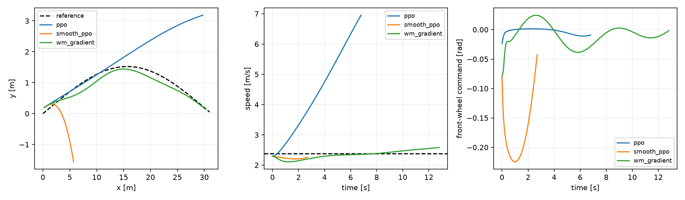

# 模型梯度辅助PPO：新种子与新测试

本轮保留全部真实rollout和GAE，以冻结世界模型的多步可微预测辅助actor，而不是用一步TD样本替换真实经验。在线执行仍仅运行PPO，不运行MPC或世界模型。

## 配置选择与隔离

只在训练seed0/1、独立88M验证场景中比较两个预先登记候选。按完成率、再按原始回报选择b：16步模型预测、辅助系数1、每4次PPO梯度加入一次模型辅助项、256次warm-start。

新seed6/7/8使用16384在线步，纯PPO总交互控制使用20480步。模型方法加3000离线交互共19384，仍少于该控制。配置保持冻结，新测试从99.6M起共600回合。

环境、原PPO配置与奖励不变。额外在线预算PPO有3200次Adam更新，模型含预热共2816次。另有不调用世界模型的动作平滑控制；各自成本完整记录。

## 方法

冻结模型由独立激励数据拟合：物理先验加16项非线性特征的岭回归残差。Torch实现与NumPy拟合模型数值一致；模型参数是buffer，训练时只更新策略，模型不接收隐藏condition或未来真实状态。丰富物理模型作为同机制对照。

用已知参考曲线采样2048个可行状态根，执行256次actor模型辅助预热；根由几何和范围采样，不来自测试或真实未来。此过程不是额外车辆交互，但256次更新和模型计算成本必须单列。

在线阶段，每4次PPO小批量梯度更新，从当前真实小批量取16个根，递归使用当前actor均值与模型预测16步，对横向/航向/速度误差和指令变化的平均代价反向传播。真实GAE/return不改写；附加损失与PPO损失相加后，统一一次backward、梯度裁剪和Adam step。

辅助项是可微的预测跟踪代价，包含比环境奖励更强的动作变化约束，也没有环境奖励的代价饱和。因此算法改变了训练目标；不是原版PPO的无偏梯度保证，也不应称为原版MBPO或Dreamer。actor均值滚动也不等于随机策略期望的精确积分。

简式：`总损失 = PPO损失 + beta × 预测时域内的平均跟踪/动作变化代价`。模型转移与actor在每一步递归连接梯度，因而能跨执行器延迟分配转向信用；这与旧h1 critic-bootstrap替换机制不同。

## 全部最终测试

|方法|分布|完成/回合|道路越界|原始回报|横向RMSE m|速度RMSE m/s|转角变化率RMS rad/s|
|---|---|---:|---:|---:|---:|---:|---:|
|ppo|id|9/60|51|2.613|1.0280|1.5253|0.0733|
|ppo|ood|12/60|48|4.633|1.0694|1.4267|0.1049|
|ppo_total_budget|id|18/60|42|15.198|0.9688|1.5683|0.0800|
|ppo_total_budget|ood|21/60|39|15.002|1.0512|1.4756|0.1141|
|smooth_ppo|id|1/60|59|-5.244|1.0536|0.6678|0.1845|
|smooth_ppo|ood|1/60|59|-6.457|1.0860|0.7271|0.2065|
|wm_gradient|id|60/60|0|156.559|0.1428|0.2858|0.0793|
|wm_gradient|ood|60/60|0|118.610|0.2741|0.5605|0.1447|
|physics_gradient|id|60/60|0|161.052|0.1378|0.3086|0.0800|
|physics_gradient|ood|60/60|0|120.362|0.2586|0.6529|0.1631|

## 分层配对差异（wm_gradient − 对照）

训练seed先重采样，再在seed内按直线/曲线分别配对重采样，共2000次。只有三个训练种子，区间不支持跨任务普遍保证，多重比较未校正。完成/回报越大越好，误差/转角变化率越小越好。

|对照|分布|指标|差值|95%区间|逐seed差值|
|---|---|---|---:|---|---|
|ppo|id|return_raw|153.94538|[145.18436, 162.86437]|161.5463, 149.4868, 150.8030|
|ppo|id|completed|0.85000|[0.76667, 0.93333]|0.8500, 0.8500, 0.8500|
|ppo|id|lateral_rmse_m|-0.88517|[-0.98689, -0.79688]|-0.9738, -0.8150, -0.8668|
|ppo|id|speed_rmse_mps|-1.23949|[-1.46850, -0.96376]|-1.3392, -0.9371, -1.4421|
|ppo|id|steering_rate_rms_radps|0.00599|[-0.03190, 0.03849]|-0.0331, 0.0139, 0.0372|
|ppo|ood|return_raw|113.97669|[104.71945, 122.90664]|104.7816, 115.1079, 122.0406|
|ppo|ood|completed|0.80000|[0.61667, 0.96667]|0.6000, 0.9500, 0.8500|
|ppo|ood|lateral_rmse_m|-0.79527|[-0.98118, -0.63552]|-0.7605, -0.6414, -0.9839|
|ppo|ood|speed_rmse_mps|-0.86617|[-1.25864, -0.51336]|-0.8194, -0.4978, -1.2813|
|ppo|ood|steering_rate_rms_radps|0.03974|[-0.03552, 0.08920]|-0.0390, 0.0808, 0.0774|
|ppo_total_budget|id|return_raw|141.36034|[113.75691, 159.17387]|157.9394, 113.6316, 152.5100|
|ppo_total_budget|id|completed|0.70000|[0.38333, 0.95000]|0.8000, 0.3500, 0.9500|
|ppo_total_budget|id|lateral_rmse_m|-0.82603|[-1.00440, -0.61239]|-1.0070, -0.6053, -0.8658|
|ppo_total_budget|id|speed_rmse_mps|-1.28250|[-1.45030, -1.10696]|-1.1290, -1.4166, -1.3020|
|ppo_total_budget|id|steering_rate_rms_radps|-0.00068|[-0.06042, 0.04169]|-0.0620, 0.0178, 0.0422|
|ppo_total_budget|ood|return_raw|103.60813|[73.21010, 123.45863]|119.6459, 72.0113, 119.1672|
|ppo_total_budget|ood|completed|0.65000|[0.30000, 0.90000]|0.8000, 0.3000, 0.8500|
|ppo_total_budget|ood|lateral_rmse_m|-0.77708|[-0.98301, -0.48106]|-0.9688, -0.4571, -0.9053|
|ppo_total_budget|ood|speed_rmse_mps|-0.91504|[-1.16010, -0.64744]|-0.6557, -0.9079, -1.1815|
|ppo_total_budget|ood|steering_rate_rms_radps|0.03062|[-0.07152, 0.09374]|-0.0740, 0.0804, 0.0854|
|smooth_ppo|id|return_raw|161.80226|[155.48057, 167.46122]|166.5952, 159.6151, 159.1965|
|smooth_ppo|id|completed|0.98333|[0.93333, 1.00000]|1.0000, 0.9500, 1.0000|
|smooth_ppo|id|lateral_rmse_m|-0.91081|[-0.95735, -0.86515]|-0.9495, -0.9090, -0.8739|
|smooth_ppo|id|speed_rmse_mps|-0.38193|[-0.60188, -0.03085]|-0.0263, -0.5282, -0.5912|
|smooth_ppo|id|steering_rate_rms_radps|-0.10516|[-0.14849, -0.05229]|-0.1515, -0.0505, -0.1135|
|smooth_ppo|ood|return_raw|125.06712|[116.33395, 130.75862]|129.4799, 115.8577, 129.8638|
|smooth_ppo|ood|completed|0.98333|[0.93333, 1.00000]|1.0000, 0.9500, 1.0000|
|smooth_ppo|ood|lateral_rmse_m|-0.81190|[-0.90549, -0.69414]|-0.8563, -0.6809, -0.8985|
|smooth_ppo|ood|speed_rmse_mps|-0.16653|[-0.49615, 0.26560]|0.2681, -0.2538, -0.5139|
|smooth_ppo|ood|steering_rate_rms_radps|-0.06185|[-0.15157, 0.04558]|-0.1531, 0.0509, -0.0833|
|physics_gradient|id|return_raw|-4.49291|[-6.52282, -2.81358]|-4.2064, -2.9253, -6.3471|
|physics_gradient|id|completed|0.00000|[0.00000, 0.00000]|0.0000, 0.0000, 0.0000|
|physics_gradient|id|lateral_rmse_m|0.00500|[-0.02739, 0.03212]|0.0110, 0.0327, -0.0287|
|physics_gradient|id|speed_rmse_mps|-0.02275|[-0.07196, 0.03110]|-0.0197, -0.0740, 0.0255|
|physics_gradient|id|steering_rate_rms_radps|-0.00068|[-0.01950, 0.01434]|-0.0151, 0.0096, 0.0035|
|physics_gradient|ood|return_raw|-1.75209|[-4.93245, 2.06789]|2.1905, -4.8803, -2.5664|
|physics_gradient|ood|completed|0.00000|[0.00000, 0.00000]|0.0000, 0.0000, 0.0000|
|physics_gradient|ood|lateral_rmse_m|0.01553|[-0.11721, 0.18177]|-0.1265, 0.1919, -0.0188|
|physics_gradient|ood|speed_rmse_mps|-0.09238|[-0.17896, -0.03106]|-0.0634, -0.0308, -0.1830|
|physics_gradient|ood|steering_rate_rms_radps|-0.01845|[-0.13534, 0.06563]|-0.1401, 0.0713, 0.0135|

## 每个训练种子

|seed|方法|分布|完成/回合|原始回报|横向RMSE|
|---:|---|---|---:|---:|---:|
|6|ppo|id|3/20|-2.018|1.1106|
|6|ppo|ood|8/20|16.130|0.9894|
|6|ppo_total_budget|id|4/20|1.589|1.1438|
|6|ppo_total_budget|ood|4/20|1.266|1.1977|
|6|smooth_ppo|id|0/20|-7.067|1.0863|
|6|smooth_ppo|ood|0/20|-8.568|1.0852|
|6|wm_gradient|id|20/20|159.528|0.1368|
|6|wm_gradient|ood|20/20|120.912|0.2289|
|6|physics_gradient|id|20/20|163.734|0.1258|
|6|physics_gradient|ood|20/20|118.721|0.3554|
|7|ppo|id|3/20|8.361|0.9979|
|7|ppo|ood|1/20|-1.469|1.0469|
|7|ppo_total_budget|id|13/20|44.217|0.7883|
|7|ppo_total_budget|ood|14/20|41.628|0.8627|
|7|smooth_ppo|id|1/20|-1.767|1.0920|
|7|smooth_ppo|ood|1/20|-2.218|1.0864|
|7|wm_gradient|id|20/20|157.848|0.1829|
|7|wm_gradient|ood|20/20|113.639|0.4055|
|7|physics_gradient|id|20/20|160.774|0.1503|
|7|physics_gradient|ood|20/20|118.520|0.2137|
|8|ppo|id|3/20|1.497|0.9754|
|8|ppo|ood|3/20|-0.762|1.1717|
|8|ppo_total_budget|id|1/20|-0.210|0.9744|
|8|ppo_total_budget|ood|3/20|2.111|1.0931|
|8|smooth_ppo|id|0/20|-6.897|0.9825|
|8|smooth_ppo|ood|0/20|-8.585|1.0863|
|8|wm_gradient|id|20/20|152.300|0.1087|
|8|wm_gradient|ood|20/20|121.278|0.1878|
|8|physics_gradient|id|20/20|158.647|0.1373|
|8|physics_gradient|ood|20/20|123.845|0.2066|

## 数据与计算账本

|方法|在线步/任务|总Adam调用/任务|额外离线交互/任务|imagined steps/任务|预热+训练平均秒|
|---|---:|---:|---:|---:|---:|
|ppo|16384|2560|0|0|12.59|
|ppo_total_budget|20480|3200|0|0|15.61|
|smooth_ppo|16384|2816|0|0|13.04|
|wm_gradient|16384|2816|3000|425984|38.33|
|physics_gradient|16384|2816|3000|425984|39.50|

模型池预训练和验证选择预算另计，不能用同在线步数掩盖3000离线交互、候选筛选、额外模型计算或墙钟开销。共享CPU主机计时不代表Pi。actor warm-start只更新actor参数，critic/log_std的Adam计数不同；审计分别核验。

## 判断规则与限制

预登记主指标为新测试原始回报，同时完成率不能降低；横向RMSE和转向平顺性为次指标。只改善次指标或某个种子，不能表述为稳定总体胜出。

仍是给定参考路径的合成仿真，执行器状态为特权输入，尚无视觉输入、障碍规划、真实车辆标定或部署。旧一步替换方法的失败、验证候选a和全部最终种子均保留，不替换旧报告，不把本轮与旧测试混为一个总体效果。

## 复现

```powershell
.\.venv\Scripts\python.exe run_ackermann_improvement.py --stage select --output outputs/ackermann_rl/new_selection --workers 4
.\.venv\Scripts\python.exe run_ackermann_improvement.py --stage efficiency --selection outputs/ackermann_rl/new_selection/selection.json --output outputs/ackermann_rl/new_final --workers 5
.\.venv\Scripts\python.exe scripts/audit_ackermann_rl.py --run outputs/ackermann_rl/new_final
.\.venv\Scripts\python.exe scripts/report_ackermann_improvement.py --run outputs/ackermann_rl/new_final
```

独立审计：verified_complete，600回合、35990转移，0错误。模型生成/辅助样本没有逐步完整训练日志，不能声称形式化验证了全部训练执行。



图按首个训练seed、ID、curve、pair0的固定身份选择，不按表现选最佳回合。
