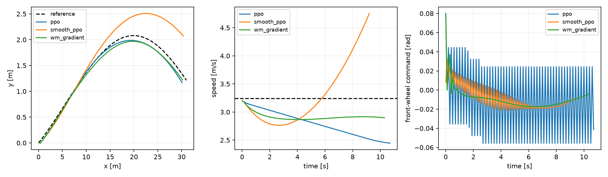

# 模型梯度辅助PPO：新种子与新测试

本轮保留全部真实rollout和GAE，以冻结世界模型的多步可微预测辅助actor，而不是用一步TD样本替换真实经验。在线执行仍仅运行PPO，不运行MPC或世界模型。

## 配置选择与隔离

只在训练seed0/1、独立88M验证场景中比较两个预先登记候选。按完成率、再按原始回报选择b：16步模型预测、辅助系数1、每4次PPO梯度加入一次模型辅助项、256次warm-start。

选择文件冻结后，最终训练换为seed3/4/5，65536在线步。最终测试换为95.3M起的新场景：每seed每分布每场景族10回合，共600回合。测试不用于重新选择超参数或checkpoint。

原PPO超参数、环境、奖励、观测、动作限制、预算与最终策略评价规则保持一致。另有额外256次PPO更新控制，以及不调用世界模型的动作平滑控制；不能把所有改善都归因于额外梯度或平滑项。

## 方法

冻结模型由独立激励数据拟合：物理先验加16项非线性特征的岭回归残差。Torch实现与NumPy拟合模型数值一致；模型参数是buffer，训练时只更新策略，模型不接收隐藏condition或未来真实状态。丰富物理模型作为同机制对照。

用已知参考曲线采样2048个可行状态根，执行256次actor模型辅助预热；根由几何和范围采样，不来自测试或真实未来。此过程不是额外车辆交互，但256次更新和模型计算成本必须单列。

在线阶段，每4次PPO小批量梯度更新，从当前真实小批量取16个根，递归使用当前actor均值与模型预测16步，对横向/航向/速度误差和指令变化的平均代价反向传播。真实GAE/return不改写；附加损失与PPO损失相加后，统一一次backward、梯度裁剪和Adam step。

辅助项是可微的预测跟踪代价，包含比环境奖励更强的动作变化约束，也没有环境奖励的代价饱和。因此算法改变了训练目标；不是原版PPO的无偏梯度保证，也不应称为原版MBPO或Dreamer。actor均值滚动也不等于随机策略期望的精确积分。

简式：`总损失 = PPO损失 + beta × 预测时域内的平均跟踪/动作变化代价`。模型转移与actor在每一步递归连接梯度，因而能跨执行器延迟分配转向信用；这与旧h1 critic-bootstrap替换机制不同。

## 全部最终测试

|方法|分布|完成/回合|道路越界|原始回报|横向RMSE m|速度RMSE m/s|转角变化率RMS rad/s|
|---|---|---:|---:|---:|---:|---:|---:|
|ppo|id|57/60|0|160.334|0.1002|0.2882|0.7883|
|ppo|ood|60/60|0|123.307|0.1323|0.5210|0.7742|
|ppo_compute|id|59/60|0|160.887|0.1039|0.2619|0.7872|
|ppo_compute|ood|60/60|0|123.395|0.1385|0.4847|0.7727|
|smooth_ppo|id|60/60|0|153.631|0.1344|0.3283|0.6209|
|smooth_ppo|ood|60/60|0|121.469|0.1695|0.4359|0.5511|
|wm_gradient|id|59/60|0|162.255|0.0753|0.2301|0.5702|
|wm_gradient|ood|60/60|0|124.199|0.0868|0.3648|0.5560|
|physics_gradient|id|58/60|0|161.874|0.0730|0.2354|0.7318|
|physics_gradient|ood|60/60|0|124.394|0.0915|0.4251|0.5677|

## 分层配对差异（wm_gradient − 对照）

训练seed先重采样，再在seed内按直线/曲线分别配对重采样，共2000次。只有三个训练种子，区间不支持跨任务普遍保证，多重比较未校正。完成/回报越大越好，误差/转角变化率越小越好。

|对照|分布|指标|差值|95%区间|逐seed差值|
|---|---|---|---:|---|---|
|ppo|id|return_raw|1.92129|[-1.41760, 6.07554]|0.0058, 1.1502, 4.6079|
|ppo|id|completed|0.03333|[-0.05000, 0.13333]|-0.0500, 0.0500, 0.1000|
|ppo|id|lateral_rmse_m|-0.02496|[-0.05082, 0.00267]|-0.0506, 0.0060, -0.0303|
|ppo|id|speed_rmse_mps|-0.05809|[-0.09532, -0.01965]|-0.0283, -0.0943, -0.0517|
|ppo|id|steering_rate_rms_radps|-0.21815|[-0.63578, -0.00632]|-0.6393, -0.0073, -0.0079|
|ppo|ood|return_raw|0.89153|[0.16740, 1.92328]|2.0418, 0.2991, 0.3338|
|ppo|ood|completed|0.00000|[0.00000, 0.00000]|0.0000, 0.0000, 0.0000|
|ppo|ood|lateral_rmse_m|-0.04548|[-0.05816, -0.03289]|-0.0407, -0.0566, -0.0391|
|ppo|ood|speed_rmse_mps|-0.15619|[-0.20649, -0.08937]|-0.1893, -0.0850, -0.1942|
|ppo|ood|steering_rate_rms_radps|-0.21823|[-0.60330, -0.01853]|-0.6068, -0.0183, -0.0296|
|ppo_compute|id|return_raw|1.36773|[-0.75061, 3.53571]|1.7175, 0.7775, 1.6082|
|ppo_compute|id|completed|0.00000|[-0.06667, 0.06667]|-0.0500, 0.0500, 0.0000|
|ppo_compute|id|lateral_rmse_m|-0.02862|[-0.05483, 0.00707]|-0.0546, 0.0094, -0.0406|
|ppo_compute|id|speed_rmse_mps|-0.03179|[-0.08585, 0.01146]|-0.0146, -0.0881, 0.0073|
|ppo_compute|id|steering_rate_rms_radps|-0.21705|[-0.63658, -0.00491]|-0.6388, -0.0068, -0.0056|
|ppo_compute|ood|return_raw|0.80362|[0.19391, 1.70204]|1.7224, 0.4093, 0.2792|
|ppo_compute|ood|completed|0.00000|[0.00000, 0.00000]|0.0000, 0.0000, 0.0000|
|ppo_compute|ood|lateral_rmse_m|-0.05170|[-0.06555, -0.03905]|-0.0485, -0.0638, -0.0428|
|ppo_compute|ood|speed_rmse_mps|-0.11984|[-0.16503, -0.08139]|-0.1660, -0.0867, -0.1069|
|ppo_compute|ood|steering_rate_rms_radps|-0.21674|[-0.60392, -0.01693]|-0.6063, -0.0165, -0.0274|
|smooth_ppo|id|return_raw|8.62418|[1.59038, 20.07269]|21.1059, 2.9070, 1.8597|
|smooth_ppo|id|completed|-0.01667|[-0.06667, 0.00000]|-0.0500, 0.0000, 0.0000|
|smooth_ppo|id|lateral_rmse_m|-0.05907|[-0.16116, 0.00204]|-0.1646, 0.0030, -0.0156|
|smooth_ppo|id|speed_rmse_mps|-0.09814|[-0.26242, 0.00636]|-0.2740, -0.0204, -0.0001|
|smooth_ppo|id|steering_rate_rms_radps|-0.05069|[-0.13711, -0.00125]|-0.1458, -0.0017, -0.0046|
|smooth_ppo|ood|return_raw|2.72947|[-0.21700, 8.08447]|8.2340, 0.1342, -0.1797|
|smooth_ppo|ood|completed|0.00000|[0.00000, 0.00000]|0.0000, 0.0000, 0.0000|
|smooth_ppo|ood|lateral_rmse_m|-0.08267|[-0.16813, -0.01628]|-0.1750, -0.0588, -0.0143|
|smooth_ppo|ood|speed_rmse_mps|-0.07103|[-0.18161, 0.06812]|0.0686, -0.1006, -0.1811|
|smooth_ppo|ood|steering_rate_rms_radps|0.00492|[-0.02561, 0.04164]|0.0439, -0.0021, -0.0270|
|physics_gradient|id|return_raw|0.38102|[-2.53153, 4.52546]|-0.1639, -2.3171, 3.6241|
|physics_gradient|id|completed|0.01667|[-0.06667, 0.11667]|-0.0500, 0.0000, 0.1000|
|physics_gradient|id|lateral_rmse_m|0.00230|[-0.00463, 0.00888]|0.0032, 0.0084, -0.0047|
|physics_gradient|id|speed_rmse_mps|-0.00527|[-0.08072, 0.11855]|0.1246, -0.0812, -0.0592|
|physics_gradient|id|steering_rate_rms_radps|-0.16164|[-0.62859, 0.14225]|-0.6303, 0.1496, -0.0042|
|physics_gradient|ood|return_raw|-0.19594|[-1.08965, 0.64115]|0.6606, -1.1269, -0.1216|
|physics_gradient|ood|completed|0.00000|[0.00000, 0.00000]|0.0000, 0.0000, 0.0000|
|physics_gradient|ood|lateral_rmse_m|-0.00466|[-0.01409, 0.00381]|-0.0001, -0.0148, 0.0009|
|physics_gradient|ood|speed_rmse_mps|-0.06023|[-0.17435, 0.14750]|0.1496, -0.1721, -0.1583|
|physics_gradient|ood|steering_rate_rms_radps|-0.01174|[-0.57711, 0.56365]|-0.5813, 0.5703, -0.0243|

## 每个训练种子

|seed|方法|分布|完成/回合|原始回报|横向RMSE|
|---:|---|---|---:|---:|---:|
|3|ppo|id|20/20|156.014|0.1179|
|3|ppo|ood|20/20|123.012|0.1258|
|3|ppo_compute|id|20/20|154.302|0.1220|
|3|ppo_compute|ood|20/20|123.331|0.1336|
|3|smooth_ppo|id|20/20|134.914|0.2320|
|3|smooth_ppo|ood|20/20|116.820|0.2600|
|3|wm_gradient|id|19/20|156.020|0.0674|
|3|wm_gradient|ood|20/20|125.054|0.0850|
|3|physics_gradient|id|20/20|156.184|0.0642|
|3|physics_gradient|ood|20/20|124.393|0.0851|
|4|ppo|id|19/20|160.716|0.0950|
|4|ppo|ood|20/20|122.979|0.1469|
|4|ppo_compute|id|19/20|161.089|0.0915|
|4|ppo_compute|ood|20/20|122.869|0.1541|
|4|smooth_ppo|id|20/20|158.960|0.0980|
|4|smooth_ppo|ood|20/20|123.144|0.1491|
|4|wm_gradient|id|20/20|161.867|0.1010|
|4|wm_gradient|ood|20/20|123.278|0.0903|
|4|physics_gradient|id|20/20|164.184|0.0925|
|4|physics_gradient|ood|20/20|124.405|0.1051|
|5|ppo|id|18/20|164.270|0.0878|
|5|ppo|ood|20/20|123.931|0.1243|
|5|ppo_compute|id|20/20|167.270|0.0982|
|5|ppo_compute|ood|20/20|123.985|0.1279|
|5|smooth_ppo|id|20/20|167.018|0.0732|
|5|smooth_ppo|ood|20/20|124.444|0.0994|
|5|wm_gradient|id|20/20|168.878|0.0575|
|5|wm_gradient|ood|20/20|124.264|0.0851|
|5|physics_gradient|id|18/20|165.254|0.0622|
|5|physics_gradient|ood|20/20|124.386|0.0843|

## 数据与计算账本

|方法|在线步/任务|总Adam调用/任务|额外离线交互/任务|imagined steps/任务|预热+训练平均秒|
|---|---:|---:|---:|---:|---:|
|ppo|65536|10240|0|0|48.18|
|ppo_compute|65536|10496|0|0|48.47|
|smooth_ppo|65536|10496|0|0|49.96|
|wm_gradient|65536|10496|3000|917504|125.96|
|physics_gradient|65536|10496|3000|917504|130.69|

模型池预训练和验证选择预算另计，不能用同在线步数掩盖3000离线交互、候选筛选、额外模型计算或墙钟开销。共享CPU主机计时不代表Pi。actor warm-start只更新actor参数，critic/log_std的Adam计数不同；审计分别核验。

## 判断规则与限制

预登记主指标为新测试原始回报，同时完成率不能降低；横向RMSE和转向平顺性为次指标。只改善次指标或某个种子，不能表述为稳定总体胜出。

仍是给定参考路径的合成仿真，执行器状态为特权输入，尚无视觉输入、障碍规划、真实车辆标定或部署。旧一步替换方法的失败、验证候选a和全部最终种子均保留，不替换旧报告，不把本轮与旧测试混为一个总体效果。

## 复现

```powershell
.\.venv\Scripts\python.exe run_ackermann_improvement.py --stage select --output outputs/ackermann_rl/new_selection --workers 4
.\.venv\Scripts\python.exe run_ackermann_improvement.py --stage final --selection outputs/ackermann_rl/new_selection/selection.json --output outputs/ackermann_rl/new_final --workers 5
.\.venv\Scripts\python.exe scripts/audit_ackermann_rl.py --run outputs/ackermann_rl/new_final
.\.venv\Scripts\python.exe scripts/report_ackermann_improvement.py --run outputs/ackermann_rl/new_final
```

独立审计：verified_complete，600回合、55653转移，0错误。模型生成/辅助样本没有逐步完整训练日志，不能声称形式化验证了全部训练执行。



图按首个训练seed、ID、curve、pair0的固定身份选择，不按表现选最佳回合。
