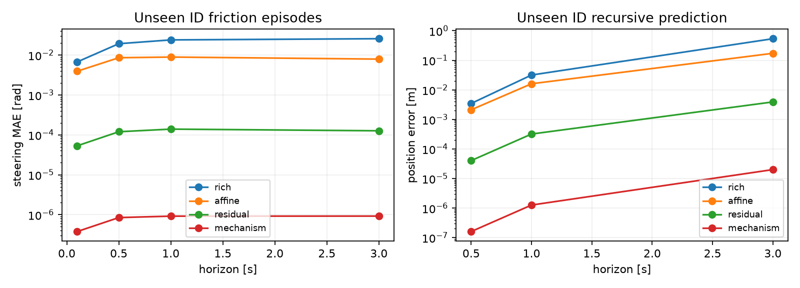

# 残差处理未建模转向失配：合成实验

本轮区分三个结论：残差是否修正结构失配、是否改善模型预测、预测改善是否转化为PPO闭环收益。不能将三者等同。

## 植物模型和基线公平性

原七参数丰富物理模型缺少转向标定偏置、增益与平滑死区。本轮只在转角执行器引入这些合成失配，车辆几何、纵向/横摆基础机制、奖励和路线任务保持一致；不是R550实测。

设转向驱动力 e=1.08*u_delta+0.025-delta，死区宽度w=0.032*(1+0.30*(v/5)^2)，使用F(e)=e-w*tanh(e/w)。F在零处为零、与e同号，导数1-sech²(e/w)>=0，避免非单调或反向响应。

标准工程模型中的死区与库仑/黏性摩擦参考：[MathWorks Dead Zone](https://www.mathworks.com/help/simulink/slref/deadzone.html)、[Coulomb and Viscous Friction](https://www.mathworks.com/help/simulink/slref/coulombandviscousfriction.html)。这里只借鉴失配类型；具体平滑函数、速度系数和数值为仿真假设，并非从这些文档或实车获得的参数。

所有方法使用同一2400 train＋600 val转移，并允许物理模型重新拟合：

- rich：重新辨识原七参数丰富物理族。
- affine：扩大为可校准转向增益/偏置的物理族，有效9参数。
- residual：在同一个affine模型上学习转角残差，输入速度、指令与当前转角之差、转向指令；3→64→64→1 tanh网络，所有尺度只用train，val早停。
- mechanism：知道平滑摩擦结构、但参数仍从同一train数据估计的物理族，有效12参数。它是匹配结构的强对照，不直接读取真值参数。

网络残差不是用真实公式手工写入的特征项。训练/验证/预测测试及PPO测试的随机种子命名空间隔离，模型先冻结再测试。原非单调近似v1已归档并排除，不作为物理证据；v2换用全新310M/320M/330M/340M/350M/360M种子空间。

## 冻结预测测试

每训练种子10个独立ID测试episode及10个响应时间改变的OOD episode。各时域用不重叠窗口，先汇总episode，避免把窗口当独立样本。

|分布|时域步数|模型|episode数|转角MAE rad|位置误差m|
|---|---:|---|---:|---:|---:|
|test|1|rich|30|0.0067092639|0|
|test|1|affine|30|0.0039228612|0|
|test|1|residual|30|5.3117161e-05|0|
|test|1|mechanism|30|3.7786443e-07|0|
|test|5|rich|30|0.019190063|0.0034526829|
|test|5|affine|30|0.0085486671|0.002110493|
|test|5|residual|30|0.00011960952|4.0341284e-05|
|test|5|mechanism|30|8.4572651e-07|1.6030154e-07|
|test|10|rich|30|0.023901266|0.031649048|
|test|10|affine|30|0.0088863014|0.016038183|
|test|10|residual|30|0.00013913359|0.00031920744|
|test|10|mechanism|30|9.1900683e-07|1.2636522e-06|
|test|30|rich|30|0.025605709|0.53578419|
|test|30|affine|30|0.0078937915|0.17207762|
|test|30|residual|30|0.00012632969|0.0038915526|
|test|30|mechanism|30|9.215507e-07|2.000224e-05|
|ood|1|rich|30|0.0086529555|0|
|ood|1|affine|30|0.0089721195|0|
|ood|1|residual|30|0.0073247838|0|
|ood|1|mechanism|30|0.0073609335|0|
|ood|5|rich|30|0.023117174|0.0057435038|
|ood|5|affine|30|0.022614658|0.0063452746|
|ood|5|residual|30|0.018681718|0.0065232338|
|ood|5|mechanism|30|0.01869853|0.0065291736|
|ood|10|rich|30|0.025799067|0.039903503|
|ood|10|affine|30|0.023814864|0.041632974|
|ood|10|residual|30|0.020535896|0.041549178|
|ood|10|mechanism|30|0.020549581|0.041588879|
|ood|30|rich|30|0.028466559|0.39233259|
|ood|30|affine|30|0.021107641|0.35616966|
|ood|30|residual|30|0.020233751|0.36712342|
|ood|30|mechanism|30|0.02024471|0.36728714|

## PPO冻结闭环：全部种子

三训练种子×五方法，每任务16384在线步。辅助方法统一使用原先验证选出的16步模型梯度、256次actor预热、每4次更新附加一次模型损失；未按本轮test改训练参数或选checkpoint。各辅助模型参数固定。

|方法|分布|完成/60|原始回报|横向RMSE m|速度RMSE m/s|转角变化率RMS|
|---|---|---:|---:|---:|---:|---:|
|ppo|id|23/60|26.6223|0.94371|1.23190|0.12516|
|ppo|ood|23/60|24.3585|0.98965|1.14005|0.14712|
|rich|id|60/60|157.6527|0.14965|0.35510|0.10558|
|rich|ood|60/60|122.7102|0.21434|0.68027|0.16607|
|affine|id|60/60|155.9087|0.19435|0.22778|0.10345|
|affine|ood|60/60|122.6956|0.26008|0.48953|0.16792|
|residual|id|60/60|159.2476|0.17811|0.26630|0.10479|
|residual|ood|60/60|122.7111|0.25536|0.54078|0.18354|
|mechanism|id|59/60|155.9186|0.12015|0.43111|0.08885|
|mechanism|ood|60/60|122.0883|0.19039|0.69644|0.15008|

## 配对差异：residual − 对照

训练seed先重采样，再在seed内配对重采样episode；PPO测试另按直线/曲线分层。2000次bootstrap，只有三个训练种子，多重比较未校正。误差越小越好，回报/完成越大越好。

|任务|对照|分布|时域|指标|差值|95%区间|逐seed差值|
|---|---|---|---|---|---:|---|---|
|prediction|rich|test|1|steering_mae_rad|-0.006656147|[-0.007474492,-0.005906404]|-0.0066134, -0.0069097, -0.0064453|
|prediction|rich|test|1|position_error_m|0|[0,0]|0, 0, 0|
|prediction|rich|test|5|steering_mae_rad|-0.01907045|[-0.02120486,-0.01711921]|-0.02002, -0.018971, -0.01822|
|prediction|rich|test|5|position_error_m|-0.003412342|[-0.004613247,-0.002175216]|-0.0044754, -0.0033298, -0.0024318|
|prediction|rich|test|10|steering_mae_rad|-0.02376213|[-0.0265486,-0.02144964]|-0.025646, -0.023217, -0.022423|
|prediction|rich|test|10|position_error_m|-0.03132984|[-0.04377315,-0.01961572]|-0.042389, -0.030036, -0.021565|
|prediction|rich|test|30|steering_mae_rad|-0.02547938|[-0.02923664,-0.02183043]|-0.028731, -0.025028, -0.022679|
|prediction|rich|test|30|position_error_m|-0.5318926|[-0.74808,-0.3273053]|-0.64351, -0.57734, -0.37483|
|prediction|rich|ood|1|steering_mae_rad|-0.001328172|[-0.001881771,-0.0007975134]|-0.0011437, -0.001772, -0.0010688|
|prediction|rich|ood|1|position_error_m|0|[0,0]|0, 0, 0|
|prediction|rich|ood|5|steering_mae_rad|-0.004435456|[-0.005802252,-0.003227596]|-0.0043093, -0.0052308, -0.0037663|
|prediction|rich|ood|5|position_error_m|0.00077973|[2.918917e-05,0.001854617]|0.0013083, 0.0008604, 0.00017053|
|prediction|rich|ood|10|steering_mae_rad|-0.005263172|[-0.007080612,-0.003382359]|-0.0052757, -0.0053747, -0.0051391|
|prediction|rich|ood|10|position_error_m|0.001645675|[-0.001818634,0.004975215]|0.0024745, 0.0023965, 6.6017e-05|
|prediction|rich|ood|30|steering_mae_rad|-0.008232808|[-0.01295463,-0.00295718]|-0.0039919, -0.0080078, -0.012699|
|prediction|rich|ood|30|position_error_m|-0.02520917|[-0.1426905,0.102495]|-0.00054391, -0.031052, -0.044032|
|prediction|affine|test|1|steering_mae_rad|-0.003869744|[-0.004179641,-0.003581271]|-0.0037896, -0.0040397, -0.00378|
|prediction|affine|test|1|position_error_m|0|[0,0]|0, 0, 0|
|prediction|affine|test|5|steering_mae_rad|-0.008429058|[-0.009019804,-0.00790287]|-0.0087085, -0.0085314, -0.0080473|
|prediction|affine|test|5|position_error_m|-0.002070152|[-0.002850433,-0.001388393]|-0.0025291, -0.0020676, -0.0016138|
|prediction|affine|test|10|steering_mae_rad|-0.008747168|[-0.009679517,-0.007827385]|-0.0095666, -0.0082014, -0.0084735|
|prediction|affine|test|10|position_error_m|-0.01571898|[-0.02161614,-0.0104007]|-0.017998, -0.016312, -0.012847|
|prediction|affine|test|30|steering_mae_rad|-0.007767462|[-0.00921268,-0.006272616]|-0.0079199, -0.0071154, -0.0082671|
|prediction|affine|test|30|position_error_m|-0.1681861|[-0.2405546,-0.1071756]|-0.18453, -0.17353, -0.1465|
|prediction|affine|ood|1|steering_mae_rad|-0.001647336|[-0.00215785,-0.0009703762]|-0.0019048, -0.0020505, -0.0009867|
|prediction|affine|ood|1|position_error_m|0|[0,0]|0, 0, 0|
|prediction|affine|ood|5|steering_mae_rad|-0.00393294|[-0.005326493,-0.002152057]|-0.0046328, -0.0049705, -0.0021955|
|prediction|affine|ood|5|position_error_m|0.0001779592|[-5.741402e-05,0.0004582299]|0.00019476, 6.0912e-05, 0.00027821|
|prediction|affine|ood|10|steering_mae_rad|-0.003278969|[-0.00514204,-0.001162014]|-0.0047351, -0.0036887, -0.0014131|
|prediction|affine|ood|10|position_error_m|-8.379607e-05|[-0.001943615,0.001770757]|-0.00096105, -0.00089834, 0.001608|
|prediction|affine|ood|30|steering_mae_rad|-0.0008738898|[-0.004550288,0.002832714]|-0.0028327, -0.0024005, 0.0026115|
|prediction|affine|ood|30|position_error_m|0.01095376|[-0.03477948,0.06635975]|0.050591, -0.027726, 0.0099959|
|prediction|mechanism|test|1|steering_mae_rad|5.27393e-05|[4.436821e-05,6.252532e-05]|6.0329e-05, 4.4784e-05, 5.3104e-05|
|prediction|mechanism|test|1|position_error_m|0|[0,0]|0, 0, 0|
|prediction|mechanism|test|5|steering_mae_rad|0.0001187638|[9.259804e-05,0.0001608644]|0.00015404, 9.4062e-05, 0.00010819|
|prediction|mechanism|test|5|position_error_m|4.018098e-05|[1.899597e-05,7.173026e-05]|6.76e-05, 2.9959e-05, 2.2984e-05|
|prediction|mechanism|test|10|steering_mae_rad|0.0001382146|[0.0001029758,0.0001893482]|0.00018397, 0.00010549, 0.00012519|
|prediction|mechanism|test|10|position_error_m|0.0003179438|[0.0001232864,0.000633805]|0.00059209, 0.0001997, 0.00016204|
|prediction|mechanism|test|30|steering_mae_rad|0.0001254081|[9.02653e-05,0.0001571032]|0.00012805, 0.00010872, 0.00013946|
|prediction|mechanism|test|30|position_error_m|0.00387155|[0.001472768,0.007757055]|0.0073707, 0.0020032, 0.0022408|
|prediction|mechanism|ood|1|steering_mae_rad|-3.614963e-05|[-6.183157e-05,-1.626273e-05]|-3.8175e-05, -1.88e-05, -5.1474e-05|
|prediction|mechanism|ood|1|position_error_m|0|[0,0]|0, 0, 0|
|prediction|mechanism|ood|5|steering_mae_rad|-1.681144e-05|[-5.066196e-05,1.299762e-05]|-4.6968e-05, -8.2599e-06, 4.7937e-06|
|prediction|mechanism|ood|5|position_error_m|-5.939782e-06|[-1.566177e-05,-4.992115e-07]|-1.5149e-05, -1.2592e-06, -1.4115e-06|
|prediction|mechanism|ood|10|steering_mae_rad|-1.368536e-05|[-7.435696e-05,5.06352e-05]|-5.6937e-05, -4.0191e-05, 5.6072e-05|
|prediction|mechanism|ood|10|position_error_m|-3.970092e-05|[-0.0001592525,6.988697e-05]|-0.00015583, -1.5957e-05, 5.268e-05|
|prediction|mechanism|ood|30|steering_mae_rad|-1.095896e-05|[-5.697881e-05,2.909392e-05]|-4.0738e-05, 2.1188e-05, -1.3327e-05|
|prediction|mechanism|ood|30|position_error_m|-0.000163724|[-0.001951112,0.0008925701]|-0.0011619, 0.00037775, 0.00029295|
|PPO|rich|id|None|return_raw|1.594911|[-0.1580094,3.18386]|-0.29404, 2.1532, 2.9256|
|PPO|rich|id|None|completed|0|[0,0]|0, 0, 0|
|PPO|rich|id|None|lateral_rmse_m|0.02846258|[-0.03134907,0.06483935]|0.056565, -0.033303, 0.062126|
|PPO|rich|ood|None|return_raw|0.0009550856|[-0.4618217,0.414652]|0.29128, -0.38209, 0.093677|
|PPO|rich|ood|None|completed|0|[0,0]|0, 0, 0|
|PPO|rich|ood|None|lateral_rmse_m|0.04101564|[-0.01048801,0.08398863]|0.05428, 0.083403, -0.014637|
|PPO|affine|id|None|return_raw|3.338899|[0.5815967,6.17991]|6.3601, 0.59616, 3.0605|
|PPO|affine|id|None|completed|0|[0,0]|0, 0, 0|
|PPO|affine|id|None|lateral_rmse_m|-0.01624372|[-0.08950139,0.05591781]|-0.089118, -0.01619, 0.056577|
|PPO|affine|ood|None|return_raw|0.01547129|[-1.707429,1.767931]|2.14, -0.36407, -1.7296|
|PPO|affine|ood|None|completed|0|[0,0]|0, 0, 0|
|PPO|affine|ood|None|lateral_rmse_m|-0.004722414|[-0.0816743,0.05519747]|-0.085973, 0.01492, 0.056887|
|PPO|mechanism|id|None|return_raw|3.328978|[-2.699168,7.422928]|-3.2424, 6.7242, 6.5052|
|PPO|mechanism|id|None|completed|0.01666667|[0,0.06666667]|0.05, 0, 0|
|PPO|mechanism|id|None|lateral_rmse_m|0.05795952|[0.02611293,0.08378067]|0.06817, 0.022828, 0.08288|
|PPO|mechanism|ood|None|return_raw|0.6228282|[-0.953882,1.838477]|1.4187, 1.4487, -0.99895|
|PPO|mechanism|ood|None|completed|0|[0,0]|0, 0, 0|
|PPO|mechanism|ood|None|lateral_rmse_m|0.06497187|[0.04010844,0.08740097]|0.058957, 0.047057, 0.088901|

## 解释边界

ID单步及递归预测可以检验残差是否修正未建模失配，但不能据此声称PPO控制全面更好。结构知情物理模型预测仍更准确，说明残差不是超越正确物理定律，而是在不手工写入该机制时学习补偿。

OOD同时改变执行器时间常数和横摆响应；残差训练没有见过这种漂移。OOD多步预测不保证改善，例如3秒位置误差可能弱于仿射物理对照。不能用ID结果宣称残差自动识别任意外部变化。

PPO表中原回报、横向精度、速度误差和转向变化可能相互冲突；完成率已经饱和时不能只报告更高回报。所有种子及配对差异均保留。模型网络拟合、actor预热和模型反向传播有额外成本；纯PPO原生离线预算为0，模型方法3000，辅助更新及warm-start不能视为免费。

## 探索性补充：在线适应前与2048步后

该诊断是在主实验结果后提出的新问题，不替代主预登记结论。模型与全部训练超参数保持冻结，另用380M新场景，0和2048两个预算都报告，不挑最佳预算。所有控制器均为模型辅助PPO，不包含未训练纯PPO。

|在线步|方法|分布|完成/60|原始回报|横向RMSE|
|---:|---|---|---:|---:|---:|
|0|rich|id|51/60|148.3565|0.31806|
|0|rich|ood|17/60|42.1580|0.87146|
|0|affine|id|49/60|145.1253|0.35289|
|0|affine|ood|16/60|41.0624|0.86862|
|0|residual|id|51/60|149.6520|0.22092|
|0|residual|ood|20/60|49.7856|0.81919|
|0|mechanism|id|50/60|150.4125|0.22217|
|0|mechanism|ood|20/60|48.8927|0.84127|
|2048|rich|id|49/60|124.5163|0.35782|
|2048|rich|ood|31/60|62.9875|0.69016|
|2048|affine|id|47/60|127.1326|0.37806|
|2048|affine|ood|21/60|47.8304|0.82739|
|2048|residual|id|43/60|107.8022|0.26335|
|2048|residual|ood|32/60|58.4928|0.77584|
|2048|mechanism|id|55/60|144.3789|0.24808|
|2048|mechanism|ood|27/60|56.1946|0.83967|

## 独立审计与复现

主闭环600回合/50931次转移、预测960条episode-模型-时域汇总均独立审计，零错误。预测审计用独立NumPy实现网络推理和物理递推；闭环审计不导入模拟器，重建真值动力学、扫掠车身几何、奖励、终止和Adam预算。没有完整逐训练样本执行轨迹，审计不是形式化训练证明。

```powershell
.\.venv\Scripts\python.exe run_ackermann_mismatch.py --stage prepare --output outputs/ackermann_rl/new_mismatch
.\.venv\Scripts\python.exe run_ackermann_mismatch.py --stage evaluate --output outputs/ackermann_rl/new_mismatch --workers 5
.\.venv\Scripts\python.exe scripts/audit_ackermann_mismatch_prediction.py --run outputs/ackermann_rl/new_mismatch
.\.venv\Scripts\python.exe scripts/audit_ackermann_rl.py --run outputs/ackermann_rl/new_mismatch
.\.venv\Scripts\python.exe run_ackermann_mismatch_warm.py --source outputs/ackermann_rl/new_mismatch --output outputs/ackermann_rl/new_warm --workers 4
.\.venv\Scripts\python.exe scripts/report_ackermann_mismatch.py --run outputs/ackermann_rl/new_mismatch --warm outputs/ackermann_rl/new_warm
```


