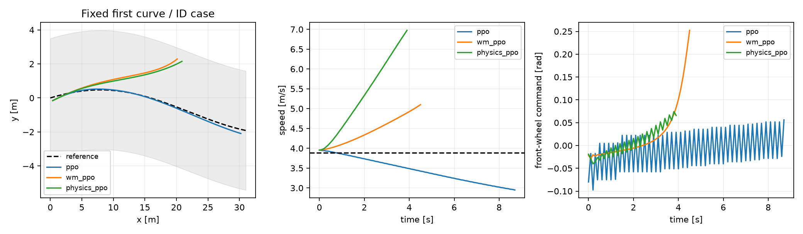

# 二维阿克曼：横纵向联合 PPO

状态：已实现并实际训练；本地合成仿真，不是视觉驾驶、实车部署或稳定模型优势结论。

固定预算：3 seeds × 3 方法，每任务 65536 在线步。最终 checkpoint 测试，共 288 回合。

## 动作、观测与模型分支

PPO 独立输出两个连续归一化动作，映射为期望加速度 [-3,2] m/s² 和前轮转角 [-0.5,0.5] rad；共同限制加速度命令变化率 5 m/s³、转角命令变化率 0.8 rad/s。没有传统控制器替代策略的转向输出。

14 维观测包括全局位姿、速度、仿真执行器加速度/转角、上一实际指令、已知路线参数/目标速度、横向误差、航向误差和 3m 前瞻参考偏差。没有图像、隐藏动力学 condition 或未来真实状态。路线由上游提供，尚不涉及自主路线选择或障碍物绕行。

世界模型复用已实现的二维物理＋16项基函数岭回归残差，预测执行器加速度、转角和横摆修正；不是新建视觉网络。每训练种子用 24×100 train、6×100 val 的自由空间激励数据拟合，ridge 仅按 val 选取；训练前冻结。丰富物理模型是相同机制的强对照。

辅助 PPO 从当轮真实观测池抽根，用同一个冻结行为策略批量生成一步分支；保留原始 Gaussian 动作及 log probability，动力学只接收裁剪、限幅与限速后的指令；替换一半固定学习 buffer。真正越界/抵达目标终止不 bootstrap，160步超时保留最终状态 bootstrap。合成一步 TD 与真实 GAE 分开，不能对混合 buffer 重算 GAE。

主比较采用 SB3 默认 2048 rollout、64 batch、10 epochs；实际 Adam 更新数相同，模型生成不增加策略更新。纯 PPO 原生离线交互为0，模型方法额外3000步，未宣称同总交互/同时间预算。一步 TD 的目标时域与模型分布均改变，不能将差异全部归因于预测精度。

## 场景和训练奖励

ID：直线/正弦曲线，振幅0或1.3m，目标速度2–4m/s。OOD：曲线振幅1.8m、目标速度4–5m/s、执行器响应时间乘1.3。道路宽7m、轴距1m、车长1.5m，均为仿真假设，不是R550标定。终点x=30m，最长16秒，扫掠车身越出道路即失败；本轮没有其他交通参与者，因此不能把道路越界称为车辆碰撞。

v1累计负跟踪代价使seed0验证策略较早越界，完整失败结果保留在quick。依据验证日志与奖励结构统一修正为v2；未读取v1正式test结果来选奖励。v2各方法使用同一有界存活奖励、跟踪与动作代价、目标到达奖励50、越界奖励−20；训练统一缩放0.01，测试报告原始回报。没有根据v2 test调参或选择checkpoint。

## 全部冻结测试结果

|方法|分布|回合|完成|道路越界|平均原始回报|横向RMSE m|速度RMSE m/s|
|---|---|---:|---:|---:|---:|---:|---:|
|ppo|id|48|48|0|156.35|0.100|0.323|
|ppo|ood|48|48|0|123.00|0.139|0.531|
|wm_ppo|id|48|34|14|87.43|0.556|1.120|
|wm_ppo|ood|48|28|20|62.44|0.665|0.978|
|physics_ppo|id|48|16|30|52.02|0.694|0.627|
|physics_ppo|ood|48|19|29|42.78|0.781|0.740|

## 逐训练种子（全部保留）

|seed|方法|分布|完成/回合|越界|平均回报|
|---:|---|---|---:|---:|---:|
|0|ppo|id|16/16|0|155.16|
|0|ppo|ood|16/16|0|121.79|
|0|wm_ppo|id|4/16|12|20.67|
|0|wm_ppo|ood|2/16|14|7.80|
|0|physics_ppo|id|0/16|14|-11.72|
|0|physics_ppo|ood|3/16|13|4.71|
|1|ppo|id|16/16|0|156.67|
|1|ppo|ood|16/16|0|124.14|
|1|wm_ppo|id|16/16|0|158.19|
|1|wm_ppo|ood|16/16|0|121.63|
|1|physics_ppo|id|16/16|0|158.79|
|1|physics_ppo|ood|16/16|0|122.57|
|2|ppo|id|16/16|0|157.23|
|2|ppo|ood|16/16|0|123.07|
|2|wm_ppo|id|14/16|2|83.43|
|2|wm_ppo|ood|10/16|6|57.88|
|2|physics_ppo|id|0/16|16|8.98|
|2|physics_ppo|ood|0/16|16|1.08|

## 训练成本

|方法|平均训练秒|每任务实际Adam次数|每任务合成替换|额外离线步/任务|
|---|---:|---:|---:|---:|
|ppo|51.61|10240|0|0|
|wm_ppo|51.97|10240|32768|3000|
|physics_ppo|52.03|10240|32768|3000|

共享CPU主机计时，不代表Pi实时性；离线数据拟合及验证/测试开销另计，见各目录manifest/complete.json。

**本轮世界模型辅助PPO的总体完成率和横向误差弱于纯PPO，没有证明横向辅助收益。纯PPO的转角命令存在高频振荡，尚需改善平顺性。**

## 审计与解释边界

独立审计：verified_complete，288回合，21588转移，0错误。

独立重建真值动力学、扫掠车身道路判定、原始奖励和指标，并检查轨迹连续性、数据划分、模型/策略SHA、zip中的真实Adam步数。没有逐样本训练执行日志，因此不是完整训练过程的形式化证明。

仅三个训练种子，结果不足以建立稳定总体优势；学习世界模型辅助方法可能劣于纯PPO，所有失败与超时均保留。当前实现证明联合转向/加速度策略确实可训练和可加载，不表示已达到车辆安全或部署门槛。



图选seed0、ID、curve、pair0，按事先固定身份选取，不按表现选最佳回合。

## 复现

```powershell
.\.venv\Scripts\python.exe run_ackermann_rl.py --preset quick --workers 3 --output outputs/ackermann_rl/new_run
.\.venv\Scripts\python.exe scripts/audit_ackermann_rl.py --run outputs/ackermann_rl/new_run
.\.venv\Scripts\python.exe scripts/report_ackermann_rl.py --run outputs/ackermann_rl/new_run
```

首次复现先按根README执行setup_rl.ps1；输出目录必须不存在，不会覆盖冻结记录。
