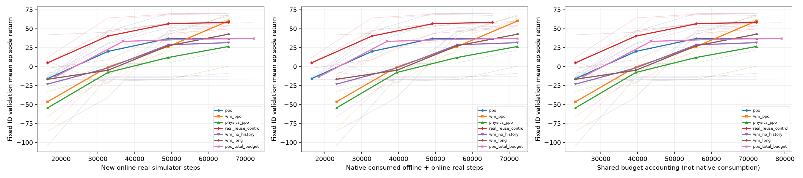
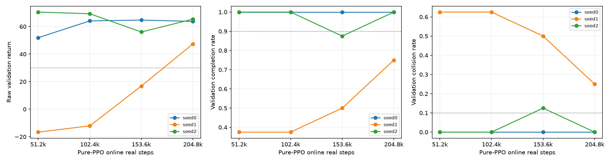

# SB3世界模型辅助PPO：独立强基线对照

运行目录：`outputs\rl_sb3\standard`；preset=standard；算法为Stable-Baselines3官方默认PPO，模型分支辅助当轮on-policy更新，不能称为原版MBPO。

训练学习奖励缩放learning_reward_scale=0.01。评估始终使用未缩放的环境原始reward/return，不能将学习目标的缩放误读为评价指标变更。

完整性：已验证齐全；任务21/21，episode 1680/1680，缺失0，重复0，真实步数/实际optimizer更新数预算异常0。

固定预算、最终checkpoint测试，val仅监控、不挑test-best。只运行本地仿真，没有R550连接、上线或部署。

## 新轮依据与交付边界

旧自研PPO32k首轮与131k预算诊断基线质量不足，全部保留在outputs/rl_ppo及rl_ppo_budget_validation，旧报告docs/RL_REPORT.md不被覆盖。仅train/val的独立SB3官方默认交叉检查在51200首个验证点8/8完成、0碰撞、raw return58.78，这只是配置与实现证据，不是新三seed正式测试，也不能从单点推出世界模型优势。

新轮standard每method/seed65536真实online步、3seed、7方法；smoke8192只检验工程。实际新PPO基线质量必须结合本轮最终policy与验证曲线核验，不能仅凭换用SB3便假定所有种子已达到可用驾驶水平。完整性通过只说明登记实验齐全，不代表整个目标或世界模型优势已经成立。

学习reward统一乘0.01，评价保持同一raw reward。主PPO结构、entropy、优化器超参数使用本机SB3默认；只有real_reuse_control的20epochs是登记的额外计算控制。不存在按新test表现选择缩放、horizon、entropy或checkpoint。

## 实验约定

ppo使用真实在线rollout；wm_ppo使用history模型一步分支，在super().train()前替换一半当轮真实buffer学习样本，不增加总梯度次数；physics_ppo使用丰富辨识物理同样分支；wm_no_history和wm_long检验历史与分支长度；real_reuse_control使用额外2倍更新，作为独立计算控制。ppo_total_budget把共同offline转移数改花为额外online步，使其原生总真实训练交互与wm_ppo相同，允许更多更新且单独记账。离线数据仅拟合预测模型，不进入PPO actor/critic梯度。真实与模型轨迹分别GAE，分支old_log_prob来自更新前同一冻结behavior策略。

主比较每method/seed新增online预算为65536真实步，rollout2048，batch64，10epochs，每完整rollout实际320个optimizer步（real_reuse_control20epochs为640）。ppo_total_budget另加offline对应online步数，末个partial rollout精确补齐请求的真实交互预算，不向上补成2048倍数；尾段与optimizer hook实测更新数按实际账本报告，不能归入同online/同更新数主比较。

## 最终策略闭环

|方法|分布|回合|碰撞|完成|return|进度m|gap RMSE m|jerk RMS m/s³|
|---|---|---:|---:|---:|---:|---:|---:|---:|
|physics_ppo|id|120|29|91|32.854|103.841|11.585|2.248|
|physics_ppo|ood|120|37|83|10.617|168.504|9.100|1.566|
|ppo|id|120|21|99|42.771|102.854|11.369|1.516|
|ppo|ood|120|28|92|26.083|169.421|8.539|1.271|
|ppo_total_budget|id|120|21|99|43.343|103.119|11.122|1.551|
|ppo_total_budget|ood|120|28|92|27.865|169.322|8.202|1.234|
|real_reuse_control|id|120|6|114|59.080|104.108|10.432|1.836|
|real_reuse_control|ood|120|28|92|20.811|170.885|8.961|1.502|
|wm_long|id|120|15|105|45.652|102.145|11.503|1.683|
|wm_long|ood|120|27|93|26.603|168.040|9.319|1.285|
|wm_no_history|id|120|27|93|33.466|101.325|11.692|2.256|
|wm_no_history|ood|120|25|95|29.682|165.837|9.556|1.655|
|wm_ppo|id|120|2|118|58.774|102.329|10.902|2.189|
|wm_ppo|ood|120|11|109|50.282|167.086|9.477|1.369|

## 全部方法的训练seed差异

|方法|分布|seed|回合|碰撞|完成|return|进度m|
|---|---|---:|---:|---:|---:|---:|---:|
|ppo|id|0|40|0|40|65.02|100.46|
|ppo|id|1|40|21|19|-2.26|110.80|
|ppo|id|2|40|0|40|65.56|97.30|
|ppo|ood|0|40|4|36|42.66|173.39|
|ppo|ood|1|40|20|20|-24.26|165.48|
|ppo|ood|2|40|4|36|59.84|169.40|
|wm_ppo|id|0|40|0|40|60.13|102.16|
|wm_ppo|id|1|40|2|38|57.78|109.86|
|wm_ppo|id|2|40|0|40|58.41|94.97|
|wm_ppo|ood|0|40|10|30|12.75|171.34|
|wm_ppo|ood|1|40|1|39|66.47|166.51|
|wm_ppo|ood|2|40|0|40|71.63|163.40|
|physics_ppo|id|0|40|20|20|3.97|102.01|
|physics_ppo|id|1|40|9|31|33.35|109.68|
|physics_ppo|id|2|40|0|40|61.24|99.84|
|physics_ppo|ood|0|40|19|21|-20.81|164.35|
|physics_ppo|ood|1|40|14|26|-1.53|169.14|
|physics_ppo|ood|2|40|4|36|54.19|172.02|
|real_reuse_control|id|0|40|0|40|63.16|103.31|
|real_reuse_control|id|1|40|6|34|50.92|112.57|
|real_reuse_control|id|2|40|0|40|63.16|96.44|
|real_reuse_control|ood|0|40|6|34|36.89|171.39|
|real_reuse_control|ood|1|40|18|22|-17.46|168.44|
|real_reuse_control|ood|2|40|4|36|43.01|172.83|
|wm_no_history|id|0|40|0|40|60.78|96.80|
|wm_no_history|id|1|40|8|32|44.69|107.81|
|wm_no_history|id|2|40|19|21|-5.08|99.36|
|wm_no_history|ood|0|40|1|39|62.68|164.28|
|wm_no_history|ood|1|40|4|36|54.90|166.55|
|wm_no_history|ood|2|40|20|20|-28.53|166.69|
|wm_long|id|0|40|0|40|67.49|101.07|
|wm_long|id|1|40|15|25|9.02|110.54|
|wm_long|id|2|40|0|40|60.45|94.83|
|wm_long|ood|0|40|3|37|50.41|172.91|
|wm_long|ood|1|40|20|20|-25.42|166.05|
|wm_long|ood|2|40|4|36|54.81|165.16|
|ppo_total_budget|id|0|40|0|40|66.36|100.64|
|ppo_total_budget|id|1|40|21|19|-1.92|110.84|
|ppo_total_budget|id|2|40|0|40|65.59|97.87|
|ppo_total_budget|ood|0|40|3|37|51.25|173.07|
|ppo_total_budget|ood|1|40|20|20|-23.70|164.96|
|ppo_total_budget|ood|2|40|5|35|56.05|169.94|

训练随机性不能被总体均值掩盖：主wm_ppo在seed0的OOD return低于纯PPO、碰撞更多，seed0/2的ID return也较低；总体收益很大部分来自减少纯PPO seed1训练失败。保留所有seed，不用较好seed替代较差seed。

## 场景族条件

每格为碰撞数/回合数；raw return。全7方法的完整各族指标保留在family_summary.csv。

|分布|场景族|ppo|wm_ppo|physics_ppo|real_reuse_control|
|---|---|---|---|---|---|
|id|constant|0/30; 89.01|0/30; 92.68|0/30; 89.25|0/30; 94.84|
|id|mild|1/30; 85.68|0/30; 93.57|0/30; 84.66|0/30; 94.84|
|id|brake|10/30; -12.73|2/30; 3.66|15/30; -35.78|4/30; 4.74|
|id|stopgo|10/30; 9.13|0/30; 45.20|14/30; -6.71|2/30; 41.90|
|ood|constant|0/30; 67.48|0/30; 72.61|0/30; 63.14|0/30; 62.98|
|ood|mild|0/30; 57.57|0/30; 64.32|0/30; 51.40|0/30; 51.11|
|ood|brake|18/30; -37.51|10/30; 4.26|22/30; -53.94|20/30; -50.05|
|ood|stopgo|10/30; 16.80|1/30; 59.94|15/30; -18.13|8/30; 19.19|

未齐全表格仅描述已完成episode，不能据此排名；碰撞早停长度与全部轨迹均保留。完成要求无碰撞跑满120步且进度达到参考阈值，不能仅凭停车的低碰撞率宣称优势。

## 世界模型相对纯PPO、强物理与同总交互控制的配对效应

差值为wm_ppo−对照；return/progress/completed越高越好，碰撞/误差越低越好。训练seed先重采样，再在seed内按family分层配对episode重采样，95%区间。

|对照|分布|指标|差值|95%区间|配对数|
|---|---|---|---:|---|---:|
|ppo|id|return|16.0029|[-7.3000,59.5923]|120|
|ppo|id|collision|-0.1583|[-0.4667,0.0000]|120|
|ppo|id|completed|0.1583|[0.0000,0.4667]|120|
|ppo|id|progress_m|-0.5245|[-2.4034,1.7021]|120|
|ppo|id|gap_rmse_m|-0.4673|[-2.8224,1.5388]|120|
|ppo|id|jerk_rms_mps3|0.6725|[0.1382,1.3289]|120|
|ppo|id|fallback_count|0.0083|[-12.5106,9.1254]|120|
|ppo|id|cycle_p95_ms|-0.1970|[-0.4784,0.0680]|120|
|ppo|ood|return|24.1995|[-27.4464,90.0180]|120|
|ppo|ood|collision|-0.1417|[-0.4750,0.1333]|120|
|ppo|ood|completed|0.1417|[-0.1333,0.4750]|120|
|ppo|ood|progress_m|-2.3354|[-5.8088,0.9208]|120|
|ppo|ood|gap_rmse_m|0.9379|[-2.3034,3.6058]|120|
|ppo|ood|jerk_rms_mps3|0.0976|[-0.3831,0.4889]|120|
|ppo|ood|fallback_count|-4.9083|[-18.9760,7.8002]|120|
|ppo|ood|cycle_p95_ms|-0.0214|[-0.2897,0.2381]|120|
|physics_ppo|id|return|25.9206|[-2.3356,55.7165]|120|
|physics_ppo|id|collision|-0.2250|[-0.5000,0.0000]|120|
|physics_ppo|id|completed|0.2250|[0.0000,0.5000]|120|
|physics_ppo|id|progress_m|-1.5116|[-4.6903,0.9240]|120|
|physics_ppo|id|gap_rmse_m|-0.6830|[-2.4271,1.9610]|120|
|physics_ppo|id|jerk_rms_mps3|-0.0598|[-0.3702,0.2170]|120|
|physics_ppo|id|fallback_count|-6.4583|[-11.5006,-1.8571]|120|
|physics_ppo|id|cycle_p95_ms|0.0622|[-0.7258,0.6248]|120|
|physics_ppo|ood|return|39.6650|[18.5055,66.9913]|120|
|physics_ppo|ood|collision|-0.2167|[-0.3333,-0.1000]|120|
|physics_ppo|ood|completed|0.2167|[0.1000,0.3333]|120|
|physics_ppo|ood|progress_m|-1.4178|[-8.4344,6.7508]|120|
|physics_ppo|ood|gap_rmse_m|0.3771|[-1.6913,3.8393]|120|
|physics_ppo|ood|jerk_rms_mps3|-0.1975|[-0.5207,0.1246]|120|
|physics_ppo|ood|fallback_count|-12.1500|[-19.5835,-7.2746]|120|
|physics_ppo|ood|cycle_p95_ms|0.2507|[-0.2379,0.6491]|120|
|ppo_total_budget|id|return|15.4311|[-7.8360,59.3444]|120|
|ppo_total_budget|id|collision|-0.1583|[-0.4667,0.0000]|120|
|ppo_total_budget|id|completed|0.1583|[0.0000,0.4667]|120|
|ppo_total_budget|id|progress_m|-0.7894|[-2.8891,1.5155]|120|
|ppo_total_budget|id|gap_rmse_m|-0.2200|[-2.7053,2.0226]|120|
|ppo_total_budget|id|jerk_rms_mps3|0.6373|[0.1453,1.2485]|120|
|ppo_total_budget|id|fallback_count|-0.1167|[-12.6350,8.6835]|120|
|ppo_total_budget|id|cycle_p95_ms|0.1081|[-0.0844,0.3172]|120|
|ppo_total_budget|ood|return|22.4176|[-36.1272,89.4106]|120|
|ppo_total_budget|ood|collision|-0.1417|[-0.4750,0.1583]|120|
|ppo_total_budget|ood|completed|0.1417|[-0.1583,0.4750]|120|
|ppo_total_budget|ood|progress_m|-2.2357|[-6.3445,1.3766]|120|
|ppo_total_budget|ood|gap_rmse_m|1.2755|[-2.2527,3.9416]|120|
|ppo_total_budget|ood|jerk_rms_mps3|0.1347|[-0.3684,0.5461]|120|
|ppo_total_budget|ood|fallback_count|-4.1583|[-18.5173,9.7767]|120|
|ppo_total_budget|ood|cycle_p95_ms|0.1999|[-0.1833,0.7030]|120|
|real_reuse_control|id|return|-0.3055|[-5.0461,7.1339]|120|
|real_reuse_control|id|collision|-0.0333|[-0.1083,0.0000]|120|
|real_reuse_control|id|completed|0.0333|[0.0000,0.1083]|120|
|real_reuse_control|id|progress_m|-1.7792|[-2.7920,-0.9067]|120|
|real_reuse_control|id|gap_rmse_m|0.4693|[-0.5583,1.3089]|120|
|real_reuse_control|id|jerk_rms_mps3|0.3522|[-0.1620,1.1027]|120|
|real_reuse_control|id|fallback_count|2.9083|[0.7750,5.3335]|120|
|real_reuse_control|id|cycle_p95_ms|-0.0673|[-0.5533,0.2917]|120|
|real_reuse_control|ood|return|29.4708|[-22.1688,82.9601]|120|
|real_reuse_control|ood|collision|-0.1417|[-0.4167,0.0833]|120|
|real_reuse_control|ood|completed|0.1417|[-0.0833,0.4167]|120|
|real_reuse_control|ood|progress_m|-3.7990|[-9.1920,0.1261]|120|
|real_reuse_control|ood|gap_rmse_m|0.5159|[-1.8860,2.1851]|120|
|real_reuse_control|ood|jerk_rms_mps3|-0.1330|[-0.5628,0.4166]|120|
|real_reuse_control|ood|fallback_count|-8.2333|[-20.0256,7.7919]|120|
|real_reuse_control|ood|cycle_p95_ms|0.1921|[-0.1203,0.4378]|120|
|wm_no_history|id|return|25.3081|[-0.2183,62.4181]|120|
|wm_no_history|id|collision|-0.2083|[-0.4667,0.0000]|120|
|wm_no_history|id|completed|0.2083|[0.0000,0.4667]|120|
|wm_no_history|id|progress_m|1.0037|[-3.9722,5.2975]|120|
|wm_no_history|id|gap_rmse_m|-0.7905|[-1.6096,0.0229]|120|
|wm_no_history|id|jerk_rms_mps3|-0.0670|[-0.6795,0.6023]|120|
|wm_no_history|id|fallback_count|-2.7667|[-21.4125,8.3919]|120|
|wm_no_history|id|cycle_p95_ms|0.0563|[-0.3408,0.3376]|120|
|wm_no_history|ood|return|20.6004|[-48.7440,98.6808]|120|
|wm_no_history|ood|collision|-0.1167|[-0.5000,0.2167]|120|
|wm_no_history|ood|completed|0.1167|[-0.2167,0.5000]|120|
|wm_no_history|ood|progress_m|1.2492|[-3.3027,6.9531]|120|
|wm_no_history|ood|gap_rmse_m|-0.0787|[-1.4837,0.9914]|120|
|wm_no_history|ood|jerk_rms_mps3|-0.2866|[-0.9387,0.5167]|120|
|wm_no_history|ood|fallback_count|-5.1500|[-27.7265,11.8508]|120|
|wm_no_history|ood|cycle_p95_ms|0.0658|[-0.0802,0.2171]|120|
|wm_long|id|return|13.1220|[-7.1215,47.7421]|120|
|wm_long|id|collision|-0.1083|[-0.3083,0.0000]|120|
|wm_long|id|completed|0.1083|[0.0000,0.3083]|120|
|wm_long|id|progress_m|0.1840|[-1.2144,1.2360]|120|
|wm_long|id|gap_rmse_m|-0.6014|[-1.9326,0.2437]|120|
|wm_long|id|jerk_rms_mps3|0.5055|[-0.1216,1.1440]|120|
|wm_long|id|fallback_count|-1.4000|[-15.5838,9.4600]|120|
|wm_long|id|cycle_p95_ms|0.1834|[-0.0786,0.5832]|120|
|wm_long|ood|return|23.6792|[-35.7240,91.1332]|120|
|wm_long|ood|collision|-0.1333|[-0.4750,0.1583]|120|
|wm_long|ood|completed|0.1333|[-0.1583,0.4750]|120|
|wm_long|ood|progress_m|-0.9537|[-2.3663,0.7983]|120|
|wm_long|ood|gap_rmse_m|0.1577|[-2.3898,2.1278]|120|
|wm_long|ood|jerk_rms_mps3|0.0835|[-0.4206,0.5303]|120|
|wm_long|ood|fallback_count|-6.3250|[-19.5758,9.2842]|120|
|wm_long|ood|cycle_p95_ms|0.1829|[0.0503,0.3215]|120|

smoke只有1个训练seed，区间仅反映场景抽样，不构成训练随机性的优势证据。standard只有3seed，区间仍不稳定。零事件或恒定配对差异的经验bootstrap可能给[0,0]，它不表示真实风险为零。区间未经多重比较校正；主wm对ppo/physics按预登记解释，控制与消融/分族视为条件和探索性证据，不按显著性挑赢家。须同时检查碰撞、完成、进度和回报；区间跨零不证明等效。
## 固定主比较的科学结论

工程结论：策略和价值函数由官方PPO实际训练，世界模型仅在训练时提供当轮behavior策略短分支；部署评价执行学到的policy。模型辅助PPO已实现并闭环运行，与世界模型优势是否成立分别判定。

ID：wm_ppo碰撞2/120，纯PPO 21/120；raw return 58.77 vs 42.77，差+16.00，95%区间[-7.30,59.59]。同时报告进度102.33 vs 102.85m与jerk 2.189 vs 1.516m/s³。
OOD：wm_ppo碰撞11/120，纯PPO 28/120；raw return 50.28 vs 26.08，差+24.20，95%区间[-27.45,90.02]。同时报告进度167.09 vs 169.42m与jerk 1.369 vs 1.271m/s³。

这些样本均值显示碰撞减少，但纯PPO主比较的回报区间仍跨零，训练随机性使稳定优势证据不足；不把较少碰撞直接等同全部驾驶指标改善。

相对physics_ppo，ID return差+25.92 [-2.34,55.72]；碰撞率差-22.50个百分点 [-50.00,0.00]。
相对physics_ppo，OOD return差+39.66 [18.51,66.99]；碰撞率差-21.67个百分点 [-33.33,-10.00]。
相对ppo_total_budget，ID return差+15.43 [-7.84,59.34]；碰撞率差-15.83个百分点 [-46.67,0.00]。
相对ppo_total_budget，OOD return差+22.42 [-36.13,89.41]；碰撞率差-14.17个百分点 [-47.50,15.83]。
相对real_reuse_control，ID return差-0.31 [-5.05,7.13]；碰撞率差-3.33个百分点 [-10.83,0.00]。
相对real_reuse_control，OOD return差+29.47 [-22.17,82.96]；碰撞率差-14.17个百分点 [-41.67,8.33]。

本轮对丰富物理辅助PPO的OOD回报与碰撞差异得到这些配对区间支持，仍限于当前场景、三个训练seed与预算。对同总真实交互PPO、额外真实经验复用的return差异区间跨零，不能声称世界模型稳定胜过两种成本控制。后两者分别使用额外online交互或额外梯度，均已单列账本。

ID jerk相对纯PPO增加，相关差值区间见上表；平顺性是实际代价。无历史和更长分支不能只挑某个有利seed解释，全部方法/seed表和消融差异一起保留；h3不是自动优于h1。

每seed原生真实数据消耗：wm_ppo 72311、纯PPO 65536；两者online步与optimizer更新相同（65536、10240）。共享主机平均训练墙钟145.38s vs 98.63s，WM增加47.4%；其中模型生成44.00s。额外更新控制为127.43s。预训练整套8模型上界另为3.38s，不算进这些policy训练墙钟，不是单模型成本。

因此，本轮支持有限的条件收益与跨seed稳定性线索，尚不支持“世界模型普遍改善PPO”“在相同总数据/墙钟成本下必然更优”，也不支持“世界模型无用”。同online/同更新数比较排除了多做policy更新这一解释；额外offline数据、生成计算、控制更平缓/激烈的取舍和单seed退化仍需共同计入。

样本效率边界：这些固定预算最终策略差异不能单独证明达到同一驾驶质量所需真实数据更少。验证曲线只有预登记的稀疏监控点，早期学习并非WM一致领先；纯PPO原生无需offline数据。须同时看新增online、native总消耗及墙钟，不能仅按最终return给样本效率结论。

## 控制周期与安全回退

policy p50/p95是episode内分位数的平均；完整cycle为全部实际周期汇集后的pooled分位数，包含编码、policy、安全检查和仿真step，不含设备IO。训练时生成模型分支，评价在线不执行世界模型。

|方法|分布|回退总次数|policy均值p50/p95 ms|cycle pooled p50/p95 ms|pooled超100ms率|
|---|---|---:|---|---|---:|
|physics_ppo|id|1975|0.323/0.788|0.586/1.428|0.000000|
|physics_ppo|ood|2847|0.305/0.746|0.554/1.402|0.000000|
|ppo|id|1199|0.341/0.937|0.636/1.656|0.000000|
|ppo|ood|1978|0.345/0.924|0.632/1.671|0.000000|
|ppo_total_budget|id|1214|0.317/0.761|0.592/1.436|0.000000|
|ppo_total_budget|ood|1888|0.316/0.766|0.574/1.533|0.000000|
|real_reuse_control|id|851|0.344/0.851|0.643/1.535|0.000000|
|real_reuse_control|ood|2377|0.337/0.792|0.633/1.434|0.000000|
|wm_long|id|1368|0.332/0.733|0.621/1.334|0.000000|
|wm_long|ood|2148|0.344/0.798|0.638/1.423|0.000000|
|wm_no_history|id|1532|0.329/0.797|0.620/1.458|0.000000|
|wm_no_history|ood|2007|0.338/0.850|0.627/1.558|0.000000|
|wm_ppo|id|1200|0.340/0.832|0.634/1.490|0.000000|
|wm_ppo|ood|1389|0.346/0.897|0.661/1.563|0.000000|

## 成本与样本效率

worldmodel_pretrain_wall_s是整套8种预测模型预训练墙钟上界，给物理与神经模型同样标记；不能称单个history/physics模型的训练成本。主训练墙钟另计model_generation_wall_s，验证/测试真实步单列，不混入训练预算。

policy_updates为optimizer post-step hook实测梯度步数，不是SB3按epoch累计的_n_updates。policy_configuration.json保存各方法/seed实际超参数，model_usage.csv保存模型生成数与实际替换数，避免把h3生成量当成实际学习样本数。

|方法|seed|新增online步|共同offline转移|native总训练交互|shared数据预算交互|梯度minibatches|synthetic生成步|训练墙钟s|模型生成s|预训整套上界s|
|---|---:|---:|---:|---:|---:|---:|---:|---:|---:|---:|
|ppo|0|65536|6775|65536|72311|10240|0|103.557|0.000|0.000|
|wm_ppo|0|65536|6775|72311|72311|10240|32768|142.670|43.237|3.388|
|physics_ppo|0|65536|6775|72311|72311|10240|32768|114.775|33.128|3.388|
|real_reuse_control|0|65536|6775|65536|72311|20480|0|135.350|0.000|0.000|
|wm_no_history|0|65536|6775|72311|72311|10240|32768|129.232|38.196|3.388|
|wm_long|0|65536|6775|72311|72311|10240|32817|129.134|38.081|3.388|
|ppo_total_budget|0|72311|6775|72311|79086|11300|0|115.921|0.000|0.000|
|ppo|1|65536|6775|65536|72311|10240|0|97.937|0.000|0.000|
|wm_ppo|1|65536|6775|72311|72311|10240|32768|140.763|43.069|3.710|
|physics_ppo|1|65536|6775|72311|72311|10240|32768|123.897|36.429|3.710|
|real_reuse_control|1|65536|6775|65536|72311|20480|0|122.977|0.000|0.000|
|wm_no_history|1|65536|6775|72311|72311|10240|32768|140.393|42.208|3.710|
|wm_long|1|65536|6775|72311|72311|10240|32802|136.874|40.162|3.710|
|ppo_total_budget|1|72311|6775|72311|79086|11300|0|87.735|0.000|0.000|
|ppo|2|65536|6775|65536|72311|10240|0|94.394|0.000|0.000|
|wm_ppo|2|65536|6775|72311|72311|10240|32768|152.700|45.693|3.027|
|physics_ppo|2|65536|6775|72311|72311|10240|32768|115.451|33.427|3.027|
|real_reuse_control|2|65536|6775|65536|72311|20480|0|123.973|0.000|0.000|
|wm_no_history|2|65536|6775|72311|72311|10240|32768|126.818|38.131|3.027|
|wm_long|2|65536|6775|72311|72311|10240|32815|140.797|40.667|3.027|
|ppo_total_budget|2|72311|6775|72311|79086|11300|0|105.207|0.000|0.000|

纯PPO原生不需要offline数据，因此native总成本可低于shared预算视角；提供相同采集成本预算不等于PPO使用了这些数据。synthetic步不是real env steps，额外复用梯度不是免费收益。缺失成本字段一律未验证，不用配置反推actual。

## 验证学习曲线

val固定ID、每族2case共8个独立场景；四分之一预算监控，不据此挑test-best。左图新增online，中图原生实际消耗的offline+online真实交互；纯PPO、real_reuse_control和ppo_total_budget均原生零offline。右图仅共同预算记账，不能当作真实数据消耗；原生成本推算采用该方法是否使用预测模型与已记录offline转移数。细淡线为独立训练seed，带标记粗线为同一步数跨seed均值，不是置信区间；不能把曲线点当独立训练重复。

## 补充：固定204800步纯PPO参考（不同预算）

依据65k验证seed1学习不足而事前固定延长，默认PPO超参数保持；三个seed全部跑完204800步，不选中间最好checkpoint，不使用test决定预算或超参数。此补充不替代前述65k七方法预登记主比较，也不是等预算的模型胜负试验。

补充完整性：3/3任务、240/240唯一测试回合。

|seed|真实步|完成率(val)|碰撞率(val)|raw return(val)|联合门槛|训练墙钟s|更新数|
|---:|---:|---:|---:|---:|---|---:|---:|
|0|204800|1.000|0.000|63.72|通过|186.23|32000|
|1|204800|0.750|0.250|47.40|未通过|185.71|32000|
|2|204800|1.000|0.000|65.39|通过|185.34|32000|

固定ID验证门槛为完成≥.9、碰撞≤.1、return≥30；seed0/2通过，seed1仍未通过，不能用两个较好seed代替全部。每seed仅8个ID val场景，通过也不是普遍可靠性保证。所有四个监控点保留在reference_learning_curves.csv和下图，不择优。

|策略/预算|分布|回合|碰撞|完成|return|进度m|gap RMSE m|jerk m/s³|
|---|---|---:|---:|---:|---:|---:|---:|---:|
|纯PPO 65536|id|120|21|99|42.77|102.85|11.369|1.516|
|纯PPO 65536|ood|120|28|92|26.08|169.42|8.539|1.271|
|WM-PPO 65536|id|120|2|118|58.77|102.33|10.902|2.189|
|WM-PPO 65536|ood|120|11|109|50.28|167.09|9.477|1.369|
|纯PPO 204800|id|120|13|107|52.63|105.91|10.178|2.107|
|纯PPO 204800|ood|120|29|91|21.80|171.78|8.756|1.375|
ID描述：纯PPO增加采样后，return 42.77→52.63，碰撞21→13；相对WM65k的return样本均值差由16.00变为6.14。该差值只描述不同预算结果，不作为新的等预算显著性检验或模型节省数据证明。
OOD描述：纯PPO增加采样后，return 26.08→21.80，碰撞28→29；相对WM65k的return样本均值差由24.20变为28.49。该差值只描述不同预算结果，不作为新的等预算显著性检验或模型节省数据证明。

204800相当于65k在线交互的3.125倍、每seed32000次optimizer步（65k为10240），纯PPO原生offline0；平均训练墙钟185.76s。WM65k另需6775个共同offline转移、模型预训练和生成计算。ID差距随更多纯PPO采样缩小，OOD未呈一致改善，seed1依然不足；这限定了稳定数据效率结论，不能据最终均值断言WM只需较少总成本就必然达到同等质量。

## 当前模型池的能力归因

独立纯验证诊断见[SB3_MODEL_DIAGNOSIS.md](source_snapshot/SB3_MODEL_DIAGNOSIS.md)及当前root/model_diagnosis；使用当前common_data的12个独立val episode和3个冻结world_models，未读取test选择模型或策略。三个模型seed共享val场景，不当成36个独立episode；这不是旧MPC数据集。

当前history在匀速窗口的前车速度MAE：0.1/0.5/1/3秒分别0.00338526/0.0682029/0.306833/2.55033m/s；3秒gap MAE2.58214m，而丰富物理在该族近零。四场景族3秒gap误差均history更大。因此不能把PPO闭环差异归因成“递归预测更准”。

history与仅学习前车的learned_lead在全部登记窗口的gap/ego/leader预测最大差为0，自车执行器差最多2.78e-17m/s²；自车残差网络raw输出最大4.84e-18m/s²。本数据的自车确定性结构已由丰富物理拟合充分解决，不支持学习了有意义的额外自车响应这一解释。

同一val根、同一实际动作的h1 analytic raw reward跨模型最大差严格0：显式Euler下一gap/ego由旧状态决定。学习前车可以改变next_obs和critic bootstrap，h3还会改变后续奖励。短模型GAE目标、分支根重采样及bootstrap扰动是可能解释（推断），并未证明为收益来源；物理辅助对照与nohistory/h3消融限制这种归因，但不能完全隔离机制。

## 证据链与失效边界

现有证据链是：共同数据拟合的前车预测/近零自车残差→h1 next_obs与bootstrap变化→学习曲线和部分seed失败率改变→有限条件闭环差异→额外数据/训练成本；没有证明“更准多步预测必然带来更好PPO”。

预测误差降低不保证PPO改善；模型偏差可能被策略放大。OOD、不可预知急刹、有限数据和短分支覆盖仍是边界。零碰撞不构成通用安全保证；主机周期包含仿真step，不代表Pi性能。全部原始日志、成本、按family指标和配对区间在运行目录保留。

本轮正式报告必须来自独立outputs/rl_sb3/standard且完整性通过；smoke不替代standard，旧自研PPO报告保留历史，不混用checkpoint或按胜负选择轮次。
